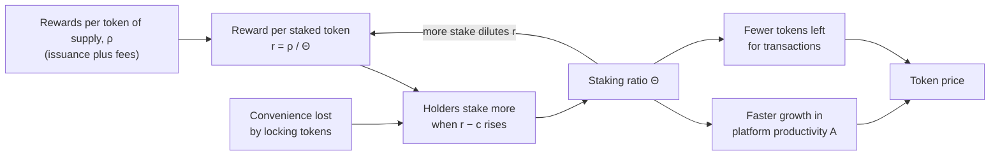

Lin William Cong, Zhiheng He, and Ke Tang show that a token's staking ratio and its reward rate are set together in one equilibrium, so the two rise together across tokens but move in opposite directions over time within a token, and they test this on 66 proof-of-stake tokens.

Cong, of Cornell University, and He and Tang, of Tsinghua University, released the paper as NBER Working Paper 33640 in April 2025. NBER working papers are not peer-reviewed, and the paper says so. Its starting point is that a platform token is both money and an investment. Held liquid, it pays in **transaction convenience**, the ease of trading and using the platform. Staked, it earns rewards but gives that convenience up. The paper prices both roles in one model.

Three quantities carry the paper. The **staking ratio** $\Theta$ is staked tokens over total supply. The **reward ratio** $\rho$ is rewards paid, from issuance and fees, per unit of total supply. The **reward rate** $r$ is what one staked token earns. Because all stakers share one reward pool, the reward rate is $r = \rho/\Theta$. The more tokens are staked, the thinner a given reward is spread.

The model is set in continuous time. Each agent chooses how much wealth to hold on the platform and what share $\theta$ of it to stake. Staking has a **convenience loss** that is convex in the staked amount, with curvature $\beta > 1$. A **staking preference** $u$ lowers that loss, and $c$ is the per-token cost of slashing risk. With identical agents, the equilibrium staking ratio has a closed form:

$$\Theta^* = \frac{\left(\frac{r^* - c}{\beta}\right)^{1/(\beta-1)} u}{1 + \left(\frac{r^* - c}{\beta}\right)^{1/(\beta-1)} u}.$$

Substituting $r = \rho/\Theta$ turns this into a fixed point with one solution. Proposition 2 shows that a higher reward ratio raises both the equilibrium staking ratio and the equilibrium reward rate. Platform **productivity** $A$ grows faster when more is staked, and the market-clearing token price rises with $(1-\Theta)A$, the productivity of the tokens left unstaked. It also rises with an external demand shock and falls as token supply grows. Issuance acts as an **inflation tax**. It pays stakers and dilutes the tokens that are not staked. When agents differ in staking preference, wealthier agents specialize in staking and retail users mainly transact.

The data are daily observations from StakingRewards for 66 tokens, Avalanche among them, from July 2018 to November 2022. The reward data mostly describe delegation. In panel regressions, a reward ratio 10 percentage points higher goes with a staking ratio 7.79 points higher, with a standard error of 1.90. With platform and investment controls, the estimate falls to about 3.7 points and stays significant. A reward rate 1 point higher raises next week's staking ratio by 0.026 points, with a standard error of 0.015, significant only at the 10% level. A staking ratio 1 point higher predicts 6.6 basis points of price appreciation the next week. **Uncovered interest parity**, the rule that reward spreads should not predict excess returns, fails, with coefficients from −1.02 to −1.25. A weekly carry trade that buys tokens with high reward rates and sells those with low ones earns an annual Sharpe ratio of 1.60. The abstract summarizes the sign pattern: the correlation between staking ratio and reward rate "is cross-sectionally positive, but time-series-wise negative."

*The paper's equilibrium as one loop. A larger reward pool draws more stake, and more stake dilutes the reward per staked token. Notice the arrow from the staking ratio back to the reward rate. It is why the two rise together across tokens with different reward pools but move in opposite directions over time within one token. This diagram is drawn from the paper's text.*

## How it relates to our research

**It is the Foundation's reference model.** The [value accrual article](/Phase-II/Wiki/Collections/Essential-Readings/Value-Accrual-as-Equilibrium-How-We-Think-About-AVAX-Tokenomics/) adopts this model by name, so its stake-or-hold choice frames the stake decision in deliverable [1.3](/Phase-II/Milestones/Milestone-1/1-3-Staking-Model-Spec/). The curvature $\beta$ and the staking preference $u$ are the two behavioral parameters to fit in deliverable [1.4](/Phase-II/Milestones/Milestone-1/1-4-Behavioral-Calibration/), with the level of Avalanche's staking ratio and its changes across upgrade periods as the moments. The price equation in the [January staking and price model](/Phase-II/Wiki/Collections/Essential-Readings/January-Staking-and-Price-Model-A-Three-Image-Reconstruction/) has the same form as this paper's market-clearing price. The paper defines the symbols that page lists as missing: $S_t$ is an external demand shock, $Q_t$ is total token supply, $A_t$ is platform productivity, $r^f$ is the risk-free rate, and $\alpha$ sets the curvature of transaction convenience. The paper has no $Q_t^*$.

**What changes for Avalanche.** The identity $r = \rho/\Theta$ assumes one reward pool shared by all stakers. Avalanche fixes each commitment's potential reward at its start from the supply remaining to the 720,000,000 AVAX cap, the stake, the duration, and the consumption rate, as the [reward formula](/Phase-II/Wiki/Reference/Glossary-and-Notation) shows. The rate per staked AVAX does not fall when more stake joins, except through the supply counter, so the fixed point must be rewritten with that formula before its comparative statics apply. Avalanche burns fees, so the fee part of $\rho$ is zero for stakers. The paper's slashing cost $c$ has no direct counterpart, since Avalanche does not slash stake. The closest term is the expected loss of the whole reward when a validator misses the [uptime requirement](/Phase-II/Wiki/Collections/Economic-ACPs/ACP-267-Uptime-Requirement/). The model also has one kind of stake with no duration and no split between validators and delegators. Since [ACP-273](/Phase-II/Wiki/Collections/Economic-ACPs/ACP-273-Minimum-Validator-Duration/), validators choose durations from 48 hours to one year, the consumption rate rises with duration, and the [validator rewards article](/Phase-II/Wiki/Collections/Essential-Readings/How-Do-Avalanche-Validators-Actually-Think-About-Staking-Rewards/) finds that duration is where validators respond.

**A pattern we can test without fitting to it.** The paper defines the staking ratio as our [glossary](/Phase-II/Wiki/Reference/Glossary-and-Notation) does, stake over total supply. The P-Chain record from deliverable [1.1](/Phase-II/Milestones/Milestone-1/1-1-Data-Ingestion/) gives a weekly Avalanche series for both the staking ratio and rewards per unit of supply. The paper's sign pattern, positive across chains and negative over time, is a check for deliverable [2.4](/Phase-II/Milestones/Milestone-2/2-4-Validation-Confirmation/) that the Avalanche series can pass or fail. The paper's coefficients pool chains with different reward rules, end in November 2022, and give an imprecise weekly response, so Avalanche's own speed of adjustment has to be estimated.

**Issuance has a cost to report.** The inflation-tax result states what issuance costs holders who do not stake. A comparison of reward mechanisms in deliverable [2.8](/Phase-II/Milestones/Milestone-2/2-8-Collaborative-Mechanism-Design/) should report that cost beside the staking ratio it buys. In the paper's terms, [ACP-285](/Phase-II/Wiki/Collections/Economic-ACPs/ACP-285-Minimum-Consumption-Rate/) lowers the reward ratio, which Proposition 2 links to a lower staking ratio and a smaller inflation tax. Because Avalanche fixes rewards per commitment, the model has to test how much of that holds.

**Liquid staking and concentration.** The model covers **liquid staking** if staked tokens carry a smaller convenience loss. [BENQI told us](/Phase-II/Interviews/BENQI-2026-08-31/) that it holds 10% to 12% of all stake, so a lower convenience loss for its stake is a concrete adaptation. [Why Stake When You Can Borrow?](/Phase-II/Wiki/Collections/Supplementary-Research-Papers/2020-Why-Stake-When-You-Can-Borrow) models these liquid claims directly. The result that wealthier holders specialize in staking matches the typed stakers in [the Ethereum staking market framework](/Phase-II/Wiki/Collections/Supplementary-Research-Papers/2025-Ethereum-Staking-Market-Framework). [Competitive Equilibria Between Staking and On-Chain Lending](/Phase-II/Wiki/Collections/Supplementary-Research-Papers/2020-Staking-and-Lending-Equilibria/) adds on-chain lending as a competing use of the same tokens.

**Open question for the Foundation.** Should AVAX price stay an external input to the model, or be solved from the paper's market-clearing condition? Solving it needs a measure of platform productivity. The paper uses average on-chain transactions per second, and the value accrual article ranks the missing micro-foundation for productivity as the most important problem to overcome.

## Source

Lin William Cong, Zhiheng He, and Ke Tang. 2025. The Tokenomics of Staking. NBER Working Paper 33640, National Bureau of Economic Research, April 2025. <https://www.nber.org/papers/w33640>. DOI [10.3386/w33640](https://doi.org/10.3386/w33640).
