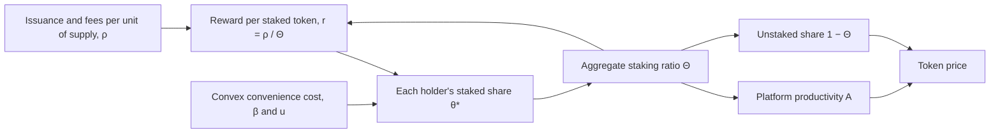

The staking model has to say how holders split AVAX between staking and other uses, and how that split feeds back into the reward rate and the price. Cong, He, and Tang give an equilibrium model in which the **[staking ratio](/Phase-II/Wiki/Reference/Glossary-and-Notation)** and the reward rate are solved together. They test its predictions on 66 proof-of-stake tokens.

## Citation

Lin William Cong, Zhiheng He, and Ke Tang. 2025. The Tokenomics of Staking. NBER Working Paper 33640, National Bureau of Economic Research, April 2025. <https://www.nber.org/papers/w33640>, DOI [10.3386/w33640](https://doi.org/10.3386/w33640).

## Question and method

The paper asks how staking shapes reward rates and token prices when the same token is used both to transact and to stake. Agents are risk-neutral and act in continuous time. Each agent chooses how much wealth to hold on the platform and what share $\theta$ of it to stake. A staked token earns rewards but gives up transaction convenience. The paper models the lost convenience as a cost that is convex in the staked share, with curvature $\beta > 1$. Platform productivity grows with the aggregate staking ratio $\Theta$.

Rewards per unit of supply $\rho$ come from issuance and fees. They are shared across staked tokens, so the reward per staked token is

$$r_t = \frac{\rho_t}{\Theta_t}.$$

Each agent's optimal staked share gives the aggregate staking ratio in closed form. Here $c$ is the per-token cost of slashing risk and $u$ scales the convenience of unstaked tokens:

$$\Theta^* = \frac{\left(\frac{r^* - c}{\beta}\right)^{1/(\beta-1)} u}{1 + \left(\frac{r^* - c}{\beta}\right)^{1/(\beta-1)} u}.$$

Combining the two gives the fixed point that pins the equilibrium:

$$\rho_t = \Theta^*_t \left[\beta \left(\frac{\Theta^*_t}{(1-\Theta^*_t)\,u}\right)^{\beta-1} + c_t\right].$$

A higher $\rho$ raises both the equilibrium staking ratio and the equilibrium reward rate. The token price rises with the productivity of the tokens left unstaked, $(1-\Theta)A$.

## Main result

The empirical sample is 66 tokens from StakingRewards, weekly from July 2018 to November 2022. The results below are the paper's and have not been reproduced for Avalanche.

| Finding | Estimate |
| --- | --- |
| Across tokens, staking ratio against aggregate reward ratio | 10 percentage points more reward ratio goes with 7.79 points more staking ratio, standard error 1.90. With controls the association falls to about 3.7 points |
| Over time within a token, staking ratio against reward rate | Negative. The abstract states that the correlation "is cross-sectionally positive, but time-series-wise negative" |
| Reward rate to next week's staking ratio | 1 percentage point more reward rate raises next week's staking ratio by 0.026 points, standard error 0.015 |
| Staking ratio to next week's price | 1 percentage point more staking ratio predicts 6.6 basis points of price appreciation |
| Uncovered interest parity | Violated. Test coefficients range from −1.02 to −1.25 across base currencies |

The weekly response of the staking ratio to the reward rate is weak. Its t-statistic is about 1.7, so the paper's evidence on speed of adjustment is suggestive rather than precise. In the theory, higher issuance raises the staking ratio and lowers price appreciation, which the authors describe as an inflation tax on holders who do not stake.

## What it gives this research

1. A model form for the staking model in deliverable [1.3](/Phase-II/Milestones/Milestone-1/1-3-Staking-Model-Spec/): a holder's stake-or-hold choice with a convex convenience cost, and a closed-form staking ratio as a function of the net reward rate. This is a portfolio choice between staked tokens, liquid tokens, and money off the platform, the framing the Foundation's [value accrual article](/Phase-II/Wiki/Collections/Essential-Readings/Value-Accrual-as-Equilibrium-How-We-Think-About-AVAX-Tokenomics/) uses.
2. Two parameters to calibrate in deliverable [1.4](/Phase-II/Milestones/Milestone-1/1-4-Behavioral-Calibration/): the curvature $\beta$ and the convenience scale $u$. The level of Avalanche's staking ratio and its change across upgrade periods are the moments that can pin them.
3. An untargeted pattern for validation in deliverable [2.4](/Phase-II/Milestones/Milestone-2/2-4-Validation-Confirmation/). The paper's sign pattern, positive across chains and negative over time, is a check the Avalanche series can pass or fail without being fitted to it.
4. A cost measure for deliverable [2.8](/Phase-II/Milestones/Milestone-2/2-8-Collaborative-Mechanism-Design/). The inflation-tax result states what issuance costs holders who do not stake, which a comparison of reward mechanisms has to report.

## Limits for Avalanche

The identity $r = \rho/\Theta$ assumes one reward pool shared by all stakers. Avalanche does not work that way. Each commitment's potential reward is fixed at its start from the remaining supply to the 720,000,000 AVAX cap, the stake, the duration, and the consumption rate. The rate per staked AVAX therefore does not fall when more stake joins, except through the supply counter. The fixed point has to be rewritten with the [Avalanche reward formula](/Phase-II/Wiki/Reference/Glossary-and-Notation) before its comparative statics apply.

The model has one kind of stake with no duration. Avalanche validators choose a duration from 48 hours, since Helicon, to one year, and the consumption rate rises with duration. Agents are identical in the baseline, and there is no split between validators and delegators. The slashing cost $c$ has no direct counterpart, since Avalanche does not slash stake. The closest term is the expected loss of the reward when a validator misses the uptime requirement. The coefficients pool chains with different reward rules and end in November 2022, so Avalanche's own responses have to be estimated.
