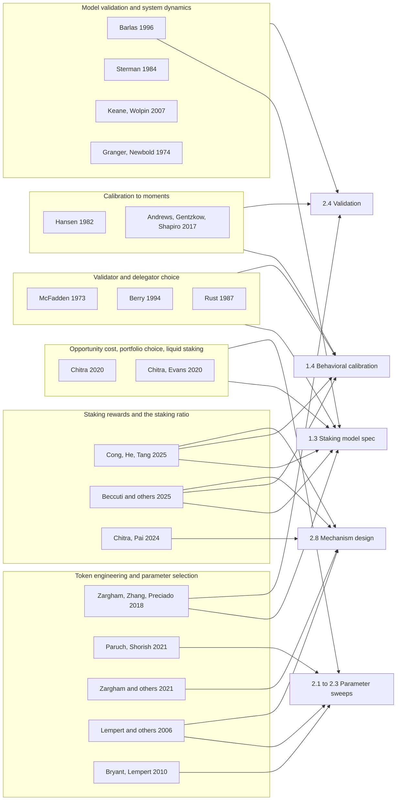

The [Essential Readings](/Phase-II/Wiki/Collections/Essential-Readings/) set the Foundation's questions and its published models. This collection holds the outside papers that the research uses to answer them. Nineteen papers give the staking model its form, the estimators for validator and delegator behavior, the method for choosing parameters under uncertainty, and the tests a model must pass before its recommendations are trusted. Each page gives the full citation with a public link, the paper's question, method, and main result, what it gives this research, and its limits for Avalanche.

## How the papers feed the deliverables

The deliverables are those of the signed agreement: [1.3](/Phase-II/Milestones/Milestone-1/1-3-Staking-Model-Spec/), [1.4](/Phase-II/Milestones/Milestone-1/1-4-Behavioral-Calibration/), [2.1](/Phase-II/Milestones/Milestone-2/2-1-PSUU-Infrastructure/) to [2.3](/Phase-II/Milestones/Milestone-2/2-3-KPI-Computation/), [2.4](/Phase-II/Milestones/Milestone-2/2-4-Validation-Confirmation/), and [2.8](/Phase-II/Milestones/Milestone-2/2-8-Collaborative-Mechanism-Design/).

## Papers by theme

### Staking rewards and the staking ratio

| Paper | Authors and year | Contribution | Informs |
| --- | --- | --- | --- |
| [The Tokenomics of Staking](/Phase-II/Wiki/Collections/Supplementary-Research-Papers/2025-The-Tokenomics-of-Staking) | Cong, He, and Tang, 2025 | Solves the staking ratio, reward rate, and price as one equilibrium and finds their correlation positive across 66 tokens and negative over time | 1.3, 1.4, 2.8 |
| [Towards a Formal Framework of the Ethereum Staking Market](/Phase-II/Wiki/Collections/Supplementary-Research-Papers/2025-Ethereum-Staking-Market-Framework) | Beccuti, Chantramonklasri, Hafner, and Oderbolz, 2025 | Models three staker types and finds that an issuance cut lowers total stake by 25.4% and hits solo stakers' profit hardest | 1.3, 1.4, 2.8 |
| [How Much Should You Pay for Restaking Security?](/Phase-II/Wiki/Collections/Supplementary-Research-Papers/2024-Restaking-Security-Pricing) | Chitra and Pai, 2024 | Prices security as the reward that keeps operators participating and makes attacks unprofitable | 2.8 |

### Opportunity cost, portfolio choice, and liquid staking

| Paper | Authors and year | Contribution | Informs |
| --- | --- | --- | --- |
| [Competitive Equilibria Between Staking and On-Chain Lending](/Phase-II/Wiki/Collections/Supplementary-Research-Papers/2020-Staking-and-Lending-Equilibria) | Chitra, 2020 | Treats staking as one asset in a mean-variance portfolio and shows stake leaves when rewards fall below lending yields | 1.3, 2.1 to 2.3 |
| [Why Stake When You Can Borrow?](/Phase-II/Wiki/Collections/Supplementary-Research-Papers/2020-Why-Stake-When-You-Can-Borrow) | Chitra and Evans, 2020 | Adds staking derivatives, the precursor of liquid staking tokens, as a third asset and traces their effect on stake concentration | 1.3, 2.1 to 2.3 |

### Validator and delegator choice

| Paper | Authors and year | Contribution | Informs |
| --- | --- | --- | --- |
| [Conditional Logit Analysis of Qualitative Choice Behavior](/Phase-II/Wiki/Collections/Supplementary-Research-Papers/1973-Conditional-Logit-Analysis) | McFadden, 1973 | Derives the conditional logit from random utility, the Foundation's model of a validator's choice of duration and fee | 1.3, 1.4 |
| [Estimating Discrete-Choice Models of Product Differentiation](/Phase-II/Wiki/Collections/Supplementary-Research-Papers/1994-Discrete-Choice-Demand-Estimation) | Berry, 1994 | Inverts market shares into utilities for logit and nested logit demand, the Foundation's delegator model | 1.3, 1.4 |
| [Optimal Replacement of GMC Bus Engines](/Phase-II/Wiki/Collections/Supplementary-Research-Papers/1987-Optimal-Replacement-of-Bus-Engines) | Rust, 1987 | Estimates a forward-looking keep-or-replace decision, the form of a validator's renew-or-exit choice | 1.3, 1.4 |

### Calibration to moments

| Paper | Authors and year | Contribution | Informs |
| --- | --- | --- | --- |
| [Large Sample Properties of Generalized Method of Moments Estimators](/Phase-II/Wiki/Collections/Supplementary-Research-Papers/1982-Generalized-Method-of-Moments) | Hansen, 1982 | Defines moment-based estimation with optimal weighting and the chi-square test of overidentifying restrictions | 1.4, 2.4 |
| [Measuring the Sensitivity of Parameter Estimates to Estimation Moments](/Phase-II/Wiki/Collections/Supplementary-Research-Papers/2017-Sensitivity-of-Estimates-to-Moments) | Andrews, Gentzkow, and Shapiro, 2017 | Gives the matrix that shows which moments drive each parameter and predicts bias from a stated misspecification | 1.4, 2.4 |

### Token engineering and parameter selection

| Paper | Authors and year | Contribution | Informs |
| --- | --- | --- | --- |
| [A State-Space Modeling Framework for Engineering Blockchain-Enabled Economic Systems](/Phase-II/Wiki/Collections/Supplementary-Research-Papers/2018-State-Space-Modeling-of-Blockchain-Economies) | Zargham, Zhang, and Preciado, 2018 | Writes a ledger as a state-space system whose rules guarantee invariants, the structure cadCAD implements | 1.3, 2.4 |
| [How to Perform Parameter Selection Under Uncertainty](/Phase-II/Wiki/Collections/Supplementary-Research-Papers/2021-Parameter-Selection-Under-Uncertainty) | Paruch and Shorish, 2021 | Sets out the six-step PSUU workflow from goals to recommended parameter ranges | 2.1 to 2.3 |
| [Summoning the Money God](/Phase-II/Wiki/Collections/Supplementary-Research-Papers/2021-Control-Theory-for-Monetary-Policy) | Zargham, Bernardineli, Clark, Shorish, and Emmett, 2021 | Tunes a feedback controller for a token's monetary policy by simulation and tests it against attacks and shocks | 2.1 to 2.3, 2.8 |
| [A General, Analytic Method for Generating Robust Strategies and Narrative Scenarios](/Phase-II/Wiki/Collections/Supplementary-Research-Papers/2006-Robust-Strategies-and-Narrative-Scenarios) | Lempert, Groves, Popper, and Bankes, 2006 | Chooses strategies that perform acceptably across many futures and identifies the futures where they fail | 2.1 to 2.3, 2.8 |
| [Thinking inside the box](/Phase-II/Wiki/Collections/Supplementary-Research-Papers/2010-Scenario-Discovery) | Bryant and Lempert, 2010 | Finds the input regions where a policy fails from a database of simulation runs, scored by coverage and density | 2.1 to 2.3 |

### Model validation and system dynamics

| Paper | Authors and year | Contribution | Informs |
| --- | --- | --- | --- |
| [Formal aspects of model validity and validation in system dynamics](/Phase-II/Wiki/Collections/Supplementary-Research-Papers/1996-Model-Validity-in-System-Dynamics) | Barlas, 1996 | Orders validation from structure tests to behavior tests to historical fit, the weakest evidence | 1.3, 2.4 |
| [Appropriate Summary Statistics for Evaluating the Historical Fit of System Dynamics Models](/Phase-II/Wiki/Collections/Supplementary-Research-Papers/1984-Summary-Statistics-for-Historical-Fit) | Sterman, 1984 | Splits mean square error into bias, unequal variation, and unequal covariation | 2.4 |
| [Exploring the Usefulness of a Nonrandom Holdout Sample for Model Validation](/Phase-II/Wiki/Collections/Supplementary-Research-Papers/2007-Nonrandom-Holdout-Validation) | Keane and Wolpin, 2007 | Validates a structural model by predicting a held-out policy regime without refitting | 2.4 |
| [Spurious regressions in econometrics](/Phase-II/Wiki/Collections/Supplementary-Research-Papers/1974-Spurious-Regressions) | Granger and Newbold, 1974 | Shows that unrelated random walks appear related about three times in four, so correlation of trending series is weak evidence | 2.4 |
