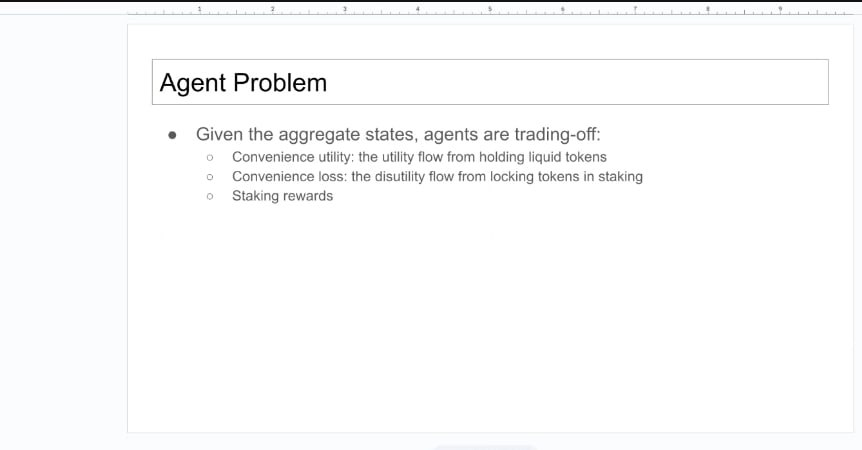
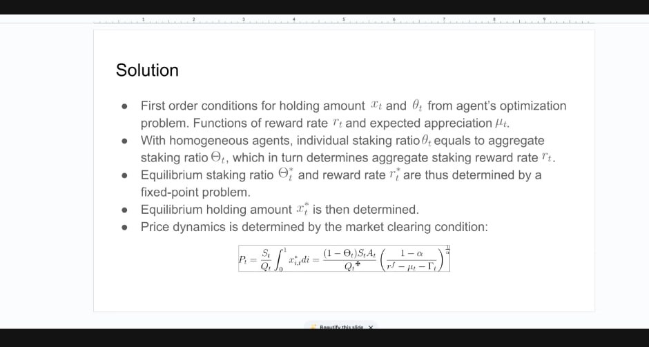
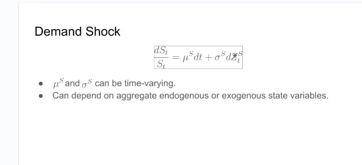

# January Staking and Price Model: A Three-Image Reconstruction

**Model artifact** · Attributed to Siyu (Eric) Lu · Observed in January 13 context · Original presentation date unresolved

This page reconstructs the smallest coherent model supported by three images shared during the Phase II scoping period. It explains the visible economic relationships and notation without filling in the missing utility function, first-order conditions, parameter definitions, data, calibration, or numerical results.

> [!warning] Evidence boundary
> A January 13 recap records that Hash captured three images of work Eric had presented. The original presentation, deck, and attachment records have not been recovered. This supports the grouping and attribution used here, but it does not prove the original date or establish a complete executable model.

## 1. Model overview

The images describe an equilibrium between liquid token holdings and staking. An agent chooses how much AVAX to hold and what share to stake. Liquid holdings provide transaction convenience and preserve flexibility. Staking locks tokens but earns rewards. Expected price appreciation also affects the value of holding the asset.

Individual staking choices aggregate into a network staking ratio. The aggregate staking ratio and the protocol reward rate determine one another through a fixed point. A market-clearing relationship then determines price. A stochastic demand state evolves through time and can shift that equilibrium.

| Input | Relationship | Output |
| --- | --- | --- |
| Aggregate and protocol state | Determines | Reward rule |
| Reward rate and expected appreciation | Shape | Agent choices |
| Agent choices | Produce | Liquid holdings and individual staking ratios |
| Individual staking ratios | Aggregate into | Network staking ratio |
| Network staking ratio | Feeds back into | Reward rate |
| Liquid holdings, staking ratio, and demand state | Enter | Market-clearing price |

The feedback from aggregate staking to rewards and back to individual choices is the central computational object. The remaining relationships cannot yet be evaluated because several functions and variables are undefined.

## 2. Image 1: Agent problem

### Original evidence

The image states that, given aggregate states, agents trade off:

- convenience utility from holding liquid tokens;
- convenience loss from locking tokens in staking; and
- staking rewards.

It identifies the economic choice, but it does not show the utility function, budget constraint, feasible set, heterogeneity, risk preferences, or time horizon.

### Mathematical reconstruction

Let $x_{i,t}$ denote agent $i$'s liquid token holdings and let $\theta_{i,t}\in[0,1]$ denote the share of the agent's holdings committed to staking. Let $z_t$ collect the aggregate and protocol state known when the choice is made.

The source-supported relationship can be represented abstractly as

$$
(x^*_{i,t},\theta^*_{i,t})
\in
\operatorname*{arg\,max}_{(x,\theta)\in\mathcal D_i(z_t)}
U_i(x,\theta;r_t,\mu_t,z_t),
$$

where $r_t$ is a staking reward rate, $\mu_t$ is expected price appreciation, and $\mathcal D_i(z_t)$ is an unresolved feasible set.

The image suggests that utility contains three economic components. We may name them without choosing their functional forms:

$$
U_i
= C_i(x;z_t)
- L_i(x,\theta;z_t)
+ R_i(x,\theta;r_t,z_t).
$$

Here $C_i$ denotes liquid-token convenience, $L_i$ denotes lock-up cost, and $R_i$ denotes staking rewards. This decomposition is explanatory notation introduced by this reconstruction. It is not a transcription of a displayed source equation.

### Unresolved

- What is the agent's budget constraint?
- Does $x_{i,t}$ mean total holdings, liquid holdings, or another quantity?
- Is $\theta_{i,t}$ a share of $x_{i,t}$ or a share of total wealth?
- How are risk, liquidity, duration, fees, and expected appreciation represented?
- Are agents homogeneous in preferences, wealth, information, or only in their chosen staking ratio?
- Is the problem static, dynamic, or a reduced form of a dynamic optimization?

## 3. Image 2: Equilibrium solution

### Original evidence

The image states that first-order conditions determine equilibrium holding amount $x_t$ and staking ratio $\theta_t$ as functions of reward rate $r_t$ and expected appreciation $\mu_t$. It then states that homogeneous agents imply equality between individual and aggregate staking ratios. The aggregate ratio determines the aggregate reward rate, so the staking ratio and reward rate are solved jointly as a fixed point. Holdings and price follow.

The displayed market-clearing equation is visually transcribed as

$$
P_t
= \frac{S_t}{Q_t}\int_0^1 x^*_{i,t}\,di
= \frac{(1-\Theta_t)S_tA_t}{Q_t^*}
  \left(\frac{1-\alpha}{r^f-\mu_t-\Gamma_t}\right)^{1/\alpha}.
$$

The equation should be checked against the original deck or model source before it becomes executable authority. In particular, the distinction between $Q_t$ and $Q_t^*$ is visible but unexplained.

### Mathematical reconstruction

The response maps described by the image can be written without assuming a utility form:

$$
x^*_{i,t}=x_i^*(r_t,\mu_t),
\qquad
\theta^*_{i,t}=\theta_i^*(r_t,\mu_t).
$$

Under the stated homogeneous-agent condition,

$$
\theta^*_{i,t}=\Theta_t.
$$

Let the missing aggregate reward relationship be represented by

$$
r_t=R(\Theta_t;z_t).
$$

The equilibrium staking ratio must then satisfy

$$
\Theta_t^*
=\theta^*\!\left(R(\Theta_t^*;z_t),\mu_t\right).
$$

Equivalently, define the residual

$$
F(\Theta_t)
=\theta^*\!\left(R(\Theta_t;z_t),\mu_t\right)-\Theta_t.
$$

An equilibrium is a root $F(\Theta_t^*)=0$ with $\Theta_t^*\in[0,1]$. This representation identifies the computation but does not prove that a root exists, is unique, or is stable.

#### Conditional fixed-point procedure

**Inputs:** a resolved response function $\theta^*$, reward rule $R$, expected appreciation $\mu_t$, aggregate state $z_t$, feasible interval $[0,1]$, and numerical tolerance $\varepsilon$.

1. Construct $F(\Theta)$ on the feasible interval.
2. Check that every function is defined and finite over the candidate domain.
3. Locate sign changes or another source-supported root bracket.
4. Solve $F(\Theta)=0$ using a bounded method.
5. Report every admissible root rather than silently selecting one.
6. Verify the residual, domain, and any equilibrium selection rule.

**Failure states:** undefined functions, no admissible root, multiple unresolved roots, failed convergence, or a root outside the economic domain.

### Unresolved

- The complete reward rule $R$.
- The utility function and first-order conditions that produce $x_i^*$ and $\theta_i^*$.
- Definitions and units for $S_t$, $Q_t$, $Q_t^*$, $A_t$, $r^f$, $\Gamma_t$, and $\alpha$.
- The time basis of all rates.
- Conditions under which the exponentiated term is real and finite.
- Whether the equilibrium is unique and how multiple equilibria would be selected.
- Whether the expression is a structural model, an illustrative specialization, or a reduced form.

## 4. Image 3: Demand shock

### Original evidence

The image displays

$$
\frac{dS_t}{S_t}=\mu^S\,dt+\sigma^S\,dZ_t^S.
$$

It also states that $\mu^S$ and $\sigma^S$ may vary through time and may depend on aggregate endogenous or exogenous states.

### Mathematical reconstruction

Read literally, the equation defines proportional changes in $S_t$ using a drift term $\mu^S$ and a stochastic innovation scaled by $\sigma^S$. A January recap characterizes this as a standard Brownian-motion process, but that interpretation is indirect context rather than a definition visible in the image.

If $Z_t^S$ is Brownian motion and $\mu^S$ and $\sigma^S$ are constant over a step of length $\Delta t$, the corresponding exact step for geometric Brownian motion would be

$$
S_{t+\Delta t}
= S_t\exp\!\left[
\left(\mu^S-\frac{(\sigma^S)^2}{2}\right)\Delta t
+\sigma^S\sqrt{\Delta t}\,\varepsilon_t
\right],
\qquad
\varepsilon_t\sim\mathcal N(0,1).
$$

This discretization is conditional. It must not be used when the driving process, coefficient behavior, time unit, or state dependence differs from those assumptions.

### Unresolved

- Whether $Z_t^S$ is Brownian motion in the original model.
- Whether $S_t$ is total demand, a demand shifter, expenditure, or another state.
- The time unit and empirical observation corresponding to one model step.
- The processes or functions governing time-varying $\mu^S$ and $\sigma^S$.
- Correlation with price, staking, network activity, or other shocks.
- Initial conditions and calibration targets.

## 5. Quantity map

| Symbol | Source-supported role | Candidate type | Units | Status |
| --- | --- | --- | --- | --- |
| $P_t$ | Price determined through market clearing | State | Unspecified | Named by the image |
| $S_t$ | Demand shock or demand state | Stochastic state | Unspecified | Named by the image |
| $Q_t$, $Q_t^*$ | Denominator terms in market clearing | State or quantity | Unspecified | Meaning and distinction unresolved |
| $x^*_{i,t}$ | Agent $i$'s equilibrium holding amount | Agent state | Unspecified | Role stated; units unresolved |
| $\theta_{i,t}$ | Individual staking ratio | Agent decision | Dimensionless ratio | Role stated |
| $\Theta_t$, $\Theta_t^*$ | Aggregate and equilibrium staking ratio | Aggregate state | Dimensionless ratio | Role stated |
| $r_t$, $r_t^*$ | Aggregate and equilibrium staking reward rate | Rate | Time basis unspecified | Formula absent |
| $\mu_t$ | Expected appreciation | Rate | Time basis unspecified | Role stated |
| $A_t$ | Multiplicative price-equation term | Unknown | Unspecified | Definition absent |
| $r^f$ | Rate-like denominator term | Parameter or environment | Time basis unspecified | Definition absent |
| $\Gamma_t$ | Rate-like denominator term | State or parameter | Time basis unspecified | Definition absent |
| $\alpha$ | Exponent and numerator parameter | Parameter | Likely dimensionless; unverified | Definition and domain absent |
| $\mu^S$ | Drift of $S_t$ | Environment or state function | Inverse time under an Itô interpretation | Calibration absent |
| $\sigma^S$ | Volatility of $S_t$ | Environment or state function | Inverse square-root time under an Itô interpretation | Calibration absent |
| $Z_t^S$ | Noise process driving $S_t$ | Stochastic process | Unspecified | Brownian interpretation indirect |

Candidate types and dimensional implications are engineering classifications, not source claims. No symbol should be mapped to an Avalanche data field until direct model definitions or a reviewed empirical mapping support it.

## 6. Research and implementation boundary

### Required before reproduction

1. Recover the original deck, note, code, or paper.
2. Confirm authorship, version, date, purpose, and whether the model remains relevant.
3. Define every symbol, unit, domain, and time basis.
4. Recover the objective function, constraints, first-order conditions, and reward mapping.
5. Obtain at least one numerical fixture or reported result.

### Required before calibration

1. Identify observable counterparts for liquid supply, staked supply, validator and delegator stake, rewards, fees, price, and candidate demand variables.
2. State the grain, time coverage, units, missingness, and lineage of every dataset.
3. Separate directly observed values from latent states and estimated preferences.
4. Define identification assumptions, uncertainty, validation targets, and failure criteria.

### Required before a dynamic cadCAD model

The static fixed point should first become a small tested function. A dynamic extension may then define demand paths, staking adjustment, reward-policy updates, market clearing, and repeated experiments. Heterogeneous validators, delegator choice, endogenous rewards, and price-to-staking feedback are later extensions that require their own evidence and tests.

> [!question] Open research questions
> - What behavior does $S_t$ represent empirically?
> - How does the protocol reward curve enter $R(\Theta_t;z_t)$?
> - Which preferences govern the liquid-versus-staked allocation?
> - Does the homogeneous-agent fixed point survive realistic validator and delegator heterogeneity?
> - Which feedbacks operate within a staking period, and which occur only at renewal?
> - How is this artifact related to the later two-sided validator-and-delegator structural model?

## Provenance and status

The three images are presented in local export order; original deck order remains unverified. The equations were transcribed visually and should be checked against an original model source. This page is an educational reconstruction of available evidence, not an endorsed specification, calibrated result, or claim about current Avalanche protocol behavior.
