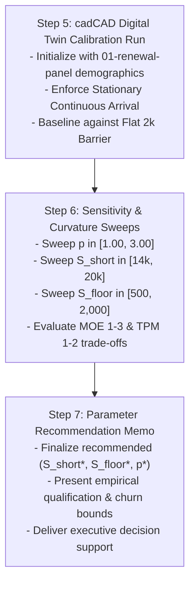

# Empirical Calibration & Digital Twin Guide: Consensus Admission Frontier ($S_{\min}(d)$)

| Metadata | Value |
| :--- | :--- |
| **Document ID** | GUIDE-2026-09-CALIBRATION-DIGITAL-TWIN |
| **Revision** | Rev 1.0 (Empirical Telemetry, cadCAD Specification & Next Execution Steps) |
| **Status** | ACTIVE CALIBRATION BRIEFING |
| **Target Reviewer / Lead** | Shawn Anderson (Empirical Data & Simulation Engineering) |
| **Primary Dataset** | `01-renewal-panel.parquet` ($N = 57{,}067$ stints, $7{,}635$ nodes) |
| **Canonical Specification** | [`docs/2026-09-29-formal-mechanism-design-admission-frontier.md`](./2026-09-29-formal-mechanism-design-admission-frontier.md) |
| **Evaluation Framework** | [`docs/2026-09-29-systems-engineering-kpi-framework.md`](./2026-09-29-systems-engineering-kpi-framework.md) |
| **Interactive Digital Twin** | [`docs/admission_frontier_digital_twin.html`](./admission_frontier_digital_twin.html) |
| **Date** | September 29, 2026 |

---

## 1. Executive Directive & Context

Shawn's primary research and simulation objective is to **ground and calibrate the Bounded Harmonic P-Decay admission frontier**:

$$S_{\min}(d) = S_{\text{floor}} + (S_{\text{short}} - S_{\text{floor}}) \cdot \left[ \frac{\frac{1}{d} - \frac{1}{d_{\max}}}{\frac{1}{d_{\min}} - \frac{1}{d_{\max}}} \right]^p$$

This requires executing three tightly coupled work streams:
1. **Empirical Grounding of the Capital Landscape**: Measuring historical self-stake distributions and duration clustering from primary ledger data (`01-renewal-panel.parquet`) to determine feasible parameter boundaries.
2. **Discrete-Event cadCAD Digital Twin Simulation**: Running the dynamic simulation under the **Stationary Continuous Arrival Invariant** to evaluate state churn and network stability.
3. **Execution of Next Methodological Steps (Steps 5–7)**: Performing systematic parameter sweeps to deliver calibrated recommendations for $(S_{\text{short}}, S_{\text{floor}}, p)$.

---

## 2. Empirical Grounding of the Capital Landscape

### 2.1 Primary Ledger Dataset
* **Path:** `/home/hash/Hub/Projects/avalanche-phase-ii-resources/research/data/01-renewal-panel.parquet`
* **Census:** $N = 57{,}067$ validated staking stints across $7{,}635$ unique physical NodeIDs.
* **Key Fields:** `node_id`, `protocol_regime` (`pre_etna`, `post_etna`), `duration_days`, `bond_avax`, `delegation_count_received`, `delegation_volume_received_avax`.

### 2.2 Empirical Demographics of Validator Capital
Auditing historical records reveals extreme skewness and cohort bifurcation:

| Quantile | Full Census ($N = 57{,}067$) Self-Bond | Post-Etna Era ($N = 17{,}818$) Self-Bond | Post-Etna Duration ($d$) | Structural Implication |
| :---: | :---: | :---: | :---: | :--- |
| **$p25$** | $2{,}000 \text{ AVAX}$ | $2{,}000 \text{ AVAX}$ | $14.0 \text{ days}$ | Staked at exact legacy minimum bounds. |
| **$p50$ (Median)** | $2{,}015 \text{ AVAX}$ | $2{,}005 \text{ AVAX}$ | **$15.0 \text{ days}$** | **Over 50% of all stints are short-horizon retail operators.** |
| **$p75$** | $6{,}000 \text{ AVAX}$ | $12{,}304 \text{ AVAX}$ | $30.0 \text{ days}$ | Capital threshold required for liquid delegation capture. |
| **$p90$** | $137{,}557 \text{ AVAX}$ | $245{,}133 \text{ AVAX}$ | $80.0 \text{ days}$ | Institutional / Enterprise node operators. |
| **$p95$** | $569{,}830 \text{ AVAX}$ | $556{,}619 \text{ AVAX}$ | $92.0 \text{ days}$ | Top capital tier. |
| **$p99$** | $2{,}163{,}747 \text{ AVAX}$ | $2{,}310{,}000 \text{ AVAX}$ | $365.0 \text{ days}$ | Maximum lockup whales ($>90\%$ of network voting weight). |

### 2.3 Empirical Calibration Mandates
1. **The Short-End Capital Filter ($S_{\text{short}}$):**
   - At $d_{\min} = 2 \text{ days}$ (ACP-273), setting $S_{\text{short}} \ge 14{,}000 \text{ AVAX}$ satisfies MOE 1 ($R_{\text{sybil}}(2\text{d}) \ge 1.0$).
   - *Empirical Check:* In `post_etna`, only validators at the $\approx 77\text{th}$ percentile of self-bond possess $\ge 14{,}000 \text{ AVAX}$. This guarantees that 2-day flash-staking cannot be exploited by micro-stake retail or cheap Sybil attackers.
2. **The 14-Day Retail delegation Gate ($S_{\min}(14\text{d})$):**
   - Under $S_{\text{short}} = 14{,}000 \text{ AVAX}, S_{\text{floor}} = 500 \text{ AVAX}$, curvature $p = 1.40$ yields:
     $$S_{\min}(14\text{d}) \approx 1{,}345 \text{ AVAX}$$
   - *Empirical Check:* $100\%$ of existing 2,000 AVAX retail validators comfortably clear this gate, experiencing immediate entry relief ($32.8\%$ capital barrier reduction) without being forced out of the network.
3. **The Terminal Sovereign Staking Floor ($S_{\text{floor}}$):**
   - At $d_{\max} = 365 \text{ days}$, the frontier reduces exactly to $S_{\text{floor}} = 500 \text{ AVAX}$ (Axiom 3 exact boundary interpolation).
   - *Empirical Check:* Allows independent sub-2k operators who commit long-term to run sovereign validators, expanding network decentralization (satisfying TPM 1: $\text{HHI}_{\text{seat}} \le \theta_{\text{HHI}}$).

---

## 3. Discrete-Event cadCAD Digital Twin Specification

### 3.1 Methodological Invariant: Stationary Continuous Arrival
> [!CAUTION]
> **No Deterministic Synthetic Cohorts:**  
> When initializing discrete-time staking simulations, never assign deterministic synthetic tenure (e.g. $d/2$ or fixed cohort waves). In asynchronous distributed networks, ongoing contracts mature as an ongoing continuous renewal process.

In the cadCAD digital twin, initial remaining contract tenure must be initialized as:
$$\tau_{\text{rem}, i}(t_0) \sim \mathcal{U}(1, d_{\text{choice}, i})$$
This prevents artificial harmonic resonance, synchronized rollover shockwaves, and false cyclical dips in simulation outputs.

### 3.2 State Representation
$$\mathcal{S}_t = \left( \mathcal{V}_t, S_{\text{total}}(t), N_{\text{churn}}(t), \text{HHI}(t), \mathcal{M}_{\text{p2p}}(t) \right)$$
* $\mathcal{V}_t = \{v_i = (S_i, d_i, \tau_{\text{rem}, i})\}_{i=1}^{N(t)}$: Active validator set.
* $S_{\text{total}}(t) = \sum_{i \in \mathcal{V}_t} S_i$: Total bonded consensus stake.
* $N_{\text{churn}}(t) = \sum_{i \in \mathcal{V}_t} \mathbb{I}\{\tau_{\text{rem}, i} = 0\}$: Validator departure flux.
* $\text{HHI}(t)$: Seat concentration index (TPM 1).
* $\mathcal{M}_{\text{p2p}}(t)$: Peer connection rate (TPM 2).

### 3.3 Atomic Simulation Loop ($\Delta t = 1 \text{ day}$)

```
+---------------------------------------------------------------------------------------+
|                              cadCAD SIMULATION LOOP (dt = 1d)                         |
+---------------------------------------------------------------------------------------+
| 1. EXPIRATION & DEPARTURE POLICY                                                      |
|    - Decrement: tau_rem,i <- tau_rem,i - 1                                            |
|    - Expiring set: E_t = { v_i in V_t : tau_rem,i == 0 }                              |
|    - Record departure churn: N_churn(t) = |E_t|                                       |
+---------------------------------------------------------------------------------------+
                                           |
                                           v
+---------------------------------------------------------------------------------------+
| 2. AGENT DECISION POLICY (Renewal & New Entrants)                                     |
|    - For each expiring v_i and new entrant j:                                         |
|      * Evaluate opportunity cost c_i and horizon tau_i                                |
|      * Select target duration d* in [d_min, d_max]                                    |
|      * Compute minimum stake requirement: S_req = S_min(d*)                           |
|      * If wealth w_i >= S_req -> Enter / Renew with S_i >= S_req                      |
|        Else -> Exit / Disqualify                                                      |
+---------------------------------------------------------------------------------------+
                                           |
                                           v
+---------------------------------------------------------------------------------------+
| 3. PROTOCOL ADMISSION FILTER (The Bouncer Gate)                                       |
|    - Deterministic filter: G(S, d) = 1 if S >= S_min(d) else 0                        |
|    - Update active validator set: V_{t+1} <- (V_t \ E_t) U A_{t, admitted}            |
|    - Evaluate 3 MOEs and 2 TPMs                                                       |
+---------------------------------------------------------------------------------------+
```

---

## 4. Next Execution Steps (Roadmap for Steps 5–7)

Shawn's pipeline follows three concrete execution milestones:



### Step 5: cadCAD Digital Twin Execution
* **Task:** Run discrete-event simulations using the empirical validator pool ($N \approx 602$ active nodes post-Granite, derived from `01-renewal-panel.parquet`).
* **Test:** Compare network churn $N_{\text{churn}}(t)$ under the flat legacy policy ($2{,}000 \text{ AVAX}$ flat) vs. the Bounded Harmonic frontier.
* **Verification:** Verify that KPI-1 (micro-stake short-duration exposure) remains strictly zero at all simulation timesteps.

### Step 6: Parameter Sensitivity Sweeps
* **Task:** Execute parameter grid searches over:
  - $S_{\text{short}} \in \{14{,}000, 16{,}000, 18{,}000, 20{,}000\} \text{ AVAX}$
  - $S_{\text{floor}} \in \{500, 1{,}000, 2{,}000\} \text{ AVAX}$
  - $p \in \{1.00, 1.20, 1.40, 1.60, 1.80, 2.00, 2.50\}$
* **Evaluation Criteria:**
  - **MOE 1:** $R_{\text{sybil}}(2\text{d}) \ge 1.00$ (must pass strictly).
  - **MOE 2:** $F_{\text{terminal}}(365\text{d}) \equiv 1.00$ (holds identically for Family 4).
  - **MOE 3:** $\Delta N_{\text{churn}} / N_{\text{churn}}^{\text{baseline}} < 0$ (churn reduction percentage).
  - **TPM 1:** $\text{HHI}_{\text{seat}} \le \theta_{\text{HHI}}$ (seat decentralization safety threshold).

### Step 7: Final Parameter Calibration Memo
* **Task:** Synthesize simulation traces and empirical data into the final Stage 7 Calibration Memo.
* **Deliverable:** Recommend the canonical parameter vector $\Theta^* = (S_{\text{short}}^*, S_{\text{floor}}^*, p^*)$ for inclusion in the formal Avalanche Community Proposal (ACP) specification.
