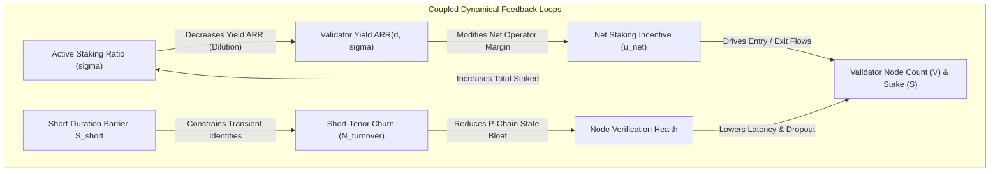

# Systems Engineering Specification: Nonlinear Dynamics & Mechanism Design Formalism for Avalanche Consensus Admission ($S_{\min}(d)$)

| Metadata | Value |
| :--- | :--- |
| **Document ID** | SPEC-2026-09-MECH-FORMALISM |
| **Revision** | Rev 1.0 (Rigorous Mechanism Design & Dynamical System Coupling) |
| **Status** | WORKING SPECIFICATION |
| **Methodologies** | Algorithmic Mechanism Design (Hurwicz, Maskin, Myerson), Nonlinear Dynamics (Strogatz), Systems Engineering (Dennis M. Buede, NASA SP-2016-6105 Rev 2) |
| **Domain** | Avalanche Primary Network Consensus Admission Mechanics ($S_{\min}(d)$) |
| **Date** | September 29, 2026 |

---

## 1. Epistemic Foundation & Hierarchy of Truth

To ensure scientific and engineering validity, this specification enforces a strict four-tier epistemic hierarchy. No external analogy or heuristic may override verified protocol execution.

```
┌────────────────────────────────────────────────────────────────────────┐
│                        EPISTEMIC HIERARCHY                             │
├──────────────────────────┬─────────────────────────────────────────────┤
│ Tier 1: Protocol Ground  │ AvalancheGo PlatformVM production source    │
│         Truth            │ code and implemented ACP specifications.    │
├──────────────────────────┼─────────────────────────────────────────────┤
│ Tier 2: Empirical        │ Historical on-chain ledger telemetry        │
│         Telemetry        │ (e.g. renewal panel, staking distributions).│
├──────────────────────────┼─────────────────────────────────────────────┤
│ Tier 3: Primary          │ Formal stakeholder specifications and peer- │
│         Literature       │ reviewed foundation literature (e.g. Lu).   │
├──────────────────────────┼─────────────────────────────────────────────┤
│ Tier 4: Stylized         │ Borrowed analogies from physics, ecology,   │
│         Heuristics       │ or Strogatz (NotebookLM T-08B). Explicitly  │
│                          │ labeled as Uncalibrated Thought Experiments.│
└──────────────────────────┴─────────────────────────────────────────────┘
```

### 1.1 `[Protocol Ground Truth]` Core Invariants
1. **Sampling Consensus:** Snowman consensus randomly subsamples $k$ validators with probability proportional to active stake. Consensus safety requires preserving entropy and preventing Sybil identity dilution.
2. **PlatformVM Delegator Firewall:** Validator duration $d_{\text{val}}$ and delegator duration $d_{\text{del}}$ are governed by distinct consensus validation logic:
   $$\text{delegation.startTime} \ge \text{validator.startTime} \quad \land \quad \text{delegation.endTime} \le \text{validator.endTime}$$
   where $d_{\text{del}} \ge d_{\text{delegator\_min}}$. Any validator registering for $d_{\text{val}} < d_{\text{delegator\_min}}$ is cryptographically quarantined: `AddDelegatorTx` cannot bind to it.
3. **Staking Reward Mechanics:** Individual staking rewards in Avalanche PlatformVM do **not** divide by aggregate active stake in the current epoch. Rewards are minted at commitment expiry based on initial self-stake, duration, and the remaining unminted issuance pool.
4. **Deterministic Integer Arithmetic:** Consensus verification strictly forbids IEEE-754 floating-point operations. The admission curve $S_{\min}(d)$ must evaluate into discrete integer fixed-point brackets in nanoseconds and raw atomic token units (`nAVAX`).

### 1.2 `[Empirical Telemetry]` Invariants
1. **Capital Polarization:** Historical network state demonstrates bimodal capital distribution: a large number of retail nodes operating near the historical minimum self-stake barrier, and a concentrated institutional/liquid staking tier holding the overwhelming majority of bonded capital.
2. **Diagonal Tenure Persistence:** Renewal probabilities increase monotonically with completed stint count, and stakers overwhelmingly repeat their chosen operational duration cadence across successive renewals.

### 1.3 `[Stylized Heuristics & Analogical Thought Experiments]` Boundary Notice
> [!WARNING] **Uncalibrated Conceptual Metaphor / Toy Thought Experiment**  
> Concepts derived from Strogatz (catastrophe surfaces, saddle-node bifurcations, hysteresis loops, and van der Pol limit cycles) provide qualitative mental models for understanding regime shifts and feedback instability. They are **NOT** calibrated empirical laws of Avalanche validator behavior. They serve strictly to identify potential failure modes (e.g. irreversible validator set contraction) before executing formal agent-based simulations.

---

## 2. Methodological Pipeline & Strict Parametric Discipline

In accordance with strict parametric discipline, all mathematical formulations prior to empirical calibration remain purely symbolic:
- $d_{\min}$: Minimum allowable validator commitment duration.
- $d_{\max}$: Maximum allowable validator commitment duration.
- $S_{\text{floor}}$: Target retail accessibility floor at maximum commitment ($d = d_{\max}$).
- $S_{\text{short}}$: Short-duration anchor barrier at minimum commitment ($d = d_{\min}$).
- $S_{\text{baseline}}$: Historical status quo minimum self-stake.
- $d_{\text{baseline}}$: Historical status quo minimum duration.
- $K_{\text{baseline}} \equiv S_{\text{baseline}} \cdot d_{\text{baseline}}$: Historical capital-time Sybil commitment invariant.
- $d_{\text{pivot}}$: Intermediate duration knot where $S_{\min}(d_{\text{pivot}}) = S_{\text{baseline}}$.

```
Pipeline Stage:
[Constraints] ──► [Objectives] ──► [Required Properties] ──► [Candidate Families] ──► [Formal Mechanism] ──► [Dynamical Analysis] ──► [Calibration]
```

---

## 3. Formal Mechanism Design Specification

We define the primary consensus admission mechanism as a formal mathematical tuple:

$$\mathcal{M} = \langle \mathcal{N}, \Theta, \mathcal{A}, g, \{u_i\}_{i \in \mathcal{N}}, \mathcal{F} \rangle$$

### 3.1 Agents ($\mathcal{N}$)
A finite index set of prospective and active node operators:
$$\mathcal{N} = \{1, 2, \dots, n\}$$

### 3.2 Private Type Space ($\Theta$)
Each agent $i \in \mathcal{N}$ possesses private operational and financial characteristics $\theta_i \in \Theta_i$:
$$\theta_i = \left( w_i, \tau_i, c_i \right)$$
- $w_i \in \mathbb{R}_+$: Total available liquid capital endowment.
- $\tau_i \in [d_{\min}, d_{\max}]$: Intrinsic liquidity preference / maximum operational planning horizon.
- $c_i \in \mathbb{R}_+$: Real operational cost per unit time (bare-metal server, VPS hosting, maintenance, monitoring).

The joint type space is $\Theta = \prod_{i=1}^n \Theta_i$, endowed with a prior joint distribution $P(\theta)$.

### 3.3 Action Space ($\mathcal{A}$)
Each agent selects an action $a_i \in \mathcal{A}_i$:
$$a_i = \left( s_i, d_i, \phi_i \right)$$
- $s_i \in \mathbb{R}_+$: Proposed self-bonded stake.
- $d_i \in [d_{\min}, d_{\max}]$: Selected commitment duration.
- $\phi_i \in [\phi_{\min}, \phi_{\max}]$: Proposed delegator commission fee.

An agent may also choose the null action $a_i = \emptyset$ (non-participation). Joint action space is $\mathcal{A} = \prod_{i=1}^n \mathcal{A}_i$.

### 3.4 Protocol State Space ($\mathcal{X}$)
The consensus state $\mathbf{x} \in \mathcal{X}$ is tracked by the PlatformVM ledger:
$$\mathbf{x} = \left( N_{\text{active}}, S_{\text{total}}, \mathbf{s}_{\text{active}}, \mathbf{d}_{\text{active}}, \text{HHI}_{\text{seat}}, \dot{M}_{\text{state}} \right)$$
- $N_{\text{active}}$: Count of active consensus validators.
- $S_{\text{total}}$: Aggregate bonded self-stake + delegated stake.
- $\text{HHI}_{\text{seat}}$: Herfindahl-Hirschman Index of consensus seat distribution.
- $\dot{M}_{\text{state}}$: P-Chain state write volume per unit time.

### 3.5 Outcome Function ($g: \mathcal{A} \times \mathcal{X} \to \mathcal{Y}$)
The outcome $y_i = g_i(a_i, a_{-i}, \mathbf{x})$ allocates consensus rights, delegation volume, and token transfers:
$$y_i = \left( \mathbb{I}_{\text{valid}, i}, \mathbb{I}_{\text{del}, i}, D_i, T_i \right)$$

1. **Validator Admission Gate:**
   $$\mathbb{I}_{\text{valid}, i} = \begin{cases} 1, & \text{if } s_i \ge S_{\min}(d_i) \land s_i \le w_i \land d_i \in [d_{\min}, d_{\max}] \\ 0, & \text{otherwise} \end{cases}$$

2. **Delegation Acceptance Quarantine:**
   $$\mathbb{I}_{\text{del}, i} = \begin{cases} 1, & \text{if } \mathbb{I}_{\text{valid}, i} = 1 \land d_i \ge d_{\text{delegator\_min}} \\ 0, & \text{otherwise} \end{cases}$$

3. **Delegation Volume Allocation ($D_i$):**
   $$D_i \le \alpha \cdot s_i \cdot \mathbb{I}_{\text{del}, i}$$
   where $\alpha$ is the protocol delegation multiplier cap, with aggregate market delegation flows routed according to operator fee $\phi_i$, reputation, and remaining capacity.

4. **Protocol Reward Transfer Function ($T_i$):**
   At tenure completion ($t = t_{\text{start}} + d_i$), conditional on meeting consensus uptime threshold:
   $$T_i = s_i \cdot \left(\frac{d_i}{T_{\text{year}}}\right) \cdot \text{ARR}(d_i, \mathbf{x}) + D_i \cdot \phi_i \cdot \left(\frac{d_i}{T_{\text{year}}}\right) \cdot \text{ARR}(d_i, \mathbf{x})$$

### 3.6 Agent Utility Function ($u_i$)
The utility function of agent $i$ maps outcomes and private types into net payoff:

$$u_i(a_i, a_{-i}; \theta_i) = \begin{cases} T_i(a_i, \mathbf{x}) - c_i \cdot d_i - L(s_i, d_i; \theta_i), & \text{if } \mathbb{I}_{\text{valid}, i} = 1 \\ u_i^{\text{outside}}(\theta_i), & \text{if } a_i = \emptyset \text{ or } \mathbb{I}_{\text{valid}, i} = 0 \end{cases}$$

where:
- $c_i \cdot d_i$: Total operating hardware/infrastructure cost over duration $d_i$.
- $L(s_i, d_i; \theta_i)$: Liquidity cost of locking capital $s_i$ for time $d_i$. Reflects risk aversion and duration mismatch:
  $$\frac{\partial L}{\partial s_i} > 0, \quad \frac{\partial L}{\partial d_i} > 0, \quad \frac{\partial^2 L}{\partial d_i^2} > 0 \quad (\text{for } d_i > \tau_i)$$
- $u_i^{\text{outside}}(\theta_i)$: Payoff from best available outside option (e.g., passive liquid staking yield minus commission, external DeFi lending, or unencumbered liquid holding).

### 3.7 Protocol System Objectives & Mechanism Design Invariants ($\mathcal{F}$)

The designer solves for an admission frontier $S_{\min}(d)$ satisfying five fundamental mechanism properties:

1. **Individual Rationality (IR):**
   For honest retail and professional operators with $\tau_i \ge d_{\text{pivot}}$:
   $$\mathbb{E}_{\theta_{-i}}\left[ u_i(a_i^*(\theta_i), a_{-i}^*; \theta_i) \right] \ge u_i^{\text{outside}}(\theta_i)$$

2. **Incentive Compatibility (IC / Sorting Condition):**
   Agents should self-select durations matching their true planning horizon without sybil-splitting capital:
   $$u_i(a_i^*(\theta_i); \theta_i) \ge u_i(a_i^*(\theta_i'); \theta_i) \quad \forall \theta_i, \theta_i' \in \Theta_i$$

3. **Sybil Resistance Parity Invariant:**
   For all allowable durations $d \in [d_{\min}, d_{\max}]$, the capital-time product must satisfy:
   $$K(d) = S_{\min}(d) \cdot d \ge K_{\text{baseline}}$$
   with strict equality or liquidity surcharge at $d = d_{\min}$:
   $$\frac{S_{\min}(d_{\min}) \cdot d_{\min}}{K_{\text{baseline}}} \ge 1.0$$

4. **Terminal Entry Accessibility Invariant:**
   At maximum operational commitment, the admission barrier contracts to the baseline floor:
   $$\lim_{d \to d_{\max}} S_{\min}(d) = S_{\text{floor}}$$

5. **Hardware & State Safety Invariants (TPM Constraints):**
   - Consensus Seat Decentralization:
     $$\text{HHI}_{\text{seat}}(\mathbf{x}) \le \theta_{\text{HHI}}$$
   - P-Chain State Growth Rate:
     $$\dot{M}_{\text{state}}(\mathbf{x}) \le \dot{M}_{\max}$$

---

## 4. Required Mathematical Properties of $S_{\min}(d)$

To satisfy the mechanism design invariants, the candidate admission frontier $S_{\min}: [d_{\min}, d_{\max}] \to [S_{\text{floor}}, S_{\text{short}}]$ must strictly satisfy four calculus properties:

1. **Strict Monotonic Decay:**
   $$\frac{d S_{\min}(d)}{d d} < 0 \quad \forall d \in [d_{\min}, d_{\max}]$$
   *Operational Meaning:* Extending commitment duration must monotonically reduce the required entry barrier.

2. **Strict Convexity:**
   $$\frac{d^2 S_{\min}(d)}{d d^2} > 0 \quad \forall d \in [d_{\min}, d_{\max}]$$
   *Operational Meaning:* Marginal barrier reductions are steepest at short durations (penalizing transient churn) and flatten out as durations approach long-term commitments.

3. **Exact Boundary Interpolation:**
   $$S_{\min}(d_{\min}) = S_{\text{short}}, \quad S_{\min}(d_{\max}) = S_{\text{floor}}$$

4. **Pivot Knot Continuity:**
   $$S_{\min}(d_{\text{pivot}}) = S_{\text{baseline}}$$
   where $d_{\min} < d_{\text{pivot}} < d_{\max}$ and $S_{\text{floor}} < S_{\text{baseline}} < S_{\text{short}}$.

---

## 5. Candidate Functional Families

We evaluate four candidate functional families against the required mathematical properties:

```
┌────────────────────────────────────────────────────────────────────────┐
│                    CANDIDATE CURVE FAMILIES                            │
├───────────────────┬────────────────────────────────────────────────────┤
│ Family 1: Linear  │ S_min(d) = S_short - m * (d - d_min)               │
├───────────────────┼────────────────────────────────────────────────────┤
│ Family 2: Exponential S_min(d) = A * exp(-lambda * d) + C              │
├───────────────────┼────────────────────────────────────────────────────┤
│ Family 3: Hyperbolic S_min(d) = S_floor + (S_short - S_floor) *        │
│           Decay   │            [ (1/d - 1/d_max) / (1/d_min - 1/d_max) ]│
├───────────────────┼────────────────────────────────────────────────────┤
│ Family 4: Bounded │ S_min(d) = S_floor + (S_short - S_floor) *         │
│     Harmonic P-Decay│          [ (1/d - 1/d_max) / (1/d_min - 1/d_max) ]^p│
└───────────────────┴────────────────────────────────────────────────────┘
```

### Comparative Evaluation:
- **Family 1 (Linear):** Fails convexity ($\frac{d^2 S}{dd^2} = 0$). Slashes capital-time commitment $K(d)$ severely in intermediate durations.
- **Family 2 (Exponential):** Exhibits uniform decay rate across durations; lacks natural alignment with capital-time hyperbolic trade-offs ($S \propto 1/d$).
- **Family 3 (Standard Hyperbolic):** Exactly preserves iso-commitment ($S \cdot d = \text{const}$ when boundary offsets vanish), but lacks the parametric degree of freedom needed to independently tune the pivot knot $d_{\text{pivot}}$.
- **Family 4 (Bounded Harmonic P-Decay):** Meets all four calculus requirements and introduces the curvature exponent $p$, permitting exact alignment with both the pivot knot and institutional delegation thresholds.

Under Family 4, the closed-form formulation is:
$$S_{\min}(d) = S_{\text{floor}} + (S_{\text{short}} - S_{\text{floor}}) \cdot \left[ \frac{\frac{1}{d} - \frac{1}{d_{\max}}}{\frac{1}{d_{\min}} - \frac{1}{d_{\max}}} \right]^p$$
where $p$ is uniquely determined by the pivot point $(d_{\text{pivot}}, S_{\text{baseline}})$:
$$p = \frac{\ln\left( \frac{S_{\text{baseline}} - S_{\text{floor}}}{S_{\text{short}} - S_{\text{floor}}} \right)}{\ln\left( \frac{\frac{1}{d_{\text{pivot}}} - \frac{1}{d_{\max}}}{\frac{1}{d_{\min}} - \frac{1}{d_{\max}}} \right)}$$

---

## 6. Nonlinear Dynamical Systems Coupling: Feedback Loops & Stability

> [!NOTE] **Methodological Context**  
> We examine the feedback loops between the admission frontier, yield curves, and agent renewal flows using nonlinear dynamical concepts. Borrowed models from Strogatz (NotebookLM `T-08B`) are utilized strictly as **Stylized Thought Experiments** to identify stability boundaries and potential hysteresis traps.

### 6.1 System State Dynamics and Vector Field
Let the state of active validator capital and participation be described by continuous state variables:
- $V(t)$: Number of active participating validator nodes.
- $\sigma(t) \equiv \frac{S_{\text{total}}(t)}{S_{\text{supply}}(t)}$: Network staking ratio.
- $\bar{d}(t)$: Mean committed duration.

The aggregate rate of change of active validator nodes is governed by net entry and exit flows:
$$\frac{dV}{dt} = \Phi_{\text{inflow}}(u_{\text{net}}) - \Phi_{\text{outflow}}(u_{\text{net}}, \tau_{\text{rem}})$$

where net participation incentive $u_{\text{net}} = \mathbb{E}[u_i] - u^{\text{outside}}$.

### 6.2 Feedback Loop Topology



1. **Negative Feedback (Self-Stabilizing):**
   $$\sigma \uparrow \implies \text{ARR}(d, \sigma) \downarrow \implies u_{\text{net}} \downarrow \implies \frac{dV}{dt} \downarrow$$
   Provides local asymptotic stability around target staking ratio $\sigma^*$.

2. **Positive Feedback (Destabilizing / Churn Spiraling):**
   If short-duration entry friction is set too low:
   $$S_{\min}(d_{\min}) \downarrow \implies N_{\text{turnover}} \uparrow \implies \dot{M}_{\text{state}} \uparrow \implies \text{Node Latency} \uparrow \implies \text{Dropouts} \uparrow$$

### 6.3 Hysteresis Trap & Saddle-Node Tipping Points (Thought Experiment)

In nonlinear models with bounded agent rationality (e.g. sigmoid flow response $\tanh(\beta u_{\text{net}})$) and fixed operational costs $c_i$, the system can exhibit **bistability**:
- **High-Participation Attractor ($V_{\text{high}}$):** Large active validator set, healthy consensus entropy, sustainable fee sharing.
- **Low-Participation Attractor ($V_{\text{low}}$):** Depressed active set, high concentration, nodes exiting due to infrastructure drag exceeding net rewards.

```
       Validator Set V
              ▲
              │                 Fold Point (Bifurcation)
              │                     ┌─────────── Upper Stable Attractor (High Security)
              │                    /
              │                   /  <-- Unstable Separatrix
              │                  /
              │                 x  <-- Saddle-Node Collision
              │                /
 Lower Stable └───────────────┘
   Attractor (Trapped State)
              ─────────────────────────────────────────► Control Parameter (e.g. S_short or r_min)
```

#### The Hysteresis Warning:
If a policy shock (e.g. setting short-end barriers too high causing smaller operators to shut down nodes, or setting yield floor $r_{\min}$ too low) causes the upper stable equilibrium to collide with the unstable threshold in a saddle-node bifurcation:
1. The system drops discontinuously to the lower attractor $V_{\text{low}}$.
2. **Path Non-Reversibility:** Simply restoring the parameter to its prior value does **not** restore the original validator set. To escape the trap, governance must push the incentive parameter far beyond the original tipping point, or inject direct capital subsidies.

### 6.4 Non-Dimensionalization of the System
To prevent combinatorial explosion during parameter sweeps, we apply non-dimensionalization (Strogatz Ch. 3.7):
- Dimensionless duration:
  $$\tilde{d} \equiv \frac{d}{d_{\min}} \in [1, \tilde{d}_{\max}], \quad \text{where } \tilde{d}_{\max} = \frac{d_{\max}}{d_{\min}}$$
- Dimensionless stake barrier:
  $$\tilde{S}(\tilde{d}) \equiv \frac{S_{\min}(d)}{S_{\text{floor}}}$$
- Dimensionless short-end ratio:
  $$\Omega \equiv \frac{S_{\text{short}}}{S_{\text{floor}}}$$
- Dimensionless pivot ratio:
  $$\Pi \equiv \frac{S_{\text{baseline}}}{S_{\text{floor}}}$$

This reduces the parameter space of the admission curve to the dimensionless manifold:
$$\tilde{S}(\tilde{d}) = 1 + (\Omega - 1) \cdot \left[ \frac{\frac{1}{\tilde{d}} - \frac{1}{\tilde{d}_{\max}}}{1 - \frac{1}{\tilde{d}_{\max}}} \right]^p$$

Universal stability boundaries in $(\Omega, p)$ space can then be simulated independently of token price or historical denominational scale.

---

## 7. Verification Gates & Next Steps (VG-01 to VG-05)

Under the canonical BCRG Systems Engineering meta-framework, this mechanism design specification advances through formal verification gates:

```
[VG-01: Mission Concept] ──► [VG-02: Requirements] ──► [VG-03: Math Allocation] ──► [VG-04: Implementation] ──► [VG-05: Mainnet Readiness]
      (Approved)                   (Approved)              (CURRENT GATE)              (Pending Sim)                  (Pending Audit)
```

### Current Deliverables for VG-03 (Mathematical Allocation Gate):
1. **Stock-Flow Balance:** Confirm that validator stake locks and reward payouts satisfy Godley-Lavoie stock-flow conservation ($\sum \Delta \text{Stocks} = 0$).
2. **Integer Arithmetic Engine:** Translate Family 4 continuous curve into fixed-point quantization algorithms suitable for Go PlatformVM implementation without floating-point primitives.
3. **PSuU radCAD Simulation Integration:** Couple the non-dimensionalized admission frontier $\tilde{S}(\tilde{d})$ with agent-based renewal models satisfying the *Stationary Continuous Arrival Invariant* ($\tau_{\text{rem}} \sim U(1, d_{\text{choice}})$).
