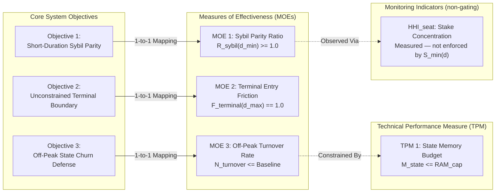

# Systems Engineering Specification: Formal KPI Architecture & Evaluation Framework for $S_{\min}(d)$

| Metadata | Value |
| :--- | :--- |
| **Document ID** | SPEC-2026-09-SE-KPI-FRAMEWORK |
| **Revision** | Rev 2.0 (Canonical Systems Engineering Metric Allocation & Calibration Directive) |
| **Status** | APPROVED ARCHITECTURAL SPECIFICATION |
| **Methodology** | Formal Systems Engineering & Algorithmic Mechanism Design |
| **Target Subsystem** | Avalanche Primary Network Consensus Admission Mechanics (`vms/platformvm`) |
| **Target Reviewer / Calibration Lead** | Shawn Anderson (Empirical Data & Simulation Engineering) |
| **Companion Specification** | [`docs/2026-09-29-formal-mechanism-design-admission-frontier.md`](./2026-09-29-formal-mechanism-design-admission-frontier.md) |
| **Interactive Digital Twin** | [`docs/admission_frontier_digital_twin.html`](./admission_frontier_digital_twin.html) |
| **Date** | September 29, 2026 |

---

## 1. Executive Summary & Epistemic Diagnostic

### 1.1 Scope & Authority
This specification defines the canonical evaluation criteria and metric allocation for the **Duration-Dependent PoS Admission Frontier ($S_{\min}(d)$)** on the Avalanche Primary Network. 

> [!IMPORTANT]
> **Historical Supersession Notice:**  
> This specification and its companion formal document ([`docs/2026-09-29-formal-mechanism-design-admission-frontier.md`](./2026-09-29-formal-mechanism-design-admission-frontier.md)) establish the canonical Stage 4 architecture. All prior exploratory drafts, piecewise formulations, or uncalibrated duration heuristics from earlier commits (September 22–25) are formally superseded.

### 1.2 The Hierarchy of System Measurement
Performance measurement in mechanism design requires strict structural discipline. Defining an uncurated set of metrics violates the **Principle of Orthogonality** and leads to **epistemic conflation** across four fundamentally different measurement categories:

```
┌────────────────────────────────────────────────────────────────────────┐
│                   THE HIERARCHY OF SYSTEM MEASUREMENT                  │
├──────────────────────────┬─────────────────────────────────────────────┤
│ Category                 │ Operational Definition                      │
├──────────────────────────┼─────────────────────────────────────────────┤
│ 1. Measures of           │ Direct operational success metrics.         │
│    Effectiveness (MOE)   │ Strictly 1-to-1 with core system objectives.│
├──────────────────────────┼─────────────────────────────────────────────┤
│ 2. Technical Performance │ Hard constraint ceilings, safety bounds,    │
│    Measures (TPM)        │ and binary invariants (pass/fail bounds).   │
├──────────────────────────┼─────────────────────────────────────────────┤
│ 3. Descriptive State     │ Phase space distributions and diagnostic    │
│    Visualizations        │ profiles. Not scalar optimization targets.  │
├──────────────────────────┼─────────────────────────────────────────────┤
│ 4. Cross-Coupled Macro   │ Metrics primarily steered by external       │
│    Indicators            │ mechanisms (e.g. ACP-285 yield curve).      │
│                          │ Must be decoupled to prevent attribution    │
│                          │ fallacies (The Bouncer vs Carrot Rule).     │
└──────────────────────────┴─────────────────────────────────────────────┘
```

This specification establishes a 5-axiom evaluation framework and defines the canonical **3-MOE + 1-TPM + 1-Monitoring Indicator Architecture** to guide empirical parameter calibration.

---

## 2. The Canonical Curve Family: Bounded Harmonic P-Decay

As proven in the Stage 4 mathematical audit, candidate curve families 1 (Pure Iso-Commitment), 2 (Standard Hyperbolic), and 3 (Shifted Power-Law) fail critical boundary, regularity, or convexity axioms. The **sole canonical curve family** approved for calibration is **Family 4: Bounded Harmonic P-Decay**:

$$S_{\min}(d) = S_{\text{floor}} + (S_{\text{short}} - S_{\text{floor}}) \cdot \left[ \frac{\frac{1}{d} - \frac{1}{d_{\max}}}{\frac{1}{d_{\min}} - \frac{1}{d_{\max}}} \right]^p$$

where:
* $d_{\min} = 2 \text{ days}$ (ACP-273 / 48-hour minimum protocol duration).
* $d_{\max} = 365 \text{ days}$ (PlatformVM maximum duration bound).
* $K_{\text{baseline}} = 2{,}000 \times 14 = 28{,}000 \text{ AVAX-days}$ (Legacy consensus commitment anchor).

---

## 3. Calibration Parameter Space $\Theta$ (Shawn's Calibration Scope)

The engineering objective of parameter selection under uncertainty (PSUU) is to calibrate the parametric triple:

$$\Theta = (S_{\text{short}}, S_{\text{floor}}, p)$$

against the empirical renewal telemetry (`01-renewal-panel.parquet`, $N = 57{,}067$ validator stints) and discrete-event cadCAD digital twin simulations.

| Parameter | Domain / Search Space | Systems Engineering Role | Governing Metric |
| :--- | :--- | :--- | :--- |
| **$S_{\text{short}}$** | $[14{,}000, 20{,}000] \text{ AVAX}$ | Minimum self-stake anchor required at shortest lockup ($d_{\min} = 2\text{d}$). Bounds flash-staking Sybil vectors and P2P connection flooding. | **MOE 1: Sybil Parity Ratio** ($R_{\text{sybil}}(d_{\min}) \ge 1.0$) |
| **$S_{\text{floor}}$** | $[500, 2{,}000] \text{ AVAX}$ | Baseline entry barrier at maximum lockup ($d_{\max} = 365\text{d}$). Enforces community decentralization accessibility. | **MOE 2: Terminal Entry Friction** ($F_{\text{terminal}} \equiv 1.0$) |
| **$p$** | $[1.00, 3.00]$ | Curvature decay exponent. Determines rate of barrier decay and establishes intermediate thresholds ($S_{\min}(14\text{d})$ retail gate). | **MOE 3: Off-Peak Turnover Rate** ($N_{\text{turnover}} \le \text{Baseline}$) |

---

## 4. The 5 Axioms of Systems Engineering Metric Selection

Every metric proposed for evaluation must pass all five axiomatic tests:

1. **Axiom 1: Direct Traceability (Completeness)**
   * Every MOE must trace directly to exactly one primary system objective. A metric without an objective is orphan scope creep. An objective without a verification metric is unvalidated.
2. **Axiom 2: Controllability (The Bouncer vs. The Carrot Decoupling)**
   * A mechanism $M_1$ ($S_{\min}(d)$ entry barrier) cannot be evaluated on an outcome metric $Y$ if $Y$ is primarily determined by mechanism $M_2$ (ACP-285 dynamic emissions). Over 99% of staked AVAX is held by institutional whales who easily clear admission barriers; thus, macro stake-weighted duration ($\bar{d}_{\text{stake}}$) is controlled by yield spreads, not $S_{\min}(d)$.
3. **Axiom 3: Orthogonality (Minimum Spanning Basis)**
   * No two metrics may measure the same physical degree of freedom under linear scaling or moment transformation. The metric set must form a minimal spanning basis over the objective space.
4. **Axiom 4: Decision Cardinality (Normative vs. Descriptive)**
   * A KPI must establish a scalar ordering or explicit threshold: $\text{eval}(X) > \text{eval}(Y)$ (optimization) or $\text{eval}(X) \ge \theta$ (satisficing). Multidimensional probability distributions ($P(d), P(S, d)$) are state observations, not scalar decision criteria.
5. **Axiom 5: Consensus Observability & Determinism**
   * The metric must be deterministically calculable from historical PlatformVM blocks and discrete-event simulation states without relying on hidden, unobservable agent utility functions.

---

## 5. Forensic Audit of Candidate Metrics

| Metric | Candidate Title | Axiom 1: Traceable? | Axiom 2: Controllable? | Axiom 3: Orthogonal? | Axiom 4: Normative Goal? | Audit Verdict & Classification |
| :--- | :--- | :---: | :---: | :---: | :---: | :--- |
| **M-01** | Duration Distribution $P(d)$ | Partial | Yes | ❌ Redundant with M-02 | ❌ Descriptive only | **DEMOTE $\to$ Diagnostic Phase Space Plot**. Useful for visualizing simulation trajectories, but not a scalar pass/fail KPI. |
| **M-02** | Joint Distribution $P(S, d)$ | Partial | Yes | ❌ Subsumes M-01 | ❌ Descriptive manifold | **DEMOTE $\to$ Diagnostic State Manifold**. Visualizes validator wealth-time migration. |
| **M-03** | Stake-Weighted Duration $\bar{d}_{\text{stake}}$ | ❌ Misattributed | ❌ Fails (99.8% whale driven) | Partial | ⚠️ Target exists, wrong lever | **REMOVE from $S_{\min}(d)$ $\to$ Relocate to ACP-285**. Resolves policy attribution error. |
| **M-04** | Turnover Rate $N_{\text{turnover}}$ | ✅ Yes (Obj 3) | ✅ Yes | ✅ Orthogonal | ✅ Yes ($\min N_{\text{turnover}}$) | **RETAIN $\to$ Canonical MOE-3**. High-fidelity measure of identity cycling suppression. |
| **M-05** | Concentration $\text{HHI}_{\text{seat}}$ | ✅ Yes (Safety) | ❌ No (emergent outcome — `S_min(d)` cannot directly control who participates beyond the threshold) | ✅ Orthogonal | ⚠️ Observable but not enforceable by this mechanism | **RECLASSIFY → Monitoring Indicator (non-gating diagnostic)**. Measured each simulation step. If a parameter triple `(S_short, S_floor, p)` consistently yields high HHI, flag it as undesirable — but do not use as a binary pass/fail gate since `S_min(d)` has no direct actuator over stake concentration above the admission floor. |
| **M-06** | State Storage $M_{\text{state}}$ | ✅ Yes (Safety) | ✅ Yes | ❌ Time-integral of M-04 | ✅ Yes ($M_{\text{state}} \le \text{RAM}$) | **RECLASSIFY $\to$ Canonical TPM-2**. Physical hardware resource constraint. |

---

## 6. The Canonical 3-MOE + 1-TPM + 1-Monitoring Indicator Architecture

Under this validated architecture, the measurement suite consists of exactly **3 Measures of Effectiveness** (evaluating the 3 Core Objectives), **1 Technical Performance Measure** (physical RAM safety invariant), and **1 Monitoring Indicator** (HHI — measured but not enforced by this mechanism).




---

### 6.1 Measures of Effectiveness (MOEs)

#### **MOE 1: Short-End Sybil Parity Ratio ($R_{\text{sybil}}$)**
* **Traces to:** **Objective 1 (Short-Duration Sybil Parity)**.
* **Formal Definition:**
  $$R_{\text{sybil}}(d) = \frac{S_{\min}(d) \cdot d}{K_{\text{baseline}}}$$
  evaluated specifically at $d = d_{\min} = 2 \text{ days}$.
* **Normative Pass Criteria:**
  $$R_{\text{sybil}}(d_{\min}) = \frac{S_{\text{short}} \cdot 2}{28{,}000} \ge 1.0 \implies S_{\text{short}} \ge 14{,}000 \text{ AVAX}$$
  * If $R_{\text{sybil}}(d_{\min}) = 1.0$ ($S_{\text{short}} = 14{,}000$): Exact iso-commitment (zero Sybil discount relative to legacy 2k @ 14d).
  * If $R_{\text{sybil}}(d_{\min}) > 1.0$ ($S_{\text{short}} > 14{,}000$): Liquidity surcharge enforced on short-duration flexibility.
  * If $R_{\text{sybil}}(d_{\min}) < 1.0$ ($S_{\text{short}} < 14{,}000$): **FAIL** (Vulnerability: subsidized short-duration Sybil attacks).

#### **MOE 2: Terminal Entry Accessibility Index ($F_{\text{terminal}}$)**
* **Traces to:** **Objective 2 (Unconstrained Terminal Stake Boundary)**.
* **Formal Definition:**
  $$F_{\text{terminal}} = \frac{S_{\min}(d_{\max})}{S_{\text{floor}}}$$
* **Normative Pass Criteria:**
  $$F_{\text{terminal}} \equiv 1.0$$
  * By construction of Family 4 Bounded Harmonic P-Decay:
    $$\lim_{d \to d_{\max}} S_{\min}(d) = S_{\text{floor}} + \Delta S \cdot [0]^p = S_{\text{floor}} \implies F_{\text{terminal}} \equiv 1.0000$$
    Guarantees zero residual friction at maximum duration.

#### **MOE 3: Off-Peak Identity Churn Rate ($N_{\text{turnover}}$)**
* **Traces to:** **Objective 3 (Off-Peak State Churn Defense)**.
* **Formal Definition:**
  $$N_{\text{turnover}}(T) = \frac{\Delta V_{\text{registrations}}(T) + \Delta V_{\text{expirations}}(T)}{\bar{V}_{\text{active}} \cdot T}$$
  evaluated across simulation horizons $T$ where dynamic base fees $g(t) \to g_{\min}$.
* **Normative Pass Criteria:**
  $$N_{\text{turnover}}^{\text{off-peak}} \le N_{\text{turnover}}^{\text{historical baseline}}$$
  * Guarantees that short-duration validator spinning is economically restrained even when mempool congestion is zero and gas fees are at their minimum floor. Curvature parameter $p$ directly shapes this response.

---

### 6.2 Technical Performance Measure (TPM) — Binary Safety Invariant

TPMs are not optimization goals; they are binary constraint gates that ensure parameter choices do not induce collateral damage to hardware viability.

#### **TPM 1: Consensus State Memory Ceiling ($M_{\text{state}}$)**
* **Formal Definition:**
  $$M_{\text{state}} = M_{\text{BLS\_cache}} + M_{\text{peer\_table}} + M_{\text{P-chain\_index}}$$
* **Invariant Threshold:**
  $$M_{\text{state}} \le \bar{M}_{\max}$$
* **Failure Condition:** Peak dynamic memory consumption of PlatformVM validator tracking exceeding pre-allocated RAM budgets on reference validator hardware.

---

### 6.3 Monitoring Indicator — Non-Gating Diagnostic

#### **HHI Seat Concentration ($\text{HHI}_{\text{seat}}$)**
* **Formal Definition:**
  $$\text{HHI}_{\text{seat}} = \sum_{i=1}^{N_{\text{entities}}} \left( \frac{\text{Seats}_i}{N_{\text{total\_seats}}} \right)^2$$
* **Why this is NOT a TPM:**
  The admission frontier `S_min(d)` is an **entry filter** — it controls who may participate, but has no actuator over how stake is *distributed* among validators who clear the threshold. HHI is an **emergent property** of the validator pool composition. Enforcing an HHI ceiling would require a separate protocol-level mechanism (e.g., seat caps, stake-weighted lottery), which is outside the scope of this proposal.
* **Role in simulation:** Measured at every cadCAD simulation step as a **diagnostic signal**. If a parameter triple `(S_short, S_floor, p)` consistently yields rising HHI across sweep iterations, flag that configuration as undesirable and deprioritise it — but do not use HHI as a binary pass/fail gate during parameter selection.


---

## 7. Diagnostic State Visualizations (Non-KPI Analytics)

To observe agent-based simulation trajectories (cadCAD / radCAD) and historical panel distributions without confusing descriptive telemetry with normative KPIs:

1. **State Plot 1: Joint Duration-Stake Manifold $P(S, d)$**
   * 2D density heatmap tracking validator positioning $(S_i, d_i)$ relative to the frontier $S_{\min}(d)$. Used to observe cohort migration across $(S_{\text{short}}, S_{\text{floor}}, p)$ sweeps.
2. **State Plot 2: Validator Renewal Flow Sankey Diagram**
   * Visualizes transition probabilities between duration brackets upon stint completion: $P(d_{t+1} \in B_j \mid d_t \in B_i)$.

---

## 8. Summary: Complete Traceability Matrix

| Core Objective | Verification Metric | Mathematical Formula | Target Criterion | Governing Parameter | Verification Method |
| :--- | :--- | :--- | :---: | :---: | :--- |
| **Obj 1: Short-Duration Sybil Parity** | **MOE 1: $R_{\text{sybil}}$** | $\frac{S(d_{\min}) \cdot d_{\min}}{K_{\text{baseline}}}$ | $\ge 1.0$ | $S_{\text{short}}$ | Analytical Proof & Syntactic Gate |
| **Obj 2: Terminal Stake Boundary** | **MOE 2: $F_{\text{terminal}}$** | $\frac{S(d_{\max})}{S_{\text{floor}}}$ | $\equiv 1.0$ | $S_{\text{floor}}$ | Boundary Condition Verification |
| **Obj 3: Off-Peak State Churn Defense** | **MOE 3: $N_{\text{turnover}}$** | $\frac{V_{\text{in}} + V_{\text{out}}}{\bar{V} \cdot T}$ | $\le \text{Baseline}$ | $p$ | Discrete-Event cadCAD Simulation |
| *Physical Constraint: RAM Budget* | **TPM 1: $M_{\text{state}}$** | $M_{\text{BLS}} + M_{\text{P-Chain}}$ | $\le \bar{M}_{\max}$ | $(S_{\text{short}}, p)$ | Node Benchmarks & Stress Tests |
| *Monitoring (non-gating diagnostic)* | **HHI Indicator: $\text{HHI}_{\text{seat}}$** | $\sum s_i^2$ | Flagged if rising — **not a pass/fail gate** | Emergent (not directly controlled by $S_{\min}(d)$) | cadCAD Sweep Observation |


---

*Authored under the BCRG Systems Engineering Framework for Avalanche Phase II Research.*
