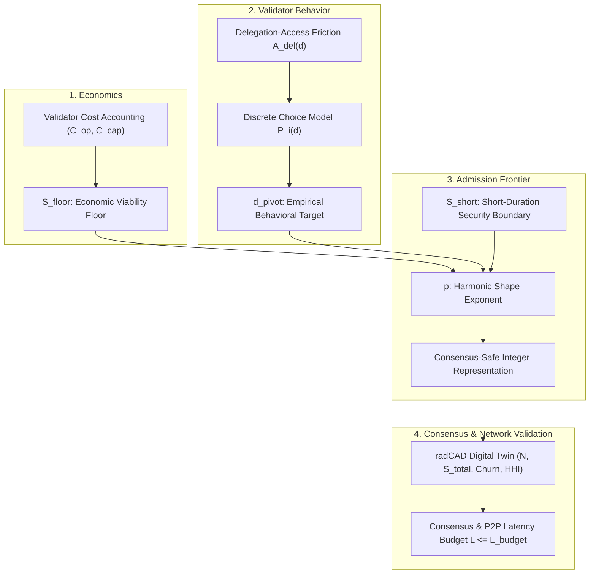
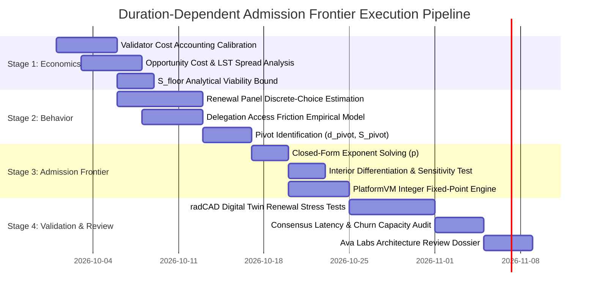
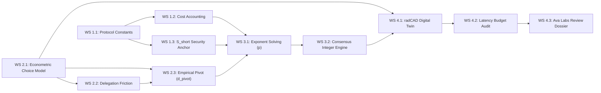

# Technical Work Plan: Duration-Dependent PoS Admission Frontier Specification

**Repository:** `avalanche-phase-ii-research`  
**Subsystem:** Avalanche Primary Network Consensus & PlatformVM  
**Document Type:** Systems Engineering & Mechanism Design Work Plan  
**Target Document:** [docs/2026-09-30-duration-dependent-admission-frontier-specification.md](file:///home/hash/Hub/Projects/avalanche-phase-ii-research/docs/2026-09-30-duration-dependent-admission-frontier-specification.md)  
**Status:** Planning Draft (Awaiting Approval)  

---

## Executive Summary & Sufficiency Assessment

This document provides a technical work plan and forensic audit for transitioning the **Duration-Dependent PoS Admission Frontier: Revised Mechanism Design Specification** from its current working draft into an externally defensible protocol specification ready for Ava Labs PlatformVM architectural review.

### Forensic Sufficiency Finding: Is the Specification Ready for Calibration?
The revised working draft establishes sound architectural separation (admission gate vs. reward schedule) and a mathematically well-behaved candidate curve family (bounded harmonic power). 

**However, the specification is NOT YET sufficient to proceed directly to numerical parameter selection.** 

Three foundational prerequisites must be resolved first:
1. **Economic Viability Baseline Definition:** The long-duration floor condition $V_i(S_{\text{floor}}, d_{\max}) \ge 0$ lacks an explicit target validator persona and capital-opportunity cost model.
2. **Behavioral Econometric Grounding:** The pivot duration $d_{\text{pivot}}$ cannot be chosen geometrically. It requires empirical estimation of duration penalty parameters ($\beta_{\text{dur}}$) and exit probabilities using historical P-Chain telemetry.
3. **Consensus Exponent Admissibility Rules:** The mathematical parameter $p$ cannot be solved in a continuous vacuum without defining whether PlatformVM accepts fixed-point rational approximations ($a/b$), lookup tables, or restricted integer exponents.

Proceeding to numerical calibration without these three inputs guarantees invalid curve parameters and implementation rework.

---

## 1. Specification Audit: Current State Classification



### 1.1 What is Already Established in the Document
* **Separation of Concerns:** The admission gate $G(S, d) \in \{0, 1\}$ enforces state-validity at entry; the reward schedule $R(d)$ distributes yield. They are decoupled in execution but co-dependent in validator utility $M(S, d) = (G(S, d), R(d))$.
* **Domain & Boundary Invariants:** Duration is compact $d \in [d_{\min}, d_{\max}]$; minimum self-stake values hit sovereign targets $S_{\min}(d_{\min}) = S_{\text{short}}$ and $S_{\min}(d_{\max}) = S_{\text{floor}}$.
* **Delegation Firewall & Access Ratio:** Retail delegator ordering $d_{\text{del},\min} \le d_{\text{del}} \le d_{\text{val}}$ quarantines sub-$14\text{d}$ validators from retail delegation. The access ratio $A_{\text{del}}(d) = \max(0, (d - d_{\text{del},\min})/d)$ formalizes the friction zone immediately above $d_{\text{del},\min}$.
* **Candidate Functional Form:** Bounded harmonic power family:
  $$S_{\min}(d) = S_{\text{floor}} + (S_{\text{short}} - S_{\text{floor}}) \left[ \frac{\frac{1}{d} - \frac{1}{d_{\max}}}{\frac{1}{d_{\min}} - \frac{1}{d_{\max}}} \right]^p$$
* **Deficiencies of Alternative Families:** Rejection of pure iso-commitment ($C/d$), unshifted hyperbola ($S_{\text{floor}} + K/d$), and shifted power-law decay due to boundary drift or derivative collapse.
* **Calibration Ordering:** Strict four-step calibration hierarchy: $S_{\text{floor}} \to d_{\text{pivot}} \to p \to$ rejection tests.

### 1.2 What is Mathematically Established
* **Exact Two-Point Dirichlet Boundary Interpolation:** $\eta(d_{\min}) = 1 \implies S_{\min}(d_{\min}) = S_{\text{short}}$; $\eta(d_{\max}) = 0 \implies S_{\min}(d_{\max}) = S_{\text{floor}}$ with identically zero residual error for any $p > 0$.
* **Strict Monotonic Decrease:** For all $p \ge 1$ and $d \in [d_{\min}, d_{\max})$, $S'_{\min}(d) < 0$.
* **Strict Interior Convexity:** For all $p \ge 1$ and $d \in (d_{\min}, d_{\max})$, $S''_{\min}(d) > 0$.
* **Analytical Invertibility for Exponent $p$:** Given an empirical pivot point $(d_{\text{pivot}}, S_{\text{pivot}})$, the shape exponent is uniquely determined:
  $$p = \frac{\ln\left( \frac{S_{\text{pivot}} - S_{\text{floor}}}{S_{\text{short}} - S_{\text{floor}}} \right)}{\ln \eta(d_{\text{pivot}})}$$
* **Finite Terminal Derivative:** 
  $$\lim_{d \to d_{\max}^-} |S'_{\min}(d)| = \begin{cases} \frac{\Delta S \cdot d_{\min}}{d_{\max}(d_{\max} - d_{\min})} < \infty, & p = 1 \\ 0, & p > 1 \end{cases}$$

### 1.3 What is Currently Only a Design Choice or Assumption
* **Design Choice (DC1):** Selection of the bounded harmonic coordinate $\eta(d)$ over alternative two-point interpolators (e.g., cubic Hermite, rational splines).
* **Design Choice (DC2):** Single-point pivot calibration $(d_{\text{pivot}}, S_{\text{pivot}})$ to pin down $p$, rather than an econometric regression fit over multiple tenure buckets.
* **Design Choice (DC3):** Formulation of the linear temporal delegation availability ratio $A_{\text{del}}(d) = (d - d_{\text{del},\min})/d$.
* **Assumption (A1):** Validator utility $U_{i,d}$ can be adequately represented by an additive linear random utility model with Weibull/Gumbel errors ($\varepsilon_{i,d}$).
* **Assumption (A2):** Phase-randomized initialization $\tau_{\text{rem}, i} \sim U(0, d_i)$ produces a stationary continuous arrival process in discrete-time simulations.
* **Assumption (A3):** P2P consensus health can be abstracted by an aggregate latency response surface $L(N, \lambda_{\text{churn}})$ rather than requiring full packet-level network emulation.

### 1.4 What Requires Empirical Estimation
* **Economic Viability Lower Bound ($S_{\text{floor}}$):** Estimation of annualized operating costs $C_{\text{op}}$ across validator infrastructure types (bare-metal, commercial cloud, co-located) and capital opportunity cost $c_i$ (shadow cost relative to liquid staking LSTs and DeFi risk-free rates).
* **Validator Duration Preference Function ($g(d, \tau_i)$ and $\beta_{\text{dur}}$):** Econometric discrete-choice estimation from the empirical renewal panel (`01-renewal-panel.parquet`, $N = 57{,}067$ validator stints across $7{,}635$ nodes) to quantify operator resistance to locking capital.
* **Delegation Capture Function ($B_i(A_{\text{del}}(d))$):** Measurement of historical delegator capital allocation as a joint function of validator duration $d$ and self-stake $S$.
* **Pivot Duration & Stake Thresholds ($d_{\text{pivot}}, S_{\text{pivot}}$):** Identification of the duration threshold where duration extension is maximized while predicted operator exit remains below acceptable network risk limits.

### 1.5 What Requires Simulation
* **Intertemporal Dynamic Anti-Splitting Verification:** Testing whether heterogeneous validators can profitably circumvent capital hurdles by rolling short stints under dynamic price and yield trajectories.
* **Active Set Equilibrium ($N^*(t)$):** Evaluating whether the admission curve produces an active validator count within target bounds ($N \in [500, 1200]$) under bear and bull macro regimes.
* **Consensus Churn Distributions ($N_{\text{churn}}(t)$):** Measuring daily validator entrance/exit volume relative to historical baselines to verify churn suppression.
* **Stake Concentration & Decentralization ($HHI(t)$, Nakamoto Coefficient):** Ensuring the mechanism does not disproportionately centralize voting weight into whale operators.
* **Network Latency Stress Testing:** Simulating synchronized renewal spikes and high-turnover windows against the consensus latency budget $L \le L_{\text{budget}}$.

### 1.6 What Requires PlatformVM / Consensus Implementation Verification
* **Go Implementation of Cleared-Fraction Coordinate:** Verifying that $\eta(d) = \frac{d_{\min}(d_{\max} - d)}{d(d_{\max} - d_{\min})}$ evaluates deterministically across all architecture targets without floating-point nondeterminism.
* **Consensus-Safe Exponentiation:** Determining whether $p$ is evaluated via scaled integer binomial expansion, rational power approximation ($p = a/b$), or restricted to integer values ($p \in \{1, 2, 3\}$).
* **Integer Rounding & Boundary Preservation:** Proving that integer division and rounding (e.g., `math/big` or scaled `uint64`) preserves strict monotonic ordering and guarantees $S_{\min}(d_{\max}) \equiv S_{\text{floor}}$.
* **PlatformVM State Transition Placement:** Benchmarking gas and computational overhead of evaluating $S_{\min}(d)$ inside `vms/platformvm/txs/executor/staker_tx_verification_helpers.go` during block execution.

### 1.7 Claims that Must be Weakened, Removed, or Explicitly Qualified
* **Claim 1 (Convexity Eliminates Splitting):**
  * *Correction:* Retain the explicit qualification that static convexity ($S''_{\min}(d) > 0$) is purely a curve shape property. It does not mathematically prove intertemporal anti-splitting across repeated stints. That property must be confirmed via dynamic multi-period simulation.
* **Claim 2 (Sybil Resistance from $S_{\text{short}}$ Alone):**
  * *Correction:* Explicitly state that $S_{\text{short}}$ establishes an economic capital barrier for short-tenure consensus seats, but complete Sybil resistance in Avalanche consensus depends on sub-sampled voting weight dynamics ($\alpha, k$ Snow parameters), not seat count in isolation.
* **Claim 3 (Delegation Accessibility as Realized Flow):**
  * *Correction:* Qualify that $A_{\text{del}}(d)$ represents theoretical temporal eligibility for delegation, whereas actual delegation flow is endogenous and governed by delegator preference for large self-bonds ($\ge 6{,}000\text{ AVAX}$) and fee performance.
* **Claim 4 (Zero Terminal Slope at $d_{\max}$ for $p > 1$):**
  * *Correction:* For $p > 1$, $\lim_{d \to d_{\max}^-} S'_{\min}(d) = 0$. This means the marginal stake surcharge approaches zero near 365 days. The specification must explicitly analyze whether this flat terminal slope undermines incentives to lock for 365 days versus 300 days.

---

## 2. Four-Stage Technical Work Plan



### Stage 1: Economic Viability & Protocol Boundary Grounding (Economics)
**Objective:** Ground the parameter boundaries $(S_{\text{floor}}, S_{\text{short}}, d_{\min}, d_{\max})$ in verified protocol constants and economic operator solvency.

* **Workstream 1.1: PlatformVM Protocol Constant Audit**
  * *Task:* Extract exact production constants from `ava-labs/avalanchego/vms/platformvm`:
    * Minimum staking duration $d_{\min}$ (Helicon 48h vs legacy 14d).
    * Maximum staking duration $d_{\max}$ (365d).
    * Minimum delegation duration $d_{\text{del},\min}$ (14d).
  * *Input:* AvalancheGo release source code.
  * *Output:* Immutable protocol boundary parameter table.
  * *Acceptance Criteria:* Zero discrepancy between specification bounds and Go consensus logic.

* **Workstream 1.2: Validator Cost Accounting & Solvency Modeling ($S_{\text{floor}}$)**
  * *Task:* Calibrate operator operating costs $C_{\text{op}}(d)$ and capital opportunity costs $C_{\text{cap}}(S, d)$ across three operator personas:
    1. Independent / Home Staker (bare-metal, minimal cloud).
    2. Professional Cloud Staker (AWS/GCP/Hetzner high-availability VPS).
    3. Multi-Subnet Institutional Staker.
  * *Task:* Solve for the infimum self-stake $S_{\text{floor}}$ satisfying:
    $$\mathbb{E}\left[ V_{\text{independent}}(S_{\text{floor}}, d_{\max}) \right] \ge 0$$
  * *Input:* Empirical cloud hosting cost index, historical AVAX price volatility, staking yield projections under ACP-285.
  * *Output:* Feasible bounded range for $S_{\text{floor}} \in [S_{\text{floor},\min}, S_{\text{floor},\max}]$.
  * *Acceptance Criteria:* Documented solvency proof demonstrating positive expected net value for target operator classes at maximum duration.

* **Workstream 1.3: Short-Duration Admission Anchor ($S_{\text{short}}$)**
  * *Task:* Establish the security rationale for $S_{\text{short}}$:
    * Option A: Legacy Capital-Time Product Invariant ($S_{\text{short}} \cdot d_{\min} \ge 28{,}000\text{ AVAX-days}$).
    * Option B: Consensus Seat Capitalization Target.
  * *Output:* Formal rationale and target bound for $S_{\text{short}}$.
  * *Acceptance Criteria:* Clear analytical security justification defending $S_{\text{short}}$ against short-duration Sybil and churn risks.

---

### Stage 2: Econometric Choice Modeling & Behavioral Pivot Identification (Validator Behavior)
**Objective:** Replace geometric guesswork with empirical econometric estimation to determine how validators respond to duration requirements, identifying an economically grounded pivot region $(d_{\text{pivot}}, S_{\text{pivot}})$.

* **Workstream 2.1: Renewal Panel Econometric Estimation**
  * *Task:* Estimate a structural multinomial logit choice model on historical renewal telemetry (`01-renewal-panel.parquet`):
    $$U_{i,d} = \beta_{\text{rew}} R_i(d) - \beta_{\text{cap}} C_{\text{cap},i}(S_{\min}(d), d) - \beta_{\text{op}} C_{\text{op},i}(d) + \beta_{\text{del}} B_i(A_{\text{del}}(d)) - \beta_{\text{dur}} \ln(d) + \varepsilon_{i,d}$$
  * *Task:* Estimate the duration penalty coefficient $\hat{\beta}_{\text{dur}}$ and capital barrier sensitivity $\hat{\beta}_{\text{cap}}$ across capital strata.
  * *Input:* Canonical renewal panel ($N = 57{,}067$ stints across $7{,}635$ nodes).
  * *Output:* Estimated utility parameter vector $\hat{\boldsymbol{\beta}}$ with standard errors and renewal transition elasticity matrix.
  * *Acceptance Criteria:* Statistically significant parameter estimates explaining observed tenure clustering at 14d, 30d, 60d, 90d, 180d, and 365d.

* **Workstream 2.2: Delegation Friction Modeling**
  * *Task:* Quantify the empirical penalty of operating in the friction zone $d \in [d_{\text{del},\min}, 2 d_{\text{del},\min}]$. Measure how delegation capture decays as duration approaches 14 days.
  * *Output:* Empirical delegation capture function $\hat{B}_i(A_{\text{del}}(d))$.
  * *Acceptance Criteria:* Reconciled model matching historical delegation records for short-tenure nodes.

* **Workstream 2.3: Empirical Pivot Identification ($d_{\text{pivot}}, S_{\text{pivot}}$)**
  * *Task:* Using the estimated choice model, simulate renewal probabilities across candidate duration thresholds.
  * *Task:* Identify $d_{\text{pivot}}$ as the tenure threshold that achieves maximum duration extension per unit of predicted validator exit.
  * *Output:* Empirically calibrated target pair $(d_{\text{pivot}}, S_{\text{pivot}})$.
  * *Acceptance Criteria:* Documented trade-off curve demonstrating that $d_{\text{pivot}}$ minimizes operator churn while extending duration commitments.

---

### Stage 3: Analytical Frontier Parameterization & Consensus Integer Engineering (Admission Frontier)
**Objective:** Solve for the curvature exponent $p$, verify all mathematical and shape requirements, and produce a consensus-safe integer arithmetic specification.

* **Workstream 3.1: Analytical Exponent Solving & Interior Differentiation Tests**
  * *Task:* Compute closed-form exponent:
    $$p = \frac{\ln\left( \frac{S_{\text{pivot}} - S_{\text{floor}}}{S_{\text{short}} - S_{\text{floor}}} \right)}{\ln \eta(d_{\text{pivot}})}$$
  * *Task:* Evaluate Requirement 4 (No Interior Collapse) across intermediate duration pairs (e.g., 30d vs 90d, 90d vs 180d):
    $$S_{\min}(d_a) - S_{\min}(d_b) \ge \Gamma_{\min}$$
  * *Task:* Verify marginal elasticity profile $\varepsilon_{S, d}(d) = \frac{d}{S_{\min}} \frac{dS_{\min}}{dd}$ across the entire domain.
  * *Output:* Certified exponent $p$ and elasticity scorecard.
  * *Acceptance Criteria:* $p \ge 1$, strict interior convexity preserved, and intermediate differentiation $\Gamma_{\min}$ satisfied.

* **Workstream 3.2: Consensus Integer Arithmetic & Precision Analysis**
  * *Task:* Formulate the deterministic integer algorithm for PlatformVM using cleared-fraction coordinates:
    $$\eta(d) = \frac{d_{\min}(d_{\max} - d)}{d(d_{\max} - d_{\min})}$$
  * *Task:* Determine numerical representation for power $[\eta(d)]^p$:
    * If $p$ is non-integer: evaluate fixed-point binomial series vs. rational power $p = a/b$ vs. fixed-point lookup table.
    * If integer $p$ is required: audit the performance and shape penalty of rounding $p$ to the nearest integer ($p \in \{1, 2, 3\}$).
  * *Task:* Prove integer rounding safety:
    $$\forall d_1 < d_2 \implies S_{\min}^{\text{int}}(d_1) \ge S_{\min}^{\text{int}}(d_2)$$
    $$S_{\min}^{\text{int}}(d_{\max}) \equiv S_{\text{floor}}$$
  * *Output:* Formal Go implementation specification and error-bound proof ($|\epsilon_{\text{quant}}| < 1\text{ nAVAX}$).
  * *Acceptance Criteria:* Zero floating-point operations; zero overflow risk on `uint64`/`uint128`; deterministic identical results across AMD64 and ARM64 architectures.

---

### Stage 4: Digital-Twin Simulation, Network Capacity & Governance Verification (Consensus / Network Validation)
**Objective:** Validate that the calibrated admission frontier and integer implementation maintain active validator population stability, suppress churn, and respect the P2P consensus latency budget.

* **Workstream 4.1: radCAD Digital Twin Renewal Simulations**
  * *Task:* Integrate the calibrated choice model and integer admission function into the discrete-event digital twin.
  * *Task:* Run Monte Carlo stress simulations across macro regimes (flat, bear, bull, shock) tracking:
    * Active validator set size $N(t)$.
    * Total staked capital $S_{\text{total}}(t)$.
    * Daily churn rate $N_{\text{churn}}(t)$.
    * Voting weight concentration $HHI(t)$ and Gini coefficient.
  * *Input:* Empirical baseline demographics from `01-renewal-panel.parquet`.
  * *Output:* Distributional trajectories and KPI scorecard.
  * *Acceptance Criteria:* Churn reduced by $\ge 40\%$ relative to legacy baseline; active set maintains $N \ge 500$ under stress.

* **Workstream 4.2: Consensus & P2P Latency Budget Audit**
  * *Task:* Evaluate simulated active set and churn trajectories against the calibrated latency model:
    $$L(t) = f(N(t), \lambda_{\text{churn}}(t)) \le L_{\text{budget}}$$
  * *Task:* Verify that high-churn renewal cascades do not degrade Avalanche Snow consensus sampling latency beyond operational thresholds.
  * *Output:* Latency safety margin audit report ($L / L_{\text{budget}} \le 0.75$).
  * *Acceptance Criteria:* Provable consensus headroom under 99th-percentile churn stress.

* **Workstream 4.3: Ava Labs Architectural Review Package**
  * *Task:* Compile finalized documentation:
    1. Fully calibrated specification with empirical and simulation proofs.
    2. Deterministic Go reference implementation with comprehensive unit test vectors.
    3. Systems engineering verification matrix and decision log.
  * *Output:* Complete external review package.
  * *Acceptance Criteria:* Formal review submission approved by BCRG research leads.

---

## 3. Workstream Dependencies & Traceability Matrix



| Workstream | Direct Inputs | Direct Outputs | Blocks Downstream Workstream |
| :--- | :--- | :--- | :--- |
| **WS 1.1 (Protocol Constants)** | PlatformVM Go Source Code | $(d_{\min}, d_{\max}, d_{\text{del},\min})$ bounds | WS 1.2, WS 1.3, WS 3.2 |
| **WS 1.2 (Cost Accounting)** | Hosting costs, outside yields, ACP-285 | $S_{\text{floor}}$ viable range | WS 3.1 |
| **WS 1.3 (Short Anchor)** | Sybil security model, Snow parameters | $S_{\text{short}}$ target bound | WS 3.1 |
| **WS 2.1 (Choice Model)** | Historical panel (`01-renewal-panel.parquet`) | Utility coefficients $\hat{\boldsymbol{\beta}}$ | WS 2.2, WS 2.3, WS 4.1 |
| **WS 2.2 (Delegation Friction)** | P-Chain delegation logs, $A_{\text{del}}(d)$ | $\hat{B}_i(A_{\text{del}})$ capture function | WS 2.3 |
| **WS 2.3 (Empirical Pivot)** | $\hat{\boldsymbol{\beta}}$, renewal elasticity | $(d_{\text{pivot}}, S_{\text{pivot}})$ target | WS 3.1 |
| **WS 3.1 (Exponent Solving)** | $S_{\text{floor}}, S_{\text{short}}, d_{\text{pivot}}, S_{\text{pivot}}$ | Solved shape parameter $p$ | WS 3.2, WS 4.1 |
| **WS 3.2 (Integer Engine)** | Solved $p$, PlatformVM types | Deterministic Go implementation | WS 4.1, WS 4.3 |
| **WS 4.1 (Digital Twin)** | Integer curve, choice model, demographics | Trajectories for $N, S_{\text{total}}, \text{Churn}, HHI$ | WS 4.2 |
| **WS 4.2 (Latency Audit)** | Churn trajectories, P2P latency model | Consensus headroom verification | WS 4.3 |
| **WS 4.3 (Review Dossier)** | All preceding deliverables | External technical submission package | Ava Labs Architectural Review |

---

## 4. Key Questions & Review Gates

### 4.1 Questions Required Before Numerical Calibration
* **Q1 (Target Activation Context):** Is the mechanism calibrated against ACP-273 ($d_{\min} = 2\text{ days}$) or legacy ($d_{\min} = 14\text{ days}$)?
* **Q2 (Target Viability Class):** Exactly which validator tier must achieve non-negative economic profit at $S_{\text{floor}}$? (e.g., bare-metal home operator vs commercial cloud VPS operator).
* **Q3 (Security Model for Short End):** Is $S_{\text{short}}$ governed strictly by the legacy capital-time invariant ($K = 28{,}000\text{ AVAX-days}$), or by a maximum allowable consensus seat churn rate?
* **Q4 (Duration Choice Granularity):** Should validator choice be estimated across discrete operational buckets (2d, 14d, 30d, 60d, 90d, 180d, 365d) or continuous duration space?
* **Q5 (Consensus Exponent Constraints):** Can PlatformVM support a rational fixed-point exponent ($p = a/b$), or does consensus performance mandate an integer exponent ($p \in \{1, 2, 3\}$)?

### 4.2 Questions Required Before Ava Labs Architectural Review
* **Q6 (PlatformVM Execution Pipeline):** Where exactly will the gate be evaluated (`txs/executor/staker_tx_verification_helpers.go` vs mempool filtering), and what is the maximum compute cost per transaction?
* **Q7 (In-Flight Validator Transition):** What is the state transition policy for active validators staked under legacy rules upon hard fork activation? (Grandfathering active stints until expiration vs mandatory migration).
* **Q8 (Integer Quantization & Rounding):** Has the ceiling rounding rule been formally proven to prevent sub-floor staking and preserve strict monotonic ordering in Go?
* **Q9 (ACP-285 Reward Coordination):** Are the admission frontier ($S_{\min}(d)$) and duration reward schedule ($R(d)$) activated in the same hard fork or staged independently?
* **Q10 (Empirical Latency Budget):** Has the P2P latency response function $L(N, \lambda_{\text{churn}})$ been validated against Avalanche Primary Network testnet stress telemetry?

---

## 5. Verification & Deliverables Checklist

### Automated Verification
* Unit tests verifying closed-form mathematical properties:
  ```bash
  uv run pytest tests/test_admission_frontier.py -k "test_boundary_conditions and test_monotonicity and test_convexity"
  ```
* Integer arithmetic precision and round-trip consistency tests:
  ```bash
  uv run pytest tests/test_admission_integer_engine.py
  ```
* Econometric discrete choice estimation convergence and likelihood tests:
  ```bash
  uv run python research/scripts/estimate_renewal_choice_model.py --check-convergence
  ```
* radCAD digital twin Monte Carlo trajectory test suite:
  ```bash
  uv run python research/scripts/run_admission_digital_twin.py --runs 50 --steps 365
  ```

### Manual Verification & Review Deliverables
* [ ] Formal calibration report detailing parameter derivation $(S_{\text{floor}}, S_{\text{short}}, d_{\text{pivot}}, p)$.
* [ ] Interactive HTML dashboard visualizer demonstrating continuous vs integer quantized curves and elasticity curves.
* [ ] Ava Labs Architecture Review Briefing Memo summarizing formal proofs, telemetry grounding, and consensus gas benchmarks.
