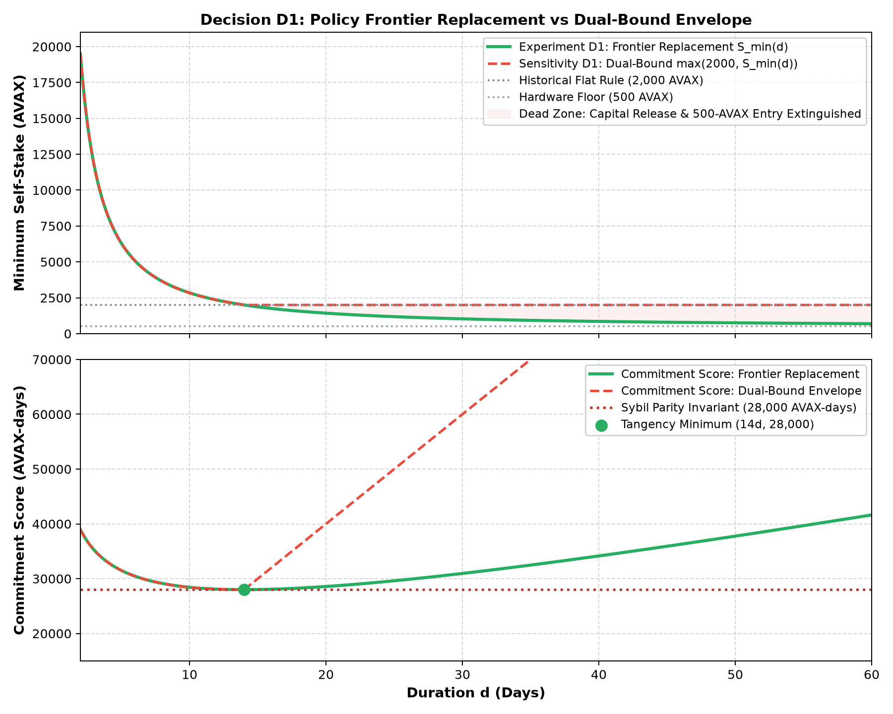
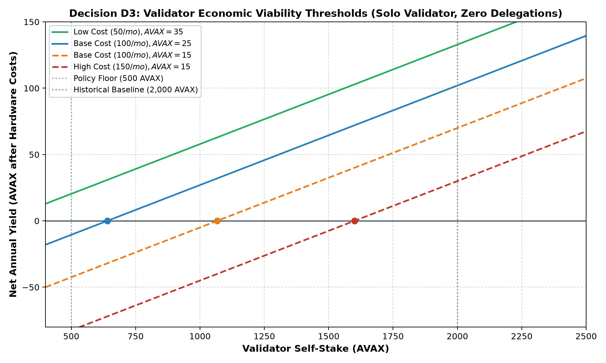
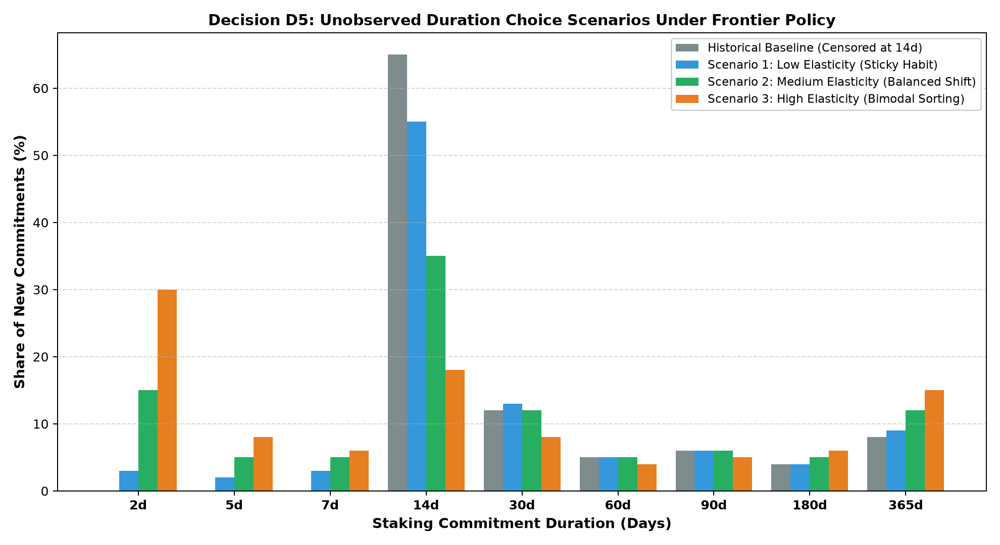
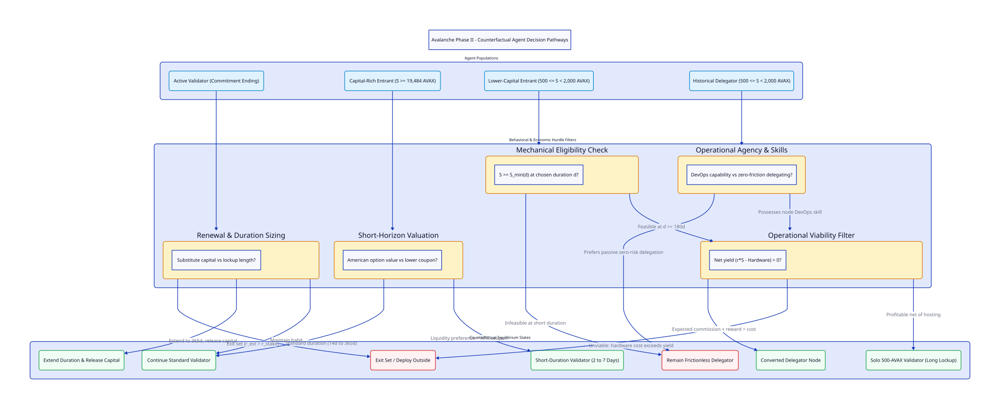

# Counterfactual Experiment Specification: Resolving Decisions D1–D5

## Abstract

This document formalizes the research design for estimating the behavioral counterfactual of the Avalanche validator set under a duration-dependent admission frontier. It resolves the five core architectural decisions (D1–D5): defining frontier replacement versus dual-bound sensitivity, formalizing historical schedule constraints (Experiment A) versus Genesis availability (Experiment B), establishing operator economic viability thresholds, modeling delegator conversion under delegation window and multiplier constraints, and parameterizing latent duration choice elasticity. All historical protocol upgrade parameters are verified against the canonical repository codebase and AvalancheGo consensus implementations.

---

## 1. Primary Estimand

The objective of this research is to estimate the positive behavioral counterfactual vector $\Delta_t$:

$$\Delta_t = \mathbb{E}\left[ Y_t(\text{Frontier}) - Y_t(\text{StatusQuo}) \mid \mathcal{F}_{t_0} \right]$$

where $Y_t$ represents the vector of realized on-chain equilibrium outcomes at time $t$, conditioned on pre-intervention history $\mathcal{F}_{t_0}$ up to origin date $t_0$:

1. **Active Validator Population $N_{\text{val}}(t)$**: The count of concurrent active validator nodes on the Primary Network.
2. **Total Staked Capital $S_{\text{tot}}(t)$**: Aggregate AVAX locked in validation.
3. **Stake Concentration $\text{HHI}(t)$**: Herfindahl-Hirschman Index across distinct node stakes and identified operator clusters.
4. **Duration Choice Distribution $\pi_t(d)$**: The density of commitment lengths across discrete bins ($d \in [2, 14)$, $[14, 30)$, $[30, 90)$, $[90, 180)$, $[180, 365]$ days).
5. **Stake-Weighted Duration $D_w(t)$**: $\sum_i S_i d_i / \sum_i S_i$, measuring the capital-time commitment of the network.
6. **Renewal Rate $\rho_{\text{renew}}(t)$**: The fraction of expiring commitments that re-stake on the same node within seven days.
7. **Annualized Network Issuance $I(t)$**: Realized AVAX minting rate under the applicable reward schedule.

This study does not estimate whether the frontier is socially optimal or whether $28{,}000\text{ AVAX-days}$ is an adequate security barrier. It estimates the magnitude and direction of agent substitution across capital and lockup duration.

---

## 2. Counterfactual Experiment Definitions

```
+---------------------------------------------------------------------------------------------------+
| Baseline: Status Quo Historical Execution                                                         |
| - Flat minimum self-stake: S_min = 2,000 AVAX across all permitted durations.                    |
| - Duration bounds: d in [14, 365] days until Helicon (2026-09-22); d in [2, 365] days thereafter.  |
| - Historical macro environment, AVAX spot prices, DeFi yields, and upgrade dates preserved.        |
+---------------------------------------------------------------------------------------------------+
                                                  |
                 +--------------------------------+--------------------------------+
                 |                                                                 |
                 v                                                                 v
+--------------------------------------------------+ +----------------------------------------------+
| Experiment A (Primary Counterfactual)            | | Experiment B (Joint Policy Hypothetical)     |
| - Policy: Frontier Replacement S_min(d).         | | - Policy: Frontier Replacement S_min(d).     |
| - Duration Bounds: Follows actual history.       | | - Duration Bounds: d in [2, 365] days from   |
|   * Genesis to Helicon: d in [14, 365] days.     | |   Genesis onward (2020 to present).          |
|   * Post-Helicon: d in [2, 365] days.            | | - Label: Joint intervention (changes         |
| - Label: Pure admission-rule substitution under   | |   admission rule AND duration consensus      |
|   the actual historical protocol schedule.       | |   rules simultaneously).                     |
+--------------------------------------------------+ +----------------------------------------------+
```

---

## 3. Decision D1: Specification of the Admission Rule

### Primary Rule: Frontier Replacement
For any duration $d$ legally permitted at time $t$, the minimum self-stake required to register a validator is governed by the Bounded Harmonic Frontier:

$$S_{\text{effective}}(d, t) = S_{\min}(d) = S_{\text{floor}} + (S_{\text{anchor}} - S_{\text{floor}}) \left[ \frac{\eta(d)}{\eta(14)} \right]^p$$

with $S_{\text{floor}} = 500\text{ AVAX}$, $S_{\text{anchor}} = 2{,}000\text{ AVAX}$, $d_{\text{anchor}} = 14\text{ days}$, $d_{\max} = 365\text{ days}$, and $p = \frac{468}{365} \approx 1.28219$.

### Sensitivity Rule: Dual-Bound Envelope
To test the effect of preserving the historical 2,000 AVAX floor, we evaluate the dual-bound alternative:

$$S_{\text{dual}}(d, t) = \max\left\{ S_{\text{protocol,min}}(t), S_{\min}(d) \right\} = \max\left\{ 2{,}000, S_{\min}(d) \right\}$$

### The "Dead Zone" Analysis
Under the dual-bound envelope, the effective requirement collapses to:
- For $d < 14\text{ days}$: $S_{\text{dual}}(d) = S_{\min}(d)$ (requiring up to $19{,}484\text{ AVAX}$ at 2 days).
- For $d \ge 14\text{ days}$: $S_{\text{dual}}(d) \equiv 2{,}000\text{ AVAX}$ identically.



Retaining the 2,000 AVAX floor extinguishes two primary behavioral mechanisms:
1. **Capital Release (Mechanism 2)**: An existing validator committing for 365 days cannot release $1{,}500\text{ AVAX}$; it must continue locking $2{,}000\text{ AVAX}$.
2. **Lower-Capital Entry (Mechanism 3)**: Independent operators with capital between 500 and 1,999 AVAX remain mechanically barred from entering the validator set.

### Self-Stake vs. Delegated Stake
$S_{\min}(d)$ applies strictly to the validator's **self-stake** (bonded operator collateral). It does not alter the delegator minimum stake ($25\text{ AVAX}$). Delegations add weight to the validator up to the protocol's delegation capacity multiplier.

---

## 4. Decision D2: Verified Protocol Parameter Timeline

All consensus rules, upgrade timestamps, and parameter boundaries are verified against `src/avalanche_research/domain/protocol/__init__.py`:

| Protocol Upgrade | Activation (UTC) | Validator Duration $[d_{\min}, d_{\max}]$ | Delegator Duration $[d_{\min}, d_{\max}]$ | Min Self-Stake | Min Delegator Stake | Delegation Multiplier | Uptime Req. | Reward Schedule Consumption Rate |
| :--- | :--- | :--- | :--- | :--- | :--- | :--- | :--- | :--- |
| **Genesis (Mainnet)** | 2020-09-21 21:00 | $[14, 365]\text{ days}$ | $[14, 365]\text{ days}$ | $2{,}000\text{ AVAX}$ | $25\text{ AVAX}$ | $4\times$ ($5\times$ total weight) | $80\%$ | $[10.0\%, 12.0\%]$ |
| **Apricot Phases 1–6** | 2021-03-31 to 2022-09-07 | $[14, 365]\text{ days}$ | $[14, 365]\text{ days}$ | $2{,}000\text{ AVAX}$ | $25\text{ AVAX}$ | $4\times$ | $80\%$ | $[10.0\%, 12.0\%]$ |
| **Banff** | 2022-10-18 16:00 | $[14, 365]\text{ days}$ | $[14, 365]\text{ days}$ | $2{,}000\text{ AVAX}$ | $25\text{ AVAX}$ | $4\times$ | $80\%$ | $[10.0\%, 12.0\%]$ |
| **Cortina** | 2023-04-25 15:00 | $[14, 365]\text{ days}$ | $[14, 365]\text{ days}$ | $2{,}000\text{ AVAX}$ | $25\text{ AVAX}$ | $4\times$ (Fee deferred to end) | $80\%$ | $[10.0\%, 12.0\%]$ |
| **Durango (ACP-41/62)** | 2024-03-06 16:00 | $[14, 365]\text{ days}$ | $[14, 365]\text{ days}$ | $2{,}000\text{ AVAX}$ | $25\text{ AVAX}$ | $4\times$ (Pending stakers removed) | $80\%$ | $[10.0\%, 12.0\%]$ |
| **Etna (ACP-77/103)** | 2024-12-16 17:00 | $[14, 365]\text{ days}$ | $[14, 365]\text{ days}$ | $2{,}000\text{ AVAX}$ | $25\text{ AVAX}$ | $4\times$ (Subnets decouple) | $80\%$ | $[10.0\%, 12.0\%]$ |
| **Fortuna** | 2025-04-08 15:00 | $[14, 365]\text{ days}$ | $[14, 365]\text{ days}$ | $2{,}000\text{ AVAX}$ | $25\text{ AVAX}$ | $4\times$ | $80\%$ | $[10.0\%, 12.0\%]$ |
| **Granite (Lockbox)** | 2025-11-19 16:00 | $[14, 365]\text{ days}$ | $[14, 365]\text{ days}$ | $2{,}000\text{ AVAX}$ | $25\text{ AVAX}$ | $4\times$ | $80\%$ | $[10.0\%, 12.0\%]$ |
| **Helicon (ACP-273/285)** | 2026-09-22 15:00 | $[2, 365]\text{ days}$ ($48\text{ hrs}$) | $[14, 365]\text{ days}$ | $2{,}000\text{ AVAX}$ | $25\text{ AVAX}$ | $4\times$ (Auto-renew ACP-236) | $90\%$ (ACP-267) | $[7.5\%, 12.0\%]$ ($90\text{d}$ ramp) |

---

## 5. Decision D3: Operator Economic Viability

A minimum self-stake of 500 AVAX defines mechanical feasibility, not economic viability. Operating a Primary Network node incurs fixed operational costs (cloud VPS or hardware hosting, monitoring, RPC bandwidth).

### Net Economic Profit Equation
The net annual return $\Pi_{\text{val}}$ for a validator operating with self-stake $S_{\text{self}}$ and delegated stake $S_{\text{del}}$ is:

$$\Pi_{\text{val}} = \left[ r(d) \cdot S_{\text{self}} + f_{\text{fee}} \cdot r(d) \cdot S_{\text{del}} \right] P_{\text{AVAX}} - C_{\text{hardware}}$$

where $r(d)$ is the annualized staking reward rate, $f_{\text{fee}} \in [0.02, 1.0]$ is the validator's delegation fee rate, $P_{\text{AVAX}}$ is the spot price of AVAX in USD, and $C_{\text{hardware}}$ is the annual operational cost in USD.

### Breakeven Threshold for Solo Validators
For a solo validator with zero delegations ($S_{\text{del}} = 0$):

$$S_{\text{breakeven}} = \frac{C_{\text{hardware}}}{r(d) \cdot P_{\text{AVAX}}}$$



### Viability Scenarios across Capital Tiers
1. **Low Hosting Cost ($50/mo, $600/yr), AVAX = $35, APR = 7.5%**:
   $S_{\text{breakeven}} = 228.6\text{ AVAX}$. A 500 AVAX solo validator earns $37.5\text{ AVAX}$ ($1,312.50$), netting $+\$712.50/yr$. Viable.
2. **Standard Cloud VPS ($100/mo, $1,200/yr), AVAX = $25, APR = 7.5%**:
   $S_{\text{breakeven}} = 640.0\text{ AVAX}$. A 500 AVAX solo validator nets a loss of $-\$262.50/yr$. Unviable without external delegation.
3. **High Reliability / Enterprise Hosting ($150/mo, $1,800/yr), AVAX = $15, APR = 7.5%**:
   $S_{\text{breakeven}} = 1,600.0\text{ AVAX}$. Validators staking under 1,600 AVAX operate at an annual financial loss.

Viability cannot be assumed from stake size alone; it is parameterized across labelled cost scenarios $\{ \$50/\text{mo}, \$100/\text{mo}, \$150/\text{mo} \}$.

---

## 6. Decision D4: Delegators and Delegation Capacity

Historical `AddDelegatorTx` records in `derived.staking-periods` reflect capital allocated to passive staking. To model delegator conversion, the counterfactual decomposes conversion into four sequential hurdles:

```
[Hurdle 1: Mechanical Eligibility]
Does delegator balance S_del satisfy S_del >= S_min(d) for some permitted d?
  |-- NO  --> Remains Delegator
  +-- YES --> Evaluate Hurdle 2

[Hurdle 2: Economic Viability]
Does expected net validator yield exceed net passive delegation yield?
  Net Val Yield = (r*S_del + Fee_Rev)*P_AVAX - C_hw
  Net Del Yield = r*S_del*(1 - Fee_Rate)*P_AVAX
  |-- NO  --> Remains Delegator (Frictionless yield is higher)
  +-- YES --> Evaluate Hurdle 3

[Hurdle 3: Operational Agency & Willingness]
Does the agent have the technical ability to maintain 80%/90% uptime?
  |-- NO  --> Remains Delegator (Avoids slashing / zero-reward penalty)
  +-- YES --> Evaluate Hurdle 4

[Hurdle 4: Delegation Capacity & External Capture]
Can the converted node attract third-party delegations?
  Cap = 4 * S_del (ACP-247 multiplier = 4)
  Delegation window must fit strictly within validator start and end times.
```

### Delegation Window Restrictions
Under PlatformVM consensus rules, a delegation transaction `AddPermissionlessDelegatorTx` is rejected unless:
$$t_{\text{start, val}} \le t_{\text{start, del}} < t_{\text{end, del}} \le t_{\text{end, val}}$$
Short-duration validators ($d < 14\text{ days}$) cannot accept standard delegations, because the delegator minimum duration remained 14 days even after Helicon.

---

## 7. Decision D5: Latent Duration Preference Scenarios

Under Durango and Fortuna, 65% of validator commitments were exactly 14 days. Because 14 days was the legal floor, this concentration reflects boundary censoring.

We specify three discrete choice elasticity scenarios:



1. **Scenario 1: Low Elasticity (Sticky Habit)**
   - Validators face high operational inertia. 55% of commitments remain at 14 days. Only 3% of capital-rich nodes migrate to 48-hour staking, and 9% migrate to 365 days.
2. **Scenario 2: Medium Elasticity (Balanced Shift)**
   - Moderate liquidity sensitivity. 15% of commitments shift to 2-day staking; 12% shift to 365 days. The 14-day share declines to 35%.
3. **Scenario 3: High Elasticity (Bimodal Sorting)**
   - Strong economic sorting. 30% of commitments migrate to 48-hour staking (high-capital nodes maximizing liquidity option value), while 15% lock for 365 days to minimize capital requirements. The 14-day middle collapses to 18%.

---

## 8. Agent-Level Decision Pathways



### Pathway 1: Expiring Validators
Expiring nodes evaluate whether to exit, renew with identical parameters, or extend duration to 365 days. If extending, they release up to $(S - 500)\text{ AVAX}$ into liquid circulation.

### Pathway 2: Capital-Rich Entrants ($S \ge 19{,}484\text{ AVAX}$)
Entrants evaluate the trade-off between the American option value of liquid capital and the lower APR of short commitments. In Experiment A, this pathway is active only post-Helicon. In Experiment B, it is active from Genesis.

### Pathway 3: Lower-Capital Entrants ($500 \le S < 2{,}000\text{ AVAX}$)
Entrants must choose long commitments ($d \ge 180\text{ to } 365\text{ days}$) to satisfy $S \ge S_{\min}(d)$. They are admitted only if they clear the hardware viability filter ($C_{\text{hardware}} \le r(d) S P_{\text{AVAX}}$).

### Pathway 4: Delegators
Delegators with balances above 500 AVAX evaluate conversion. Those lacking DevOps infrastructure or unable to cover hosting expenses remain passive delegators.

---

## 9. Identification Audit Table

| Variable / Parameter | Epistemological Status | Source / Evidence | Counterfactual Treatment |
| :--- | :--- | :--- | :--- |
| **Historical Stakes & Durations** | Observed | Primary Network PlatformVM logs | Baseline anchor; conditioning set $\mathcal{F}_{t_0}$ |
| **Upgrade Timestamps** | Observed | AvalancheGo source & consensus blocks | Exogenous timeline; fixed across baseline & counterfactuals |
| **AVAX Price & DeFi Yields** | Observed | Binance, CoinGecko, Aave historical data | Exogenous macro state; common across runs |
| **Commitment Score $C = S \cdot d$** | Derived | Arithmetic product of observed data | Evaluated against $28{,}000\text{ AVAX-days}$ threshold |
| **P-Chain Reward Counter** | Derived | Consensus supply accounting | Input to reward pricing formula |
| **Capital Release Ceiling** | Partially Identified | $\max(0, S_{\text{obs}} - 500)$ | Upper bound on capital an operator could theoretically release |
| **Delegator Balance Distribution** | Partially Identified | `AddDelegatorTx` UTXO records | Constrains candidate pool for conversion |
| **Duration Choice Elasticity** | Assumed | Nested multinomial logit structure | Swept across Low, Medium, High elasticity scenarios |
| **Hardware Hosting Cost $C_{\text{hw}}$** | Assumed | Cloud provider pricing ($50, $100, $150/mo) | Swept to establish viability bounds |
| **Latent Short-Duration Utility** | Unidentified | Pre-Helicon choices strictly censored at 14d | Cannot be estimated; mapped to sensitivity scenarios |
| **Delegator Total Wealth & Skills** | Unidentified | Unobservable from on-chain UTXOs | Bounded by sensitivity assumptions |
| **Counterfactual Active Count** | Predicted | Model simulation output | Estimated with variance-reduced keyed streams |
| **Counterfactual Stake HHI** | Predicted | Model simulation output | Compared against historical concentration |

---

## 10. Material Unresolved Questions

1. **Protocol Substitution Rule (D1)**: Will governance implement true frontier replacement or maintain a 2,000 AVAX baseline safety floor? Maintaining the floor eliminates 500 AVAX validation.
2. **Durango ACP-62 Transaction Deprecation**: In March 2024, `AddValidatorTx` was disabled in favor of `AddPermissionlessValidatorTx`. Does the admission frontier require a new transaction type or an alteration to existing verification helpers?
3. **Delegation Multiplier Future Policy (ACP-247)**: If the delegation multiplier increases from $4\times$ to $24\times$, the viability threshold for 500 AVAX validators drops by $83\%$, making small validator seats lucrative.
4. **Out-of-Sample Evaluation Lockbox**: The holdout evaluation from 2025-11-19 onward remains strictly quarantined until 2026-10-27. Pre-Helicon models cannot be tuned against Helicon's realized 48-hour choices.

---

## 11. Minimal Implementation Changes Required (Described, Not Implemented)

To execute this specification in future phases without breaking model integrity, the following codebase refactorings are required:

1. **Parameterize `FittedLifecycle` for Admission Rules**:
   Add `admission = param.ClassSelector(class_=AdmissionRule, default=ChainAdmission(), doc="Admission rule gating validator entry")` to `FittedLifecycle` in `src/avalanche_research/model/fitted_lifecycle.py`.
2. **Remove Hardcoded Invariants in `FittedLifecycle`**:
   In `FittedLifecycle.invariants` (line 248), replace:
   ```python
   ("stakes within the validator bounds", lambda s: bool(((s["stakes"] >= 2_000 * 10**9) & (s["stakes"] <= 3_000_000 * 10**9)).all()))
   ```
   with:
   ```python
   ("stakes within the validator bounds", lambda s: bool(((s["stakes"] >= self.admission.s_floor_avax * 10**9) & (s["stakes"] <= 3_000_000 * 10**9)).all()))
   ```
3. **Parameterize `Continuation` Stake Bounds**:
   In `Continuation` (`src/avalanche_research/model/fitted_blocks.py#L369-L370`), replace static class constants `MIN_STAKE_NAVAX = 2_000 * AVAX` with dynamic bounds passed from the active `AdmissionRule`.
4. **Implement Duration Choice Gating**:
   In `Continuation.durations_from_uniforms`, filter drawn duration candidates against the active protocol regime's permitted duration domain ($d \ge 14$ pre-Helicon in Experiment A).
