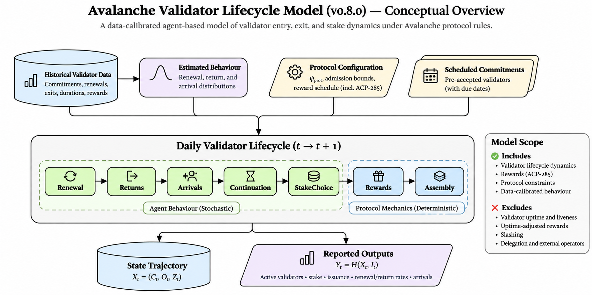
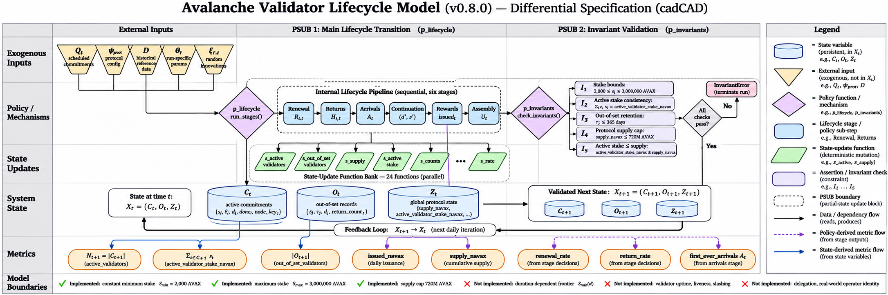
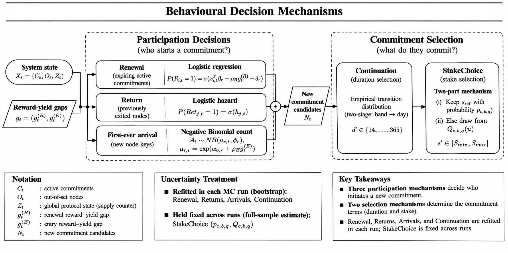

# Characterization of the Avalanche Validator Lifecycle Model (v0.8.0)
*Model Structure, State Representation, Behavioural Processes, and Modelling Boundaries*

**Document Identifier:** BCRG-AVAX-SPEC-2026-V08-CHAR  
**Model Version:** `0.8.0-candidate` (tagged specification `keyed-v1`)  
**Data Release Pin:** `data/pins/p2-model-v0.8.json` (SHA-256: `e8877bf5cbe1f45f124cd2f36993ecd1a35109eb67361634f6da31609df237c8`)  
**Evaluation Origins:** 19 Development Origins (Banff to Fortuna, 2022-07-01 to 2025-10-01)  
**Authors:** Bonding Curve Research Group (BCRG)  
**Date:** 2026-10-31  

---

## Abstract

This specification establishes the formal mathematical characterization of the Avalanche Primary Network validator lifecycle simulation model (`v0.8.0` candidate, `FittedLifecycle`). Formulated as a discrete-time stochastic dynamical system evaluated on a daily UTC step, the model micro-founds validator population dynamics through five empirical behavioral processes: penalized renewal logit, piece-wise out-of-set return hazards, overdispersed negative-binomial first-time arrivals, habit-preserving duration continuation matrices, and a two-part stake choice hurdle mechanism. Protocol accounting enforces exact integer platformvm reward arithmetic, remaining-supply headroom dynamics, and strict conservation invariants under common random numbers keyed by node identity.

---

## 2. Model Characterization

### 2.1 Overview and System Boundaries

The model simulates how the population of Avalanche Primary Network validator commitments changes over time. It does this one day at a time, rather than treating the validator economy as a single aggregate quantity.

At the beginning of each simulated day, the model has a record of the commitments that are currently active, the nodes that have recently exited, and the protocol state needed to calculate rewards. It then evaluates a sequence of behavioural decisions and protocol operations to construct the state for the following day.

The simulation is therefore a **discrete-time stochastic dynamical system**. Time advances on a daily UTC grid, with transitions evaluated at 12:00:00 UTC on each simulation day:

$$
t\in\lbrace 0,1,\ldots,T-1\rbrace
$$

The model combines two different kinds of mechanisms:

- **Behavioural policies**, which represent how validators renew, return, enter, and choose the terms of a new commitment. These are estimated from historical validator activity and contain stochastic elements.
- **Protocol mechanisms**, which apply the configured reward rules, update accounting variables, and assemble the next system state. These operations are deterministic, conditional on the decisions made by the behavioural components.

The daily lifecycle executes **six internal lifecycle stages** in strict order:

1. **Renewal (`Renewal`).** Evaluates commitments ending on day $t$; nodes decide whether to immediately renew or exit to the out-of-set population.
2. **Return (`Returns`).** Evaluates nodes currently outside the active set; eligible nodes (absent 8–365 days) face a daily empirical hazard of returning.
3. **First-ever arrival (`Arrivals`).** Generates new validator node keys entering the Primary Network for the first time via a negative-binomial arrival process.
4. **Continuation (`Continuation`).** Determines the economic terms of all starting commitments. The Continuation stage comprises two distinct behavioural components: empirical duration selection and fitted stake selection. These components are described separately in Sections 2.7 and 2.8, although they execute within the same lifecycle stage in the released implementation.
5. **Protocol reward pricing (`Rewards`).** Deterministically prices potential annualized rewards and minting liabilities for newly starting commitments under the configured protocol reward schedule.
6. **State mutation and assembly (`Assembly`).** Deterministically updates active commitments, tracks out-of-set aging, injects scheduled commitments due on day $t$, and updates the cumulative supply counter.

The decomposition into signal evaluation, behavioural policies, and protocol mechanisms is a conceptual description of the model's functional architecture. In the released implementation, the daily lifecycle stages are executed sequentially within the main lifecycle policy function rather than as separate cadCAD PSUBs.

Three qualifications are important when interpreting the released `v0.8.0` configuration.

- **The released configuration uses fixed protocol bounds.** Although the wider `v0.8` architecture supports alternative policy modules, the benchmark `v0.8.0` configuration uses a minimum stake of $S_{\min}=2{,}000$ AVAX, a maximum stake of $S_{\max}=3{,}000{,}000$ AVAX, a minimum duration of $d_{\min}=14$ days, and a maximum duration of $d_{\max}=365$ days.
- **The model tracks NodeID keys, not consolidated operators.** Each simulated node is identified by an internal key $k_i$. A real-world institution or staking provider may control several NodeIDs, and the model does not necessarily know that those keys belong to the same entity. Node-level quantities and concentration measures should therefore be interpreted at the NodeID-key level.
- **Uncertainty is handled differently across the behavioural components.** For each Monte Carlo run, the model resamples historical validator data and refits `Renewal`, `Returns`, `Arrivals`, and `Continuation`. This lets those four components vary from run to run. `StakeChoice` is treated differently: its stake-selection distributions are estimated once from the full historical dataset and then kept fixed across all runs.

These are not minor implementation details. They define what the released benchmark actually represents and what conclusions can reasonably be drawn from its outputs.

---

### 2.2 State Space and Dynamical System Formulation

The first question is: **what information must the model remember from one day to the next?**

It needs to remember which commitments are active, which nodes have recently exited but may return, and the protocol quantity that affects future reward calculations. These three pieces form the system state:

$$
X_t=(C_t,O_t,Z_t)\in\mathcal{X}
$$

The state space is:

$$
\mathcal{X}=\mathcal{C}^{\ast}\times\mathcal{O}^{\ast}\times\mathcal{Z}
$$

where:

$$
\mathcal{C}^{\ast}=\bigcup_{N=0}^{\infty}\mathcal{C}^{N},
\qquad
\mathcal{O}^{\ast}=\bigcup_{M=0}^{\infty}\mathcal{O}^{M}
$$

The star notation indicates that the collections can contain different numbers of records at different points in time. Validators can enter, renew, return, or leave, so the size of the population is not fixed.

The system state has three parts.

**1. Active commitments: $C_t$**

$$
C_t\in\mathcal{C}^{N_t},
\qquad N_t=|C_t|
$$

This is the collection of all open validator commitment records at the beginning of day $t$. Each record carries information about the commitment's stake, duration, remaining time, and the node's relevant commitment history. We define these records in Section 2.3.

**2. Nodes outside the active set: $O_t$**

$$
O_t\in\mathcal{O}^{M_t},
\qquad M_t=|O_t|
$$

This collection contains nodes whose previous commitments have ended without an immediate renewal. They are no longer active, but they have not yet been forgotten by the simulation. They remain eligible to return for up to 365 days. Their records are described in Section 2.4.

**3. Global protocol state: $Z_t$**

The global state stores the protocol variable that carries memory across days. In the released `v0.8.0` configuration, it consists of the cumulative reward-adjusted supply counter:

$$
Z_t=(S_t)
$$

Here, $S_t$ is recorded as `supply_navax` and measured in nAVAX:

$$
1\text{ AVAX}=10^9\text{ nAVAX}
$$

The important point is that the model does not need to store every reported metric as part of its internal state. It only needs to retain the variables required to calculate the next day's state. Other quantities can be calculated from that state when the daily outputs are produced.

#### Exogenous inputs and the reward-yield feedback signal

Not everything that affects the simulation is part of $X_t$. Some information is supplied to the model from outside the evolving state.

The first external input is the **scheduled commitment queue**, denoted by $Q$. It contains commitments that were already observed before the forecast origin but are scheduled to start during the simulation. The subset due on day $t$ is:

$$
Q_t=\lbrace q\in Q:t_{\text{start}}(q)=t\rbrace
$$

These commitments are not generated by the model's behavioural policies. They are predetermined inputs and are inserted when their scheduled start day arrives.

The second group of inputs consists of the **historical reference data** $D$ and the **protocol configuration** $\psi_{\text{prot}}$.

The data $D$ contain historical reference material used by the model, including benchmark reward yields, empirical duration distributions, and the fitted `StakeChoice` quantile grids. The protocol configuration $\psi_{\text{prot}}$ specifies the applicable admission bounds and reward-minting schedule.

The third quantity is different: the **reward-yield gap**, $g_t$. It is not an external input. The model calculates it from the current protocol state and the historical reference data.

At the beginning of day $t$, the protocol's offered annualized reward yield depends on the current supply counter $S_t$ and the configured reward schedule. The model compares that offered yield with the historical benchmark stored in $D$:

$$
g_t=\left(g_t^{(R)},g_t^{(E)}\right)
=G(Z_t;D,\psi_{\text{prot}})
$$

The two components are:

- $g_t^{(R)}$: the reward-yield gap used by the renewal process.
- $g_t^{(E)}$: the reward-yield gap used by the first-ever arrival process.

This creates the model's main feedback loop. The current supply state affects the reward yield offered by the protocol. The difference between that yield and the historical benchmark influences renewal and entry behaviour. Those decisions then affect future commitments and reward accounting.

For Monte Carlo run $r$, the model also uses two sources of randomness:

- $\theta_r$ is the run-specific set of behavioural parameters. It is drawn once at the start of the run through bootstrap resampling.
- $\xi_{r,t}$ contains the random innovations used to realize decisions on day $t$.

The full daily transition is therefore:

$$
X_{t+1}=F\left(X_t;Q_t,D,\psi_{\text{prot}},\theta_r,\xi_{r,t}\right)
$$

where:

- $X_t=(C_t,O_t,Z_t)\in\mathcal{X}$ is the endogenous system state.
- $U_t=(Q_t,D,\psi_{\text{prot}})$ collects the exogenous inputs: scheduled commitments $Q_t$ due on day $t$, historical reference data $D$, and the protocol parameter configuration $\psi_{\text{prot}}$.
- $\theta_r$ is the vector of run-specific parameters drawn once at the start of Monte Carlo run $r$ via bootstrap resampling.
- $\xi_{r,t}$ is the vector of step-level innovations generated deterministically on day $t$ via keyed PRNG streams.

It is useful to think of this transition as three operations performed in order:

1. **Calculate the signal.** The model uses the current protocol state to calculate the renewal and entry yield gaps, $g_t$.
2. **Generate behavioural decisions.** The fitted policies use the current active and out-of-set populations, the yield-gap signals, and random draws to determine renewals, returns, arrivals, durations, and stakes.
3. **Apply protocol rules and update the state.** The model prices potential rewards, updates the supply counter, inserts scheduled commitments, ages continuing records, and removes expired out-of-set records.

In the notation of Zhang et al. (2020), the transition can be represented schematically as:

$$
F=M\circ\pi_{\theta_r}
$$

Here, $\pi_{\theta_r}$ represents the stochastic behavioural policies, while $M$ represents the protocol and accounting mechanisms. The signal calculation $G$ supplies the feedback used by the behavioural policies.

**Figure 2.1. Conceptual overview of the Avalanche Validator Lifecycle Model (v0.8.0).** A data-calibrated agent-based model of validator entry, exit, and stake dynamics under Avalanche Primary Network protocol rules. The diagram maps system inputs (historical validator data, protocol configuration $\psi_{\text{prot}}$, and scheduled commitments $Q_t$), the daily lifecycle transition coupling stochastic agent behavioural policies (Renewal, Returns, Arrivals, Continuation, StakeChoice) with deterministic protocol mechanisms (Rewards, Assembly), the evolving state trajectory $X_t = (C_t, O_t, Z_t)$, and reported output observables $Y_t = H(X_t, I_t)$. Explicit modelling boundaries confirm that validator uptime, slashing, and delegation are excluded from the released v0.8.0 configuration.

Crucially, this decomposition into signal evaluation, behavioural policies, and protocol mechanisms is a conceptual description of the model's functional architecture. In the released implementation, the daily lifecycle stages are executed sequentially within the main lifecycle policy function (`p_lifecycle`) rather than as separate cadCAD partial-state update blocks (PSUBs). The lifecycle's `blocks()` configuration provides one main dynamic partial-state-update block containing the lifecycle policy and state-update functions, followed by a separate invariant-check block applied by the simulation engine (`checked_blocks()`).

Finally, the model produces observable daily metrics through a separate readout function:

$$
Y_t=H(X_t,I_t)
$$

The term $I_t$ (or $\Phi_t$) represents the within-day flows, including potential rewards earmarked for new endogenous commitments (`issued_navax`) and newly initiated stake. The distinction matters: $X_t$ is what the model needs to continue the simulation, while $Y_t$ is what we inspect to understand the resulting behaviour.

### 2.2.1 CadCAD Execution Architecture: PSUBs and State Updates

While the conceptual architecture separates signal evaluation, behavioural policies, and protocol mechanisms, the actual simulation software organizes execution according to cadCAD block semantics.

In the released `model-v0.8.0` implementation (`src/avalanche_research/model/fitted_lifecycle.py` and `engine.py`), each daily timestep executes exactly **two partial-state update blocks (PSUBs)**:

1. **PSUB 0: Main Lifecycle Transition (`p_lifecycle`)**
   - **Policy function**: The single policy function `p_lifecycle` constructs a `Day` context object and invokes `run_stages(stages, state, day)`.
   - **Internal lifecycle stages**: Inside `run_stages`, the six internal daily lifecycle stages execute in strict linear sequence:
     $$\text{Renewal} \rightarrow \text{Returns} \rightarrow \text{Arrivals} \rightarrow \text{Continuation} \rightarrow \text{Rewards} \rightarrow \text{Assembly}$$
     Each stage receives the pre-transition state, the `Day` context (containing keyed PRNG streams, parameter draws, yield gaps, and settings), and a mapping `earlier` containing the outputs of preceding stages. The terminal output of `assembly_stage` forms the policy signal dictionary returned by `p_lifecycle`.
   - **State-update functions**: PSUB 0 registers 24 state-update functions. In accordance with cadCAD semantics, **all 24 state-update functions evaluate on the identical pre-PSUB state snapshot** ($X_t$) and share the common policy signal dictionary returned by `p_lifecycle`. Their calculations are logically parallel rather than sequential mutations:
     - `s_copy`: Copies updated array columns for active commitments (`stakes`, `days_left`, `done`, `after_return`, `days`, `handed_on`, `returns`, `node_key`), out-of-set records (`out_stakes`, `out_days`, `out_done`, `out_last_days`, `out_returns`, `out_node_key`), and intermediate transition flows (`issued_navax`, `yield_gap_pp`, `started_stake_navax`, `started_stake_days_navax`, `offered_rate_30d`).
     - `s_supply`: Updates cumulative supply via $S_{t+1} = S_t + I_t$ (`state["supply_navax"] + signal["issued_navax"]`), reading the pre-PSUB supply $S_t$.
     - `s_count`: Updates `active_validators` from $|C_{t+1}| = \text{len}(\text{signal}["\text{stakes}"])$.
     - `s_stake`: Updates `active_validator_stake_navax` from $\sum_{i \in C_{t+1}} s_{i,t+1}$.
     - `s_out`: Updates `returning_nodes` from $|O_{t+1}| = \text{len}(\text{signal}["\text{out\_stakes}"])$.
     - `s_nakamoto`: Calculates `nakamoto_third_nodes` from the updated active stakes and node keys.

2. **PSUB 1: Invariant Validation (`p_invariants`)**
   - **Policy function**: Appended by `checked_blocks()` in `engine.py`, the policy function `p_invariants` iterates over the model's declared invariants, asserting that each condition holds on the freshly updated state $X_{t+1}$.
   - **State-update functions**: None (`"variables": {}`). PSUB 1 mutates no state.
   - **Failure semantics**: If any invariant condition evaluates to `False`, `p_invariants` immediately raises an `InvariantError` exception, terminating the simulation run without recording corrupted data.

### 2.2.2 Invariant Validation and Conservation Laws

The simulation engine enforces five mathematical and protocol conservation invariants at the conclusion of every timestep (after PSUB 0 state updates, inside PSUB 1):

1. **Validator Stake Bounds**:
   Every active commitment must strictly respect the protocol's admission bounds:
   $$2{,}000\times 10^9\text{ nAVAX} \leq s_{i,t} \leq 3{,}000{,}000\times 10^9\text{ nAVAX}, \qquad \forall i \in C_t$$
2. **Micro-to-Macro Stake Conservation**:
   The aggregate active stake state variable must exactly equal the integer sum of individual commitment stakes:
   $$\text{active\_validator\_stake\_navax}_t = \sum_{i \in C_t} s_{i,t}$$
3. **Out-of-Set Tracking Horizon**:
   No node record may remain in the out-of-set population beyond the maximum 365-day tracking horizon:
   $$\tau_{j,t} \leq 365, \qquad \forall j \in O_t$$
4. **Protocol Supply Cap**:
   Cumulative reward-adjusted supply must never exceed the absolute maximum supply headroom of 720 million AVAX:
   $$S_t \leq S_{\text{cap}} = 720{,}000{,}000\times 10^9\text{ nAVAX}$$
5. **Stake-to-Supply Solvency**:
   Total active validator stake cannot exceed the cumulative issued supply counter:
   $$\text{active\_validator\_stake\_navax}_t \leq S_t$$

These checks verify that the discrete micro-state transitions strictly preserve protocol conservation laws at every timestep before downstream observables are stored.

**Figure 2.2. Differential specification of the Avalanche Validator Lifecycle Model (v0.8.0).** The diagram maps the model's exogenous inputs, lifecycle policy functions, state-update operations, persistent system state, observable metrics, and invariant-validation process. The main lifecycle PSUB executes six internal stages, followed by state updates; a separate invariant-validation PSUB checks the resulting candidate state. Directed edges represent data dependencies between model components. The proposed duration-dependent admission frontier is not enforced in the released v0.8.0 configuration.

---

### 2.3 Active Commitment Micro-State ($C_t$)

The model does not represent an active validator as a single number. It keeps a separate record for each active commitment. This allows two commitments with different stakes, durations, or histories to behave differently, even when they belong to the same overall validator population.

Each active commitment $i\in\lbrace 1,\ldots,N_t\rbrace$ is represented by an eight-element state tuple:

$$
 c_{i,t}=\left(
 k_i,
 s_{i,t},
 d_{i,t},
 \ell_{i,t},
 n_{i,t},
 a_{i,t},
 r_{i,t},
 h_{i,t}
 \right)\in\mathcal{C}
$$

The tuple records the node's identity key, the economic terms of its current commitment, and the historical information needed by later decisions.

| Variable | Domain | What it records |
|---|---|---|
| $k_i$ | $\mathcal{K}$ | Internal simulated node key, representing a distinct NodeID key. Multiple active records may share a key if a pre-origin scheduled commitment overlaps with an existing commitment. |
| $s_{i,t}$ | $\mathbb{Z}_{+}$ | Stake committed, measured in nAVAX. |
| $d_{i,t}$ | $\lbrace 14,\ldots,365\rbrace$ | Total contracted duration, measured in integer days. |
| $\ell_{i,t}$ | $\lbrace 1,\ldots,365\rbrace$ | Number of days remaining before the commitment expires, measured at the beginning of day $t$. |
| $n_{i,t}$ | $\mathbb{Z}_{\geq0}$ | Number of commitments completed by this node before the current commitment began. |
| $a_{i,t}$ | $\lbrace 0,1\rbrace$ | Indicates whether the current commitment began after a return from the out-of-set population. It is 1 for a return after an absence exceeding seven days, and 0 for a first-ever entry or immediate renewal. |
| $r_{i,t}$ | $\mathbb{Z}_{\geq0}$ | Cumulative number of return episodes recorded for this node key. |
| $h_{i,t}$ | $\lbrace 0,1\rbrace$ | Indicates whether the commitment came from information already known before the forecast origin. It is 1 for records originating in $C_0$ or the scheduled queue $Q$, and 0 for commitments generated endogenously during the simulation. |

Three variables deserve particular attention because they describe different aspects of the node's history:

- **Completed commitments, $n_{i,t}$.** This counts commitments completed before the current one began. It is a measure of the node's prior commitment history, not a count that includes the current open commitment.
- **Prior absence, $a_{i,t}$.** This tells the model whether the current commitment began after the node had left the active set and later returned.
- **Return count, $r_{i,t}$.** This records how many return episodes the node has experienced over its simulated history.

These variables are not interchangeable. One describes how much commitment history a node has, one describes how the current commitment started, and one records how often the node has returned after an exit.

The lineage flag $h_{i,t}$ serves a different purpose. It distinguishes commitments inherited from pre-origin information from commitments created by the simulation itself. This is useful when the model handles scheduled commitments and endogenous starts differently.

---

### 2.4 Out-of-Set Population Micro-State ($O_t$)

What happens when a commitment expires and the node does not renew?

The model does not immediately delete that node. It moves the node into a second collection, $O_t$, which represents validators currently outside the active set but still eligible to return. This is important because leaving the active set is not necessarily the same as leaving the validator population permanently.

Each out-of-set record $j\in\lbrace 1,\ldots,M_t\rbrace$ is represented by a six-element tuple:

$$
o_{j,t}=\left(
 k_j,
 s^{\text{out}}_{j,t},
 \tau_{j,t},
 n^{\text{out}}_{j,t},
 d^{\text{last}}_{j,t},
 r^{\text{out}}_{j,t}
\right)\in\mathcal{O}
$$

The record preserves the node's key, its last stake, how long it has been away, and the relevant parts of its commitment history.

| Variable | Domain | What it records |
|---|---|---|
| $k_j$ | $\mathcal{K}$ | Internal simulated key of the exited node. |
| $s^{\text{out}}_{j,t}$ | $\mathbb{Z}_{+}$ | Stake, in nAVAX, associated with the node's most recent completed commitment. |
| $\tau_{j,t}$ | $\lbrace 1,\ldots,365\rbrace$ | Number of days elapsed since the last commitment expired. |
| $n^{\text{out}}_{j,t}$ | $\mathbb{Z}_{+}$ | Total number of commitments completed by the node at the time of exit, including the commitment that just expired. |
| $d^{\text{last}}_{j,t}$ | $\mathbb{Z}_{+}$ | Duration, in days, of the node's most recent completed commitment. |
| $r^{\text{out}}_{j,t}$ | $\mathbb{Z}_{\geq0}$ | Number of return episodes recorded before the current exit. |

The elapsed-time variable $\tau_{j,t}$ is especially important. It tells the return process how long a node has been outside the active set. The model tracks an out-of-set node for a maximum period of 365 days. After that window, a node that has not returned is removed from the collection.

The stated pruning condition in the model description is:

$$
\tau_{j,t}\gt 365
\quad\Longrightarrow\quad
o_{j,t}\notin O_{t+1}
$$

This gives the simulation a way to distinguish temporary inactivity from a longer-term exit. A node can leave the active set today and still reappear later, provided it returns within the model's eligibility window.

---

### 2.5 Initial Conditions, Scheduled Commitments, and Historical Reference Data

Before the first simulated day, the model needs to construct a starting population and load the historical information that its behavioural policies will use.

It is helpful to separate these into two groups: **the initial conditions**, which describe the system at the forecast origin, and **the fixed inputs**, which guide the simulation after it begins.

The initialization has five parts.

**1. Initial active population ($C_0$)**

The model loads every validator commitment active at 12:00:00 UTC on the forecast origin date. Each record receives its historical counters:

$$
(n_{i,0},a_{i,0},r_{i,0})
$$

Because these records existed before the simulation began, they are marked with:

$$
h_{i,0}=1
$$

**2. Initial out-of-set population ($O_0$)**

The model also loads historical validators whose most recent commitment expired during the 365 days before the forecast origin and who had not returned by $t=0$.

Their elapsed absence is initialized as:

$$
\tau_{j,0}\in\lbrace 1,\ldots,365\rbrace
$$

This means the simulation begins with a record not only of currently active validators, but also of recently exited nodes that may return.

**3. Initial supply counter ($Z_0$)**

The global protocol state begins with the historical reward-adjusted supply at the forecast origin:

$$
Z_0=(S_0)
$$

The counter $S_0$ is stored in nAVAX.

**4. Pre-origin scheduled commitment queue ($Q$)**

Some commitments were already registered before the forecast origin but are scheduled to begin later. They are collected in the fixed queue:

$$
Q=\bigcup_{t\geq0}Q_t
$$

Each queued commitment carries its accepted stake, duration, history counters, and node key. It is inserted into the active population on its scheduled start day. Since it was accepted before the simulation origin, it is not treated as a new behavioural decision generated by the model.

**5. Historical reference data ($D$)**

Finally, the model loads empirical information constructed from the historical training window before the forecast origin. This includes:

- Node-level bootstrap pools containing historical commitment transitions. These are used to construct the run-specific behavioural parameters $\theta_r$.
- Historical benchmark reward-yield series, used to calculate the daily yield gaps $g_t$.
- Empirical duration-transition matrices and within-band duration distributions, used by `Continuation`.
- The fitted `StakeChoice` keep probabilities and nine-knot conditional log-ratio quantile grids.

The distinction is straightforward: $C_0$, $O_0$, and $S_0$ describe where the simulation starts; $Q$ and $D$ provide information that the simulation uses as it moves forward. These inputs are not themselves evolving agent populations.

---

### 2.6 Daily Transition Pipeline and Behavioural Policies

Every simulated day follows the same sequence of six internal lifecycle stages. The order matters because each stage uses information produced by the stages before it:

$$
\text{Renewal} \rightarrow \text{Returns} \rightarrow \text{Arrivals} \rightarrow \text{Continuation} \rightarrow \text{Rewards} \rightarrow \text{Assembly}
$$

The first three stages determine **which nodes start a new commitment**. The Continuation stage determines **the terms of that commitment**. The Continuation stage comprises two distinct behavioural components: empirical duration selection and fitted stake selection. These components are described separately in Sections 2.7 and 2.8, although they execute within the same lifecycle stage in the released implementation. Rewards then calculates the potential reward associated with endogenous starts. Assembly finally updates the active and out-of-set populations to create the next day's state.

This ordering separates participation decisions from contract-attribute choices and protocol accounting. The details of each stage follow.

*Figure 2.3: Flowchart of behavioural decision mechanisms in model v0.8.0, distinguishing participation decisions (Renewal, Returns, Arrivals) from commitment selection (Continuation, StakeChoice).*

#### 2.6.1 Renewal at Commitment Expiry (`Renewal`)

The renewal process only evaluates commitments that are about to expire. Let the set of commitments expiring on day $t$ be:

$$
\mathcal{E}_t=\lbrace i\in C_t:\ell_{i,t}=1\rbrace
$$

Each eligible commitment receives a binary renewal decision:

$$
R_{i,t}\in\lbrace 0,1\rbrace
$$

A value of $R_{i,t}=1$ means the node renews immediately. A value of $R_{i,t}=0$ means the commitment ends and the node moves into the out-of-set population.

The model does not assign the same renewal probability to every validator. It uses a logistic regression policy that takes the node's commitment history and current commitment attributes into account, together with the daily renewal yield gap:

$$
P(R_{i,t}=1\mid c_{i,t},g_t^{(R)},\theta_r) = \sigma\left( x_{i,t}^{\top}\beta_r + \rho_Rg_t^{(R)} + \delta_r \right)
$$

Here:

- $\sigma(z)=(1+e^{-z})^{-1}$ is the logistic function, which maps any real-valued input to a probability between 0 and 1.
- $x_{i,t}=f(n_{i,t},a_{i,t},d_{i,t},s_{i,t})$ is the feature vector built from the node's tenure bins ($n_{i,t} \in \{0, 1, 2-5, 6-8, 9+\}$), prior-absence indicator ($a_{i,t}$), duration bins (21–40, 41–100, >100 days), and stake bands (2.1k–100k, 100k–1M, >1M AVAX). In the released `v0.8.0` configuration (`v0.8-a stake return u`), the node's own historical renewal-record term (`node_record`) is disabled (held at zero) based on empirical model-selection scoring.
- $\beta_r$ contains the fitted regression coefficients for Monte Carlo run $r$.
- $g_t^{(R)}$ is the renewal yield gap on day $t$.
- $\rho_R$ controls how strongly that gap affects the renewal decision.
- $\delta_r$ is a run-level random intercept.

The logistic model produces a probability, not the final decision. The model then draws a uniform random number:

$$
u^{\text{ren}}_{i,t}\sim\mathrm{Uniform}(0,1)
$$

The node renews if this draw is below the estimated probability:

$$
u^{\text{ren}}_{i,t} \lt P(R_{i,t}=1\mid c_{i,t},g_t^{(R)},\theta_r)
$$

This is how the fitted renewal policy becomes a stochastic decision in an individual simulation run.

**A timing distinction between the historical data and the simulation**

The historical dataset classifies a new commitment by the gap between the previous commitment's expiry and the new commitment's start:

- A new commitment beginning within 0–7 days is classified as a renewal, with $a=0$.
- A new commitment beginning eight or more days later is classified as a return, with $a=1$.

The simulation simplifies the first category. If a node renews, its new commitment starts immediately on the day of expiry. In effect, the model represents the historical 0–7 day renewal window as a zero-day transition.

If a node does not renew, it moves into $O_t$. The return hazard is then forced to zero during the first seven days outside the active set:

$$
1\leq\tau_{j,t}\leq7
\quad\Longrightarrow\quad
h_{j,t}=0
$$

This prevents the model from counting an early post-expiry re-entry as a return when the historical classification would treat it as a renewal.

#### 2.6.2 Return from the Out-of-Set Population (`Returns`)

The return process asks a different question from renewal: **once a node has left the active set, does it come back later?**

Each node $j\in O_t$ receives a daily binary return decision:

$$
\mathrm{Ret}_{j,t}\in\lbrace 0,1\rbrace
$$

The probability of returning is a discrete-time logistic hazard:

$$
h_{j,t}=P(\mathrm{Ret}_{j,t}=1\mid o_{j,t},\theta_r)
$$

The hazard depends on how long the node has been away, the stake it had in its last commitment, and two indicators describing its commitment history. It is defined piecewise:

$$
h_{j,t}=\begin{cases}
0, & 1\leq\tau_{j,t}\leq7,\\
\sigma\left(\begin{aligned}
&\gamma_{0,r}
+\gamma_{\text{day},r}(b_\tau(\tau_{j,t}))\\
&+\gamma_{\text{stake},r}(b_s(s^{\text{out}}_{j,t}))\\
&+\gamma_{\text{ret},r}\mathbf{1}_{\lbrace r^{\text{out}}_{j,t}\gt 0\rbrace}\\
&+\gamma_{\text{first},r}\mathbf{1}_{\lbrace n^{\text{out}}_{j,t}=1\rbrace}
\end{aligned}\right), & 8\leq\tau_{j,t}\leq365.
\end{cases}
$$

The terms in the equation describe:

- $\gamma_{0,r}$: the run-specific baseline hazard.
- $b_\tau(\tau_{j,t})$: the category containing the number of days the node has been out of the active set. The model uses six day-out categories.
- $\gamma_{\text{day},r}(\cdot)$: the coefficients associated with those duration-out categories.
- $b_s(s^{\text{out}}_{j,t})$: the stake band containing the node's last active stake.
- $\gamma_{\text{stake},r}(\cdot)$: the coefficients associated with the last-stake bands.
- $\mathbf{1}_{\lbrace r^{\text{out}}_{j,t}\gt 0\rbrace}$: an indicator that the node has returned at least once before.
- $\mathbf{1}_{\lbrace n^{\text{out}}_{j,t}=1\rbrace}$: an indicator that the node left after completing only its first commitment.

As with renewal, the hazard gives a probability. A keyed uniform draw determines whether the return actually occurs:

$$
u^{\text{ret}}_{j,t}\sim\mathrm{Uniform}(0,1)
$$

The node returns when:

$$
u^{\text{ret}}_{j,t}\lt h_{j,t}
$$

The important distinction is that return behaviour is based on the node's own history and time spent outside the active set. In this specification, it does not respond directly to the reward-yield gap.

#### 2.6.3 First-Ever Arrivals (`Arrivals`)

Renewals and returns involve nodes that already have a history in the model. First-ever arrivals are different: they represent new node keys with no previous commitment record.

Let $A_t$ be the number of new node keys entering for the first time on day $t$. The model generates this count using an overdispersed Negative Binomial daily count model. The expected arrival rate on day $t$ scales with the entry yield gap and is capped at 100 nodes per day:

$$
\mu_{r,t}=\min\left(100.0,\bar{\lambda}_{0,r}\exp\left(\rho_Eg_t^{(E)}\right)\right)
$$

The realized daily count is drawn via quantile inversion:

$$
A_t\sim\mathrm{NegBin}(\mu_{r,t},\phi_r)
$$

with conditional variance:

$$
\operatorname{Var}(A_t)=\mu_{r,t}+\frac{\mu_{r,t}^2}{\phi_r}
$$

where:

- $\bar{\lambda}_{0,r}$ is the run-specific baseline mean daily arrival count (capped at 100.0).
- $g_t^{(E)}$ is the entry reward-yield gap on day $t$.
- $\rho_E$ is the entry yield response elasticity.
- $\phi_r \in [10^{-3}, 10^6]$ is the run-specific dispersion parameter. In the Poisson limit ($\phi_r \to 10^6$), the variance matches the mean.

The use of a Negative Binomial distribution allows the daily count to vary more than a simple Poisson process would when the data exhibit overdispersion.

If the realized count is $A_t$, the model creates that many new node keys:

$$
\lbrace k_{\text{new},1},\ldots,k_{\text{new},A_t}\rbrace
$$

Each new key begins with no previous commitment history. It is then passed to the same duration and stake-selection stages used by renewals and returns, although its conditioning information is different because it has no previous commitment to reference.

---

### 2.7 Selection of Subsequent Commitment Durations (`Continuation`)

Once the model has determined that a node will start a new commitment, it must decide how long that commitment will last. This is the job of `Continuation`.

The duration is selected for all three endogenous start types:

- A renewal, where $c=\text{renewal}$.
- A return, where $c=\text{return}$.
- A first-ever entry, where $c=\text{entry}$.

The selected duration is an integer number of days within the allowed range:

$$
d'\in[d_{\min},d_{\max}]=\lbrace 14,\ldots,365\rbrace
$$

The model uses an empirical transition distribution rather than assigning every new commitment the same duration or drawing duration from a single unconditional distribution.

For a renewal or return, the model looks at the duration of the node's previous commitment:

- For a renewal, the previous duration is $d_{i,t}$.
- For a return, the previous duration is $d^{\text{last}}_{j,t}$.

That previous duration is placed into one of four bands:

$$
\mathcal{B}_{\text{cont}}=
\left\lbrace
[1,21),[21,41),[41,101),[101,366)
\right\rbrace
$$

| Band | Previous commitment duration |
|---|---|
| 1 | 1–20 days |
| 2 | 21–40 days |
| 3 | 41–100 days |
| 4 | More than 100 days |

A first-ever arrival has no previous commitment, so its previous-duration category is empty ($b_{\text{prev}}=\varnothing$). First-ever entries draw their duration directly from the empirical distribution of historical first-ever commitment durations (`first_days`), bypassing the transition table.

For renewing and returning validators, duration selection proceeds in two steps.

**Step 1: Choose a duration band.**

The model first samples the next duration band from a run-specific conditional multinomial distribution. The choice depends on the transition channel and, where available, the previous duration band:

$$
b_{\text{next}}\sim
\pi_r^{\text{band}}(b_{\text{next}}\mid c,b_{\text{prev}})
$$

**Step 2: Choose the exact number of days.**

After selecting the band, the model samples the exact integer duration from the empirical distribution of durations within that band:

$$
d'\sim\pi_r^{\text{day}}(d'\mid c,b_{\text{next}})
$$

subject to:

$$
d'\in b_{\text{next}}\cap[d_{\min},d_{\max}]
$$

This two-step procedure is useful because it preserves two features of the historical data: the relationship between a previous commitment and the next duration band, and the distribution of exact durations inside each band. The empirical duration distributions are resampled across Monte Carlo runs.

---

### 2.8 Fitted Stake-Choice Mechanism (`StakeChoice`)

After the duration has been selected, the model chooses how much stake is attached to the new commitment. This ordering is deliberate: `StakeChoice` conditions on the duration that has already been selected.

The selected pair $(d',s')$ must lie within the protocol's admissible action space:

$$
\mathcal{U}_{\text{adm}}=
\left\lbrace
(d',s')\in\mathbb{Z}_{+}\times\mathbb{Z}_{+}:
 d'\in[d_{\min},d_{\max}],\ 
 s'\in[S_{\min}(d'),S_{\max}]
\right\rbrace
$$

In the released `v0.8.0` configuration, the minimum stake does not depend on duration. It is a constant floor:

$$
S_{\min}(d')\equiv S_{\min}=2{,}000\times10^9\text{ nAVAX}
$$

This is equivalent to 2,000 AVAX. The maximum stake is:

$$
S_{\max}=3{,}000{,}000\times10^9\text{ nAVAX}
$$

or 3,000,000 AVAX.

The key idea behind `StakeChoice` is that historical stake changes have two distinct patterns. Many commitments keep exactly the same stake as before. Others change their stake, sometimes by a small amount and sometimes by a much larger amount.

A single continuous distribution would not represent the unchanged-stake cases very well. The model therefore uses a **two-part mechanism**:

1. Decide whether to keep the reference stake unchanged.
2. If the stake changes, draw the size of that change from an empirical distribution of historical log-stake ratios.

#### 2.8.1 What information does `StakeChoice` condition on?

The mechanism uses a three-part conditioning cell:

$$
(c,b,q)
$$

The three dimensions are transition type, the newly selected duration band, and (where applicable) the previous-stake band.

**1. Transition channel ($c$)**

$$
c\in\lbrace\text{renewal},\text{return},\text{entry}\rbrace
$$

This distinguishes a node renewing from one returning after an absence or entering for the first time.

**2. New duration band ($b$)**

The selected duration $d'$ is classified into one of five bands:

$$
\mathcal{B}_{\text{stake}}=
\left\lbrace
[1,21),[21,45),[45,100),[100,200),[200,366)
\right\rbrace
$$

Notice that these are not the same bands used by `Continuation`. `Continuation` uses four bands to select duration; `StakeChoice` uses five bands to condition the stake distribution. The boundaries at 45 and 200 days are specific to stake selection.

**3. Previous-stake band ($q$)**

For renewals and returns, the model classifies the reference stake into one of ten log-spaced stake bands defined by nine cutpoints spanning 2,100 to 2,000,000 AVAX (`MOVE_STAKE_EDGES`):

$$
\mathcal{Q}_{\text{stake}}=\lbrace q_0, q_1, \ldots, q_9\rbrace
$$

A first-ever arrival has no previous stake, so its previous-stake band is empty:

$$
q=\varnothing
$$

Its conditioning cell therefore reduces to $(c=\text{entry},b,\varnothing)$.

The reference stake depends on the type of start:

$$
s_{\text{ref}}=
\begin{cases}
s_{i,t}, & c=\text{renewal},\\
s^{\text{out}}_{j,t}, & c=\text{return},\\
S_{\min}, & c=\text{entry}.
\end{cases}
$$

So a renewal is compared with the node's current stake, a return is compared with its last completed stake, and a first-ever entry uses the protocol minimum as its reference.

#### 2.8.2 Part one: probability of keeping the same stake

For each conditioning cell $(c,b,q)$, the model estimates the probability that the new stake is exactly equal to the reference stake:

$$
p_{c,b,q}=
\frac{n_{\text{keep},c,b,q}+1}
{n_{\text{total},c,b,q}+2}
$$

Here, $n_{\text{keep},c,b,q}$ counts historical transitions that kept the reference stake unchanged, while $n_{\text{total},c,b,q}$ counts all observations in that cell.

The added 1 and 2 implement Laplace (add-one) smoothing on keep versus change counts.

For the conditional quantile knots $Q_{c,b,q}(u)$, the model applies a hierarchical sample fallback governed by a minimum threshold of **50 changed observations** ($N \geq 50$):
1. If the specific conditioning cell $(c, b, q)$ contains $\ge 50$ changed stake observations, the empirical log-ratio quantiles are estimated directly from that cell (`scope = "cell"`).
2. If the cell contains fewer than 50 observations, the estimation falls back to the pooled duration band $(c, b)$ if it contains $\ge 50$ changed observations (`scope = "duration"`).
3. If the duration band also has fewer than 50 observations, it falls back to the context-wide pool $c$ (`scope = "context"`).
4. If the context has no observed changes, it defaults to a point mass at zero change.

#### 2.8.3 Part two: draw a changed stake

When the model decides not to retain the reference stake, it draws the change from the historical distribution of log-stake ratios:

$$
\ln\left(\frac{s'}{s_{\text{ref}}}\right)
$$

The empirical quantile function for this distribution is denoted by $Q_{c,b,q}(u)$. It is represented through piecewise-linear interpolation across nine quantile knots:

$$
\mathcal{G}_{\text{knots}}=\lbrace 0.01,0.05,0.10,0.25,0.50,0.75,0.90,0.95,0.99\rbrace
$$

A uniform draw selects whether the reference stake is retained:

$$
v\sim\mathrm{Uniform}(0,1)
$$

If the draw falls below $p_{c,b,q}$, the model keeps the reference stake. Otherwise, it draws a quantile level $u\in(0,1)$ and applies the corresponding log-ratio change:

$$
s'=\begin{cases}
\mathrm{clip}(s_{\text{ref}},S_{\min},S_{\max}),
& v\lt p_{c,b,q},\\
\mathrm{clip}\left(
\left\lfloor s_{\text{ref}}\exp(Q_{c,b,q}(u))\right\rfloor,
S_{\min},S_{\max}\right),
& v\geq p_{c,b,q}.
\end{cases}
$$

The operations have straightforward meanings:

- The exponential converts a log-ratio back into a multiplicative change in stake.
- The floor function $\lfloor\cdot\rfloor$ converts the result to an integer number of nAVAX.
- The clipping function enforces the minimum and maximum stake bounds:

$$
\mathrm{clip}(x,a,b)=\min(\max(x,a),b)
$$

The two parts allow the model to represent both the large number of unchanged-stake observations and the distribution of stake changes among the remaining observations.

**Uncertainty treatment for `StakeChoice`**

There is one important difference between `StakeChoice` and the other fitted behavioural components. The fitted keep probabilities and quantile functions,

$$
(p_{c,b,q},Q_{c,b,q})
$$

are estimated from the full historical sample and then held fixed across all Monte Carlo runs. They are not bootstrap-resampled in the released `v0.8.0` configuration.

---

### 2.9 Protocol Reward Pricing and State Assembly (`Rewards` and `Assembly`)

After a new commitment has received its duration and stake, the model applies the protocol's reward rule. It then updates the active and out-of-set populations to create the next day's state.

These are two separate operations. `Rewards` calculates the potential reward associated with new endogenous commitments. `Assembly` updates the system's records and inserts any scheduled commitments that have become due.

#### 2.9.1 Protocol reward pricing (`Rewards`)

Let $\mathcal{N}_t$ be the set of commitments that start endogenously on day $t$:

$$
\mathcal{N}_t=
\mathcal{N}^{\text{ren}}_t
\cup\mathcal{N}^{\text{ret}}_t
\cup\mathcal{N}^{\text{arr}}_t
$$

It contains new commitments generated by renewal, return, and first-ever arrival. For each commitment $m\in\mathcal{N}_t$, the model knows its selected stake $s_{m}^{\prime}$ and duration $d_{m}^{\prime}$. The protocol reward mechanism uses these attributes, together with the current supply state and configured protocol parameters, to calculate the potential reward $I_{m,t}$ in nAVAX.

The reward is calculated against the remaining supply headroom:

$$
S_{\text{cap}}-S_t
$$

where the supply cap is:

$$
S_{\text{cap}}=720\times10^6\text{ AVAX}
=7.2\times10^{17}\text{ nAVAX}
$$

Under the Primary Network's linear consumption-rate schedule, the annualized rate associated with a commitment of duration $d_{m}^{\prime}$ is:

$$
\mathrm{rate}(d_{m}^{\prime})=
r_{\min}+(r_{\max}-r_{\min})
\frac{d_{m}^{\prime}-d_{\min}}{d_{\max}-d_{\min}}
$$

Here, $r_{\min}$ and $r_{\max}$ are the annualized minting rates at the minimum and maximum commitment durations, respectively.

The daily potential-reward flux is the sum across all endogenous starts:

$$
I_t=\sum_{m\in\mathcal{N}_t}I_{m,t}
$$

That flux updates the cumulative supply counter:

$$
S_{t+1}=S_t+I_t
$$

The model also records the stake and stake-days associated with the new endogenous commitments:

- `issued_navax` records the total potential reward associated with endogenous starts.
- `started_stake_navax` records the total stake associated with those starts.
- `started_stake_days_navax` records the sum of stake multiplied by contracted duration.

**Why scheduled commitments are treated separately**

A commitment in $Q_t$ was already accepted before the forecast origin. It is inserted into the active set during `Assembly`, but it is not counted as a new endogenous start in the `Rewards` stage.

Consequently, scheduled commitments are excluded from the daily calculations of:

- $I_t$ (`issued_navax`),
- `started_stake_navax`, and
- `started_stake_days_navax`.

Their potential rewards are treated as already accounted for in the initial supply state $S_0$. This prevents the simulation from counting pre-origin commitments a second time as new reward and stake flows.

#### 2.9.2 State mutation and counter algebra (`Assembly`)

The final stage of the daily pipeline constructs the next state:

$$
X_{t+1}=(C_{t+1},O_{t+1},Z_{t+1})
$$

Assembly does not make new behavioural choices. Instead, it takes the outcomes generated by the earlier stages and updates the records accordingly. It performs four operations:

1. Decreases the remaining duration of active commitments that continue.
2. Moves non-renewing commitments into the out-of-set population and updates the history counters of renewed or returning nodes.
3. Inserts scheduled commitments whose start date is day $t$.
4. Removes out-of-set records that have passed the 365-day eligibility window without returning.

The main state transitions are summarized below.

**Table 2.1. State transitions from day $t$ to day $t+1$**

| Transition | Where the record comes from | Where it goes | What changes |
|---|---|---|---|
| Continuing active commitment ($\ell_{i,t}\gt 1$) | $C_t$ | $C_{t+1}$ | The record is retained and its remaining duration decreases by one day: $\ell_{i,t+1}=\ell_{i,t}-1$. Other listed attributes remain unchanged. |
| Immediate renewal ($\ell_{i,t}=1$, $R_{i,t}=1$) | $C_t$ | $C_{t+1}$ | The node keeps its key, starts a new commitment with selected stake and duration, increments completed tenure, and resets the return flag. |
| Expiry without renewal ($\ell_{i,t}=1$, $R_{i,t}=0$) | $C_t$ | $O_{t+1}$ | The node carries its last stake and duration into the out-of-set record; its elapsed time out begins at one day. |
| Return ($\mathrm{Ret}_{j,t}=1$) | $O_t$ | $C_{t+1}$ | The node returns with a newly selected stake and duration; its return flag is set and its return count increases by one. |
| Continuing out-of-set node ($\mathrm{Ret}_{j,t}=0$) | $O_t$ | $O_{t+1}$ | Its elapsed time outside the active set increases by one day, unless it reaches the pruning boundary. |
| Out-of-set pruning | $O_t$ | Removed | A node that has not returned by the eligibility cutoff is removed from the modelled population. |
| First-ever arrival | Newly generated key | $C_{t+1}$ | A new record is created with zero prior commitments and zero return history. |
| Scheduled queue injection | $Q_t$ | $C_{t+1}$ | The accepted stake, duration, history counters, and node key are inserted without endogenous duration or stake selection. |

For completeness, the state tuples implied by the transition rules are shown below.

**Continuing active commitment**

$$
c_{i,t+1}=(k_i,s_{i,t},d_{i,t},\ell_{i,t}-1,n_{i,t},a_{i,t},r_{i,t},h_{i,t})
$$

**Immediate renewal**

$$
c'_{i,t+1}=(k_i,s'_i,d'_i,d'_i,n_{i,t}+1,0,r_{i,t},0)
$$

**Expiry to the out-of-set population**

$$
o'_{j,t+1}=(k_i,s_{i,t},1,n_{i,t}+1,d_{i,t},r_{i,t})
$$

**Return from the out-of-set population**

$$
c'_{j,t+1}=(k_j,s'_j,d'_j,d'_j,n^{\text{out}}_{j,t},1,r^{\text{out}}_{j,t}+1,0)
$$

**Continuing out-of-set node**

$$
o_{j,t+1}=(k_j,s^{\text{out}}_{j,t},\tau_{j,t}+1,n^{\text{out}}_{j,t},d^{\text{last}}_{j,t},r^{\text{out}}_{j,t})
$$

**First-ever arrival**

$$
c'_{m,t+1}=(k_{\text{new},m},s'_m,d'_m,d'_m,0,0,0,0)
$$

**Scheduled queue injection**

$$
c_{q,t+1}=(k_q,s_q,d_q,d_q,n_q,a_q,r_q,1)
$$

The key distinction is that an endogenous start goes through the behavioural selection stages, whereas a scheduled start arrives with its accepted stake and duration already determined. Assembly updates both types of records, but it does not treat them as the same kind of event.

---

### 2.10 Stochastic Architecture, Bootstrap Resampling, and Keyed PRNG

The model contains two different sources of uncertainty. It is useful to separate them because they answer two different questions:

1. **How uncertain are the fitted behavioural rules?**
2. **Even with a particular set of fitted rules, what random decisions occur during one simulated trajectory?**

The first is run-level parameter uncertainty. The second is step-level realization noise.

#### 2.10.1 Run-level parameter uncertainty ($\theta_r$)

Before each Monte Carlo run begins, the model resamples the historical training data at the NodeID cluster level.

This means that it samples historical NodeIDs with replacement and retains each selected node's complete commitment trajectory. Keeping the full trajectory matters because commitments belonging to the same node are related over time. Resampling individual records independently would break that within-node history.

The bootstrap sample is used to refit four components:

- `Renewal`, which estimates the probability of renewing at expiry.
- `Returns`, which estimates the daily probability of returning after exit.
- `Arrivals`, which estimates the first-ever arrival process.
- `Continuation`, which estimates the empirical duration-selection distributions.

The resulting run-specific parameter vector is:

$$
\theta_r=\left(
\beta_r,
\delta_r,
\gamma_r,
\alpha_{0,r},
\phi_r,
\pi_r^{\text{band}},
\pi_r^{\text{day}}
\right)
$$

In plain terms, each Monte Carlo run gets its own fitted version of these four behavioural components, reflecting the fact that the historical sample could have looked somewhat different.

`StakeChoice` is the exception. Its keep probabilities and conditional quantile tables are estimated once from the full historical sample and held fixed across runs. Therefore, uncertainty in the fitted stake-selection distribution is not propagated in the same way as uncertainty in the other four components.

#### 2.10.2 Step-level realization noise ($\xi_{r,t}$)

Even after the parameters for a run have been fixed, the simulated path is not deterministic. On every day, the model makes random draws to realize the decisions implied by those parameters.

These draws include:

- Bernoulli outcomes for renewal decisions.
- Bernoulli outcomes for return decisions.
- Negative Binomial daily arrival counts.
- Multinomial selections of duration bands.
- Within-band duration draws.
- Uniform draws used by the two-part stake-choice mechanism.

The model generates these random values with a deterministic, stateless keyed pseudo-random number generator (PRNG). Each draw is associated with a structured key:

$$
\text{PRNG-Key}=\mathrm{Hash}\left(
\text{master-seed},r,t,\text{stage-tag},k_{\text{entity}}
\right)
$$

The key contains:

- `master_seed`: the simulation seed.
- $r$: the Monte Carlo run.
- $t$: the simulation day.
- `stage_tag`: the pipeline stage and sub-step.
- $k_{\text{entity}}$: the relevant node key or arrival index.

This design ties each random draw to a specific decision, rather than to the order in which records happen to be processed. As a result, changing the order of records in a collection does not change the random value assigned to a given keyed decision.

For matching keys, the generator produces the same innovations. This provides reproducibility and helps reduce unwanted simulation noise when comparing policy counterfactuals.

---

### 2.11 Daily Observation Map and Output Schema

The model's internal state is not the same thing as the daily report that we use to analyse the simulation. At the end of each day, the simulator applies an observation map to the updated state and the flows generated during that day:

$$
Y_t=H(X_t,I_t)
$$

The output vector $Y_t$ contains the metrics used to describe the simulated validator economy. Some are read directly from the state, while others are daily flows generated during the transition.

**Table 2.2. Daily output schema and its role in the model**

| Output variable | Role | Meaning | Source in Implementation |
|---|---|---|---|
| `supply_navax` | Global state ($Z_t$) | Cumulative reward-adjusted supply counter $S_t$, updated through $S_{t+1}=S_t+I_t$. | Pre-PSUB state $S_t$ plus transition flow `issued_navax`. |
| `active_validators` | State readout | Number of active commitment records, $N_t=\vert C_t\vert$. | Post-transition commitment count `len(signal["stakes"])`. |
| `active_validator_stake_navax` | State readout | Total stake in active commitments, $\sum_{i\in C_t}s_{i,t}$. | Sum of post-transition commitment stakes `signal["stakes"].sum()`. |
| `returning_nodes` | State readout | Number of nodes outside the active set eligible to return, $M_t=\vert O_t\vert$. | Out-of-set record count `len(signal["out_stakes"])`. |
| `nakamoto_third_nodes` | State readout | Minimum number of distinct simulated node keys whose combined stake exceeds one-third of active stake. | Calculated over post-transition `signal["stakes"]` grouped by `node_key`. |
| `issued_navax` | Daily flow ($I_t$) | Total potential rewards associated with endogenous commitments started on day $t$. | Calculated by `rewards_stage` across newly started commitments. |
| `started_stake_navax` | Daily flow | Total stake attached to endogenous commitments starting on day $t$. | Calculated by `rewards_stage` as sum of newly started stakes. |
| `started_stake_days_navax` | Daily flow | Total stake multiplied by contracted duration for endogenous starts on day $t$. | Calculated by `rewards_stage` as $\sum s'_m d'_m$. |
| `yield_gap_pp` | Diagnostic signal | Daily renewal yield gap $g_t^{(R)}$, in percentage points. | Read from `day.renewal_gap` evaluated against benchmark menu. |
| `offered_rate_30d` | Diagnostic rate | Annualized reward rate offered for a 30-day baseline stake at current supply. | Evaluated directly from protocol reward mechanism at $S_t$. |

The distinction between state and flow is important. `supply_navax` accumulates over time. `issued_navax`, by contrast, records the potential reward associated with the endogenous starts occurring on a particular day. Similarly, the two `started_stake` metrics describe new endogenous starts during that day, not the full stock of active commitments.

#### 2.11.1 How `nakamoto_third_nodes` is calculated

The concentration measure is calculated by first grouping active stake by simulated node key.

Let the set of distinct node keys represented in the active commitment collection be:

$$
\mathcal{K}_t=\lbrace k_i:i\in C_t\rbrace
$$

The active stake associated with each key $k$ is:

$$
S_{k,t}=\sum_{i\in C_t:k_i=k}s_{i,t}
$$

The model then sorts these node-key stake totals from largest to smallest:

$$
S_{(1),t}\geq S_{(2),t}\geq\cdots\geq S_{(\vert\mathcal{K}_t\vert),t}
$$

The `nakamoto_third_nodes` metric is the smallest number of node keys whose combined stake strictly exceeds one-third of total active stake:

$$
\text{nakamoto-third-nodes}_t=
\min\left\lbrace
 m:\sum_{j=1}^{m}S_{(j),t}
 \gt\frac{1}{3}\sum_{i\in C_t}s_{i,t}
\right\rbrace
$$

Two qualifications are needed when interpreting this metric.

First, `active_validators` counts active commitment records, not necessarily distinct node keys. If a node key has overlapping active commitments, the number of records can be greater than the number of unique keys:

$$
N_t=\vert C_t\vert\geq\vert\mathcal{K}_t\vert
$$

Second, `nakamoto_third_nodes` groups stake by simulated NodeID key. A real-world operator may control multiple NodeIDs, and the model does not consolidate all such keys into a single institutional entity. The metric should therefore be read as a concentration measure over simulated node keys, not as a direct measure of control by real-world operators. Under this interpretation, it is an upper bound on entity-level Nakamoto decentralization.

---

### 2.12 Scope Boundaries and Ongoing Research Extensions (`BoundedHarmonicFrontier`)

The released `v0.8.0` benchmark uses a constant minimum stake requirement across all permitted commitment durations:

$$
S_{\min}(d)\equiv2{,}000\text{ AVAX}
$$

for $d\in[14,365]$.

This means that, in the baseline model, the minimum stake required to enter is the same whether a validator chooses a short or a long commitment duration.

An ongoing BCRG research extension explores a different admission rule: the **`BoundedHarmonicFrontier`**. Instead of using one constant minimum stake, this proposed mechanism makes the required minimum stake depend on commitment duration:

$$
S_{\min}(d) = S_{\text{floor}} + (S_{\text{short}} - S_{\text{floor}})\eta(d)^p
$$

where the normalized harmonic duration is:

$$
\eta(d) = \frac{1/d - 1/d_{\max}}{1/d_{\min} - 1/d_{\max}}
$$

The intended shape imposes a higher minimum stake requirement ($S_{\text{short}}$) on short-duration commitments, with the requirement relaxing toward $S_{\text{floor}}$ as duration approaches $d_{\max}=365$ days, governed by curvature $p$.

The frontier can be explored by varying three parameters:

- $S_{\text{short}}$: the minimum stake requirement at the short-duration end.
- $S_{\text{floor}}$: the lower stake floor approached at longer durations.
- $p$: the curvature parameter controlling how the minimum stake changes with duration.

The model architecture is designed to allow alternative admissible action spaces to be evaluated. This makes it possible to study counterfactual admission rules by changing the duration-dependent minimum stake boundary.

Crucially, these two mechanisms address fundamentally different questions:
- **`StakeChoice`**: What stake levels does the behavioural model generate based on historical validator patterns?
- **Admission frontier**: What minimum stake would a proposed protocol rule require for a given commitment duration?

**The released `v0.8.0` benchmark does not activate or enforce the `BoundedHarmonicFrontier` as its admission rule.** Its baseline validation, empirical calibration, and counterfactual runs use the historical constant minimum stake of $S_{\min} \equiv 2{,}000$ AVAX across all permitted durations $d \in [14, 365]$.

The frontier must therefore be treated as an analytical protocol proposal evaluated in counterfactual experiments, not as a mechanism enforced by the released `v0.8.0` lifecycle implementation.

---
