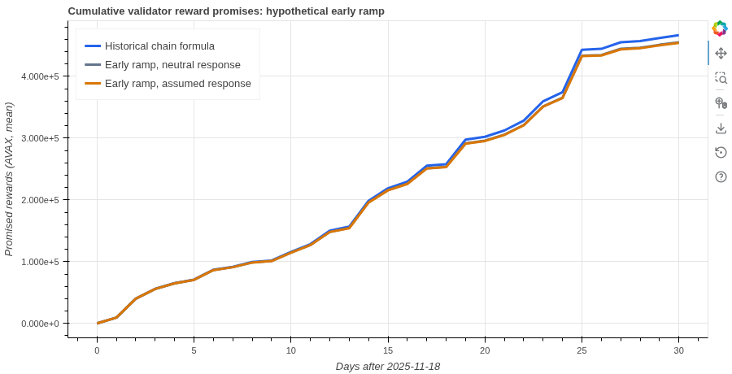

# Run a small reward comparison

This example runs model v0.8.0 on an included validator-data snapshot and compares the historical reward schedule with a hypothetical earlier reward reduction. It produces paired results, a chart and an authenticated execution record. No provider credentials or full historical dataset are needed.

## Run and inspect

Complete the [locked installation](../../SETUP.md#3-install-the-python-environment), then run from the repository root:

```sh
uv run --frozen --group model --group notebook python scripts/first_experiment.py --output release/first-experiment
uv run --frozen --group model --group notebook python scripts/first_experiment.py --output release/first-experiment --check
```

Both commands should report `status: pass`. The default result should report `matches_frozen_example_with_declared_tolerance`. The first command fits the released estimator to the included history and executes the comparison. The second authenticates the files and recomputes the summaries without fitting or simulating.

Open `release/first-experiment/figure.html` in a browser. Read `comparison.csv` for each pair, `daily.csv` for trajectories, `parameter-draws.csv` for fitted draws and `summary.json` for provenance and checks. The output directory must be new. Use `--check` to inspect an existing result.

## What the experiment fixes

| Setting | Value |
| --- | --- |
| Input population | 52,934 validator commitment records accepted by 18 November 2025 at 23:59:59 UTC |
| Supplied information | Public commitment terms, with scheduled ends retained. Realized payment, removal and later acceptance outcomes are excluded |
| Origin counter | Recorded immediately before the commitment at 23:56:46 UTC, 193 seconds before the cutoff. A complete end-of-day counter is not established |
| Reference | Historical chain reward schedule |
| Alternative | ACP-285-style ramp beginning 19 November 2025, targeting a 7.5% minimum consumption rate over 90 days |
| Assumed responses | Renewal coefficient 0.5 and entry coefficient 0.5 in the alternative. These are declared assumptions |
| Pairing | Four parameter draws and matched simulation seeds, with a neutral-response control |
| Horizon | 30 simulated days. The ramp has not finished by the end |

The minimum consumption rate is a reward-formula parameter. Annualized returns also depend on duration and the supply counter. The [modeling memo](../../docs/review/2026-10-30/modeling.md) explains that distinction and the response coefficients. [input-manifest.json](input-manifest.json) records the snapshot's selection, hashes and source identity.

## Read the result

The default comparison gives these means across the four pairs:

| Measure | Historical schedule | Earlier ramp with assumed response |
| --- | ---: | ---: |
| New validator reward promises over the horizon, AVAX | 466,777.60 | 454,387.36 |
| Final validator own stake, AVAX | 164,206,230.33 | 163,932,933.13 |

Mean paired reward saving is 12,390.24 AVAX. The mean of the four paired final-stake ratios is 0.998336824. Reward promises are the full rewards committed when new staking periods begin. They differ from rewards paid during these 30 days.



*Preview of the generated Bokeh chart. The gray control keeps reward responses at zero. Its validator-stake path must match the reference under shared draws. [Interactive chart](expected-output/figure.html), [paired table](expected-output/comparison.csv) and [preview provenance](figure-preview.json).*

These are conditional outcomes of a small, newly frozen experiment. Four pairs and one assumed response setting provide no confidence interval, policy optimum or predictive validation. The example does not reconstruct the Milestone 2 report trajectories or evaluate observed post-origin outcomes.

## Change a declared setting

Copy [config.json](config.json), edit the run count, horizon, response coefficients or ramp settings, and pass the copy with `--config PATH` and a new `--output` directory. The supported bounds are 2–8 pairs and 1–60 days. A changed design is checked against its own saved trajectories and controls, and is identified separately from the frozen default result.

Use the [research-cycle example](../research-cycle/README.md) to record a prediction before execution and attach a separate methodology reflection afterward.
