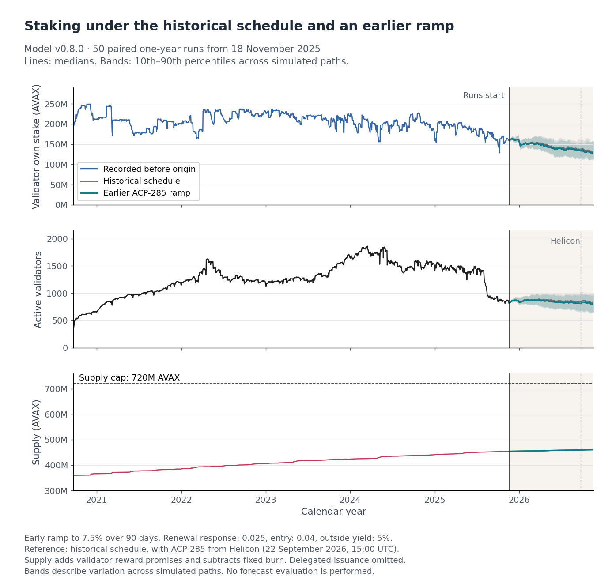

# Reproduce the central one-year result

This replay rebuilds the report's central comparison: an earlier ACP-285 ramp saves a median **12.7721% of new validator reward promises**, with **98.6901% of validator own stake retained**. It runs the original 50 paired comparisons over 365 days and checks every daily path against the stored results. The [evidence guide](../../docs/review/2026-10-30/evidence.md#central-case) explains the reported result.

## Run from a clean checkout

The replay was checked on Linux and uses a POSIX process runner. Complete the [locked installation](../../SETUP.md#3-install-the-python-environment). Install GitHub CLI if needed and run `gh auth login` with an account that can read the Foundation repository. The input download uses that GitHub access. No Snowflake or data-provider credentials are needed. [GitHub authentication](https://cli.github.com/manual/gh_auth_login).

Run from the repository root:

```sh
uv run --frozen --group model python scripts/reproduce_report.py fetch --output release/report-inputs
uv run --frozen --group model python scripts/reproduce_report.py run --inputs release/report-inputs --output release/report-result
uv run --frozen --group model python scripts/reproduce_report.py check --inputs release/report-inputs --output release/report-result
uv run --frozen --group model --group notebook python scripts/figures/central_case_reproduction.py --inputs release/report-inputs --result release/report-result --output release/report-figure
```

Each destination must be new. `fetch` downloads the 12.1 MB input archive and verifies every member. `run` prepares the tagged model, applies the original draws and executes the two formulas. `check` authenticates the saved result and recomputes the comparisons without another simulation. The final command rebuilds the three trajectory panels as PNG and SVG, with their plotted values and provenance.

## Inspect the comparison

| Paired quantity | 10th percentile | Median | 90th percentile |
| --- | ---: | ---: | ---: |
| Validator reward promises saved | 11.5968% | 12.7721% | 15.3888% |
| Validator own stake retained | 95.3483% | 98.6901% | 99.9003% |
| Active validators retained | 96.0306% | 96.9785% | 97.6430% |

Read `comparison.csv` for these summaries, `paired.csv` for the 50 ratios and `daily.csv` for the paths. CSV ratios are fractions. The table expresses them as percentages. Percentiles describe variation across simulated pairs, rather than confidence intervals for a causal effect.



*The three panels use the original comparison and pre-origin record. [Plotted values](../../content/Phase%20II/Wiki/Reproduce/central-case-figure-data.csv), [paired summary](reported-comparison.csv) and [figure provenance](../../content/Phase%20II/Wiki/Reproduce/central-case-figure-provenance.json) accompany the preview.*

Both formulas use renewal response 0.025, entry response 0.04 and 5% annual outside yield. The alternative begins its 90-day ramp to a 7.5% minimum on 18 November 2025 at 16:00 UTC. The reference adopts ACP-285 at Helicon. Initialization is at the origin's end of day, with first simulated pricing at noon on 19 November. The original counter observation is at 23:56:46 UTC, 193 seconds before the initialization cutoff. Each pair uses original draw row `k` and seed `k + 1`.

## What the replay establishes

The archive binds the original draw bank, compact pre-origin commitment terms, monetary data and tagged model source. The compact preparation and initial model state were checked against the full pinned input and matched exactly. All 36,600 reproduced daily rows are compared with the original, including 183,000 integer quantities checked exactly. Floating supply and summary tolerances are declared in [expected.json](expected.json).

The original receipt does not identify its execution-time driver or complete runtime. This independently frozen driver preserves that gap and demonstrates numerical reproduction. [Input manifest](input-manifest.json), [configuration](config.json) and [recorded verification](verification.json) identify the delivered bytes, settings and checked replay. `summary.json` and `execution.json` record each new replay.

The figure retains the original stake, validator-count and supply panels. Its recorded history ends at the simulation origin. The supply panel adds validator reward promises to initial ledger supply and subtracts a fixed burn assumption. Delegated issuance is omitted. This exercise performs no forecast evaluation or new response estimation, and it does not reproduce the full Milestone 2 sweep.
