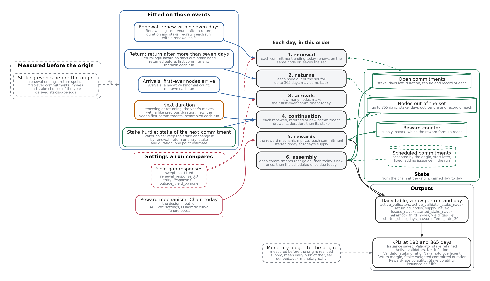

# The staking model

This folder holds the staking model of the Primary Network. A **model** here is a subclass of `SimulationModel` that declares every setting as a Param parameter with bounds and steps one UTC day at a time on the cadCAD engine. Its inputs are measured from the staking-period log before a forecast **origin**, the last observed day, so the days after the origin test it.

Two model versions live here. **v0.7**, `ValidatorLifecycle` in `lifecycle.py`, is tagged `model-v0.7.0` at commit `087484b`. **v0.8.0** is the released model, tagged `model-v0.8.0`: `FittedLifecycle` in `fitted_lifecycle.py` with its behaviour fitted to the chain, through `StakeLifecycle` in `stake_lifecycle.py`. It is the variant `v0.8.0` in `variants.py`: candidate a, the stake hurdle in `parts/stake_choice.py`, and the return hazard on each node's own history in `parts/return_hazard.py`, with every other fitted parameter drawn once per run and the stake hurdle at its point estimate. `MODEL_VERSION` in `__init__.py` names the released version, `0.8.0`.

## The structure of v0.8.0

[](images/v0.8-structure.svg)

Read it left to right. The staking events measured before the origin fit the behaviour blocks (blue frame). Each run redraws the renewal, return and arrival parameters by a bootstrap of those events, adds a renewal shift, and resamples the duration tables by node. The stake hurdle stays at its one point estimate. The reward mechanism and the yield-gap responses (red frame) are the settings a run compares: the mechanism is the design input, and the responses are swept, not fitted. Each day the six stages run in the order shown. A dashed green arrow is state a stage reads. A solid green arrow with two heads is state a stage reads and whose next value comes from that stage's output. The state starts from the chain at the origin. The scheduled commitments are fixed: accepted by the origin, they start on their day and add no issuance in the run. The KPIs read the daily table, with the realized supply and the mean daily burn from the monetary ledger up to the origin.

The drawing is traced from the code, not typed by hand. `fitted_lifecycle_dot` in `../views/model_structure.py` builds the `v0.8.0` model class on a small synthetic state and records what each stage reads and returns. A stage, block or setting it has no plain words for stops the drawing. Redraw it after any change to the stages with `uv run --group model python scripts/figures/model_v08_structure.py`, which needs Graphviz's `dot`.

## Main files

| File | What it holds |
| --- | --- |
| `engine.py` | `SimulationModel`, with `run` for one model and `sweep` for one run per combination of settings |
| `replay.py` | `Replay`, which steps recorded stake starts, ends, and reward payments through the engine with no behaviour, and `compare`, which matches it to the daily monetary ledger |
| `blocks.py` | `BehaviourBlock`, one class per decision, with `sample` for the simulator and `log_prob` for the estimator, and v0.7's one-probability `Renewal` |
| `lifecycle.py` | v0.7: open commitments end on schedule and either renew on the same node with one observed probability or leave, and new commitments enter at one observed rate (`Entry`). `origin_inputs` measures every input before the origin |
| `parts/` | v0.8's fitted blocks, one module per part: `base.py` for the contract and shared constants, `renewal.py` for `RenewalLogit`, `arrivals.py` for `Arrivals`, `returns.py` for `ReturnHazard`, and `continuation.py` for the `Continuation` draws of duration and stake |
| `fitted_blocks.py` | Every name of `parts/` under its earlier path, so existing imports keep working |
| `fitted_lifecycle.py` | v0.8: `FittedLifecycle`, and `fitted_inputs`, which fits each block on the events before the origin |
| `streams.py` | `Streams`, which keys each random draw by seed, run, purpose, and node, so two designs on one seed share their draws. v0.8 uses it. v0.7 draws from one generator per run and day |
| `evaluation.py` | Scores against simple forecasts at 30, 90, and 180 days, and distribution scores |
| `backtest.py`, `versions.py` | The check that recomputes each recorded potential reward from the protocol formula, and the version table |

The reward and admission designs a run compares are in [`../mechanisms/`](../mechanisms/): `ChainReward`, the chain's own formula, `ACP285Ramp`, `TenureBoost`, `QuadraticReward`, `ChainAdmission`, and `BoundedHarmonicFrontier`. A lifecycle model takes one reward mechanism as its `mechanism` setting. Its responses of renewal and entry to the reward rate default to zero. History before Helicon does not identify them, so they are swept.

`origin_inputs` and `fitted_inputs` refuse an origin on or after 2025-11-19, because the held-back test period starts that day at 16:00 UTC.

## Run

The tests use synthetic inputs. The few that need the built staking periods skip without them.

```sh
uv run --group model python -m pytest tests/test_lifecycle.py tests/test_fitted_lifecycle.py tests/test_replay.py tests/test_streams.py -q
```

With the pinned staking periods in `data/runs/`, a 30-day v0.7 run from one origin:

```python
from datetime import date
from avalanche_research import datasets
from avalanche_research.model import engine
from avalanche_research.model.lifecycle import ValidatorLifecycle, origin_inputs

periods = str(datasets.parquet_path("derived.staking-periods", "staking-periods-2026-09-30"))
origin = date(2024, 3, 6)
table = engine.run(ValidatorLifecycle(origin=origin, timesteps=30, runs=5, **origin_inputs(periods, origin)))
```

To reproduce the v0.7 report's runs on the tagged code, use `scripts/model_v07_report_runs.py`, which exports the tag and checks its pin before running.

## How this folder connects to the rest

The model reads `derived.staking-periods` and `derived.avax-monetary-daily`, built as the [data guide](../../../data/README.md) describes and pinned in [`data/pins/`](../../../data/pins/README.md). The protocol rules it applies are in `../domain/protocol/`. The [scripts](../../../scripts/README.md) score its runs and draw them for the research site.
